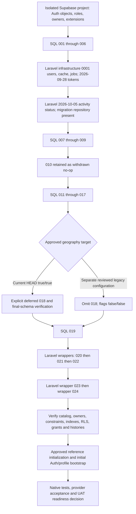

# AssocMap — F08 Database Migration Reproducibility Audit

Assessment date: **2026-10-30, Asia/Manila**. Repository: `C:\dev\AssocMap-STAGING`. Branch: `feature/member-application-r2`. Inspected HEAD: `439392bce7cbd190071879afe838994a8e80d7ae`. The working tree was clean before this report was created.

**Evidence boundary:** source inspection and static text analysis only. No database connection, provider request, credential-file inspection, migration, seeder, Composer setup, application boot, or database test was performed. This report is the sole authorized file write. Statements below describe this checkout, not a newly verified staging database. The user's statement that 023/024 were applied is accepted as context, not substituted for catalog/ledger evidence. Older checked-in verification reports describe their own dated test boundaries.

## A. Executive verdict

**NO-GO for an unqualified fresh UAT installation today. The core schema definitions are present, but a complete, safe, repeatable installation of the current application has not been demonstrated.**

There are **23 SQL files in `supabase/migrations/`**, including withdrawn, comment-only 010; **one deferred schema migration, 018**; and **10 Laravel migrations**. The SQL definitions contain **43 application tables**. Laravel supplies **nine infrastructure tables plus its migration repository**. These counts exclude Supabase-managed Auth/Storage objects and extension-owned objects. File presence proves intended definitions, not successful deployment.

The principal blockers are:

1. **Current geography flags require a cutover omitted by normal SQL discovery.** Both settings are hardcoded `true` in [web/config/associations.php:4–7](../web/config/associations.php#L4). Migration 017 leaves `area_id` required and `barangay_id` nullable; deferred 018 reverses that requirement and adds the composite relationship. The runbook still says both settings are false. A normal-directory-only install is incompatible with the current default application mode. See F08-01.
2. **Neither migration track installs the whole database alone.** SQL 007 requires Laravel tables and `public.migrations`; Laravel's first domain alteration requires the SQL baseline. An SQL-only installation also misses the Laravel-only program-activity status correction. See F08-02/03.
3. **Provider substrate and runtime permissions are not fully provisioned by these migrations.** Real Supabase Auth objects, appropriate owners, backend grants/RLS access, Auth column reads, Auth configuration, and isolated media storage need an explicit installation contract. See F08-05/06.
4. **Manual SQL and Laravel history need evidence-based reconciliation.** Several files deliberately reject replay; later files rely on a wrapper transaction. There is no basis here for replaying migrations or manufacturing staging ledger entries. See F08-04/07.

No additional missing application table was identified in the inspected model/query paths once **both tracks and approved 018** are included. That is a source-coverage conclusion, not proof that the complete sequence executes or that staging matches it. An empty GIS site-type catalog is intentional, not a missing migration.

## B. Full migration inventory

### B1. Interpretation

In the tables below, **“fresh” means no AssocMap data/schema, on an initialized Supabase PostgreSQL project, after the listed prerequisites**. It does not mean a completely bare PostgreSQL cluster. Except for the no-op 010, no migration is independently sufficient on an empty project. “Suitable after prerequisites” is a source assessment; execution was not tested.

**Completion status for every executable row: NOT VERIFIED on staging or a fresh target in this audit.** Catalog equivalence, ledger evidence where applicable, and execution records are required. SQL 004 additionally needs data-preservation evidence on a populated installation. Repository test code or old reports cannot prove current deployment. 010 is provably a no-op from its contents, but its historical tracking status remains unknown.

### B2. SQL and deferred migration track

| Identifier and exact file | Execution system / affected objects | Dependencies, order and overlap | Fresh suitability / existing-state assumptions |
| --- | --- | --- | --- |
| 001 — [001_assocmap_schema.sql:1](../supabase/migrations/001_assocmap_schema.sql#L1) | Transactional SQL baseline: 35 tables, PK/FK/CHECK/unique rules, indexes, 19 functions, 17 validation triggers, 31 timestamp triggers, catalogs and RLS. Full object groups below. | Requires real `auth.users`, `anon`, `authenticated`, trusted owner, extension authority and PostGIS in `extensions`. No Laravel wrapper. Later migrations intentionally amend it. | Suitable first after provider prerequisites. Plain `CREATE TABLE` makes replay unsafe; seed upserts do not make the whole file idempotent. |
| 002 — [002_add_locality_type_to_municipalities.sql:1](../supabase/migrations/002_add_locality_type_to_municipalities.sql#L1) | SQL: `municipalities.locality_type`, default, NOT NULL, named CHECK. | After 001; before municipality seeder. No wrapper/duplicate. | Suitable after 001. Two statements, no explicit transaction; provision through a transaction-capable executor. Existing column/constraint causes conflict. |
| 003 — [003_add_monitoring_visit_reports.sql:4](../supabase/migrations/003_add_monitoring_visit_reports.sql#L4) | Transactional SQL: `monitoring_visit_reports`, parent/user FKs, record/date and unique legacy-import indexes, timestamp trigger, RLS and table revokes. | After baseline Monitoring/profile/timestamp function. Must execute as exact trusted parent-table owner. No wrapper. | Suitable after prerequisites. Explicitly rejects an existing visit-report table; do not replay. |
| 004 — [004_backfill_monitoring_visit_reports.sql:6](../supabase/migrations/004_backfill_monitoring_visit_reports.sql#L6) | Transactional data migration: locks quarterly/visit tables; copies quarterly overview observations as legacy visit reports; validates preservation. No new persistent schema objects. | After 003; source/target keys and partial unique index required. Requires full row visibility (`row_security=off` is fail-closed, not a grant). | Suitable with zero source rows; copies zero rows. On existing data, requires matching prior imports and complete source access. Conflict checks mean it is not an unconditional retry operation. |
| 005 — [005_add_monitoring_monthly_production_and_conductors.sql:14](../supabase/migrations/005_add_monitoring_monthly_production_and_conductors.sql#L14) | Transactional SQL: `monitoring_production_monthly`, parent/month uniqueness, month/activity/quantity checks, timestamp trigger; four integrity functions/triggers; visit conductor columns, FK, exclusivity/text CHECK and index; RLS/revokes. | Declares 001–004 prerequisites, exact table ownership and READ COMMITTED. 012 later relaxes activity count; 019 adds daily projections. No wrapper. | Suitable after prerequisites; rejects existing monthly table or conductor columns. |
| 006 — [006_create_user_invitations.sql:25](../supabase/migrations/006_create_user_invitations.sql#L25) | Transactional SQL: `user_invitations`, profile/association/role/Auth FKs, email/status/acceptance checks, two unresolved identity/email unique indexes, three support indexes, scope validator and trigger, timestamp trigger, RLS/revokes. | Declares 001–005. Active `field_officer` and `association_account` catalog entries and `auth.users` required. 021 later adds unresolved-association uniqueness. | Suitable after prerequisites. Rejects an existing table. Accepted history can survive deletion of the linked Auth identity. |
| 007 — [007_secure_laravel_infrastructure.sql:14](../supabase/migrations/007_secure_laravel_infrastructure.sql#L14) | Transactional SQL: revoke client/PUBLIC privileges and enable RLS on `sessions`, `cache`, `cache_locks`, `jobs`, `job_batches`, `failed_jobs`, `migrations`, `users`, `password_reset_tokens`, `personal_access_tokens`. Creates no tables/policies. | **All ten Laravel infrastructure/repository tables must already exist.** Four infrastructure migrations and Laravel repository preparation precede it. No wrapper. | Fails on an SQL-only fresh schema. Suitable only after Laravel infrastructure creation. Does not provision backend grants. |
| 008 — [008_enforce_unique_active_executive_positions.sql:19](../supabase/migrations/008_enforce_unique_active_executive_positions.sql#L19) | Transactional SQL: `uq_members_active_executive_position`; removes baseline `trg_validate_one_active_president` and function. | Requires exact PRESIDENT/VICE_PRESIDENT codes and officer flags; locks position catalog and members. No wrapper. Intentional replacement of weaker check-only enforcement. | Suitable on baseline catalog/empty members. Rejects duplicates/inconsistent catalogs. Index predicate captures resolved numeric IDs; preserve those IDs/codes afterward. |
| 009 — [009_add_member_application_evidence.sql:6](../supabase/migrations/009_add_member_application_evidence.sql#L6) | Transactional SQL: `member_applications.endorsement_letter`, `applicant_photo_path`. | After 001. Independent of 008; no wrapper. Separate from 023's four-parent media metadata. | Suitable after baseline; no historical backfill. Existing columns cause conflict. |
| 010 — [010_add_permanent_association_termination.sql:7](../supabase/migrations/010_add_permanent_association_termination.sql#L7) | **Withdrawn, comment-only placeholder.** No operation. | Reserve its historical position; never restore the withdrawn Association termination design. | Safe no-op. It does not create a missing Association-termination feature. |
| 011 — [011_add_permanent_project_closure.sql:8](../supabase/migrations/011_add_permanent_project_closure.sql#L8) | Transactional SQL: Project closure evidence columns, profile FK and CHECK; `protect_project_completion()`, trigger, function revoke. | After baseline Projects/profiles/commodities. 013 intentionally replaces constraint/function behavior. No wrapper. | Suitable on empty Projects. Existing closure objects conflict; legacy completed Projects may retain NULL closure metadata. |
| 012 — [012_allow_zero_production_activities.sql:7](../supabase/migrations/012_allow_zero_production_activities.sql#L7) | Transactional SQL: replace `chk_monitoring_production_activity_count` with `activity_count >= 0`. | Requires exact named constraint/table from 005. Needed before 019. | Suitable after 005. This is an intentional amendment, not conflicting duplicate DDL. |
| 013 — [013_add_permanent_project_finalization.sql:7](../supabase/migrations/013_add_permanent_project_finalization.sql#L7) | Transactional SQL: replace Project status/closure checks, allow formal `terminated`, replace `protect_project_completion()` with authorization and operational-parent checks. | Requires 011 and baseline role helper; keeps 011 trigger. No wrapper. | Suitable after 011. Requires compatible existing statuses/evidence; does not rewrite historical rows. |
| 014 — [014_protect_finalized_project_history.sql:6](../supabase/migrations/014_protect_finalized_project_history.sql#L6) | Transactional SQL: `project_history_project_ids(text,jsonb)`, `protect_finalized_project_history()`; 12 linked-history triggers; private function ACLs. | Declares 003/005/011/013, exact trusted ownership across 13 tables. Linked writes require READ COMMITTED. 024 deliberately replaces the history function. | Suitable after prerequisites. Plain function/trigger creation rejects replay. |
| 015 — [015_add_monitoring_income_version.sql:7](../supabase/migrations/015_add_monitoring_income_version.sql#L7) | Transactional SQL: `monitoring_records.income_version`, default 0, NOT NULL, nonnegative CHECK. | Baseline Monitoring; used by current Income services. No wrapper. Header says “proposal,” which is not deployment evidence. | Suitable after baseline. Must precede matching application writes; existing column conflicts. |
| 016 — [016_add_monitoring_materials_version.sql:6](../supabase/migrations/016_add_monitoring_materials_version.sql#L6) | Transactional SQL: `monitoring_records.materials_version`, default 0, NOT NULL, nonnegative CHECK. | Baseline Monitoring; current Materials services depend on it. No wrapper. | Suitable after baseline; existing column conflicts. |
| 017 — [017_expand_association_geography.sql:7](../supabase/migrations/017_expand_association_geography.sql#L7) | Transactional expansion: nullable `associations.barangay_id`, nullable independent `specific_address`, direct Barangay FK, address CHECK and Barangay index. | Baseline Associations/Barangays; prerequisite for 018. No backfill, no Area nullability change, no wrapper. | Suitable after baseline. **Not sufficient for current hardcoded true/true configuration.** |
| 018 — [supabase/deferred/018_cutover_association_geography.sql:1](../supabase/deferred/018_cutover_association_geography.sql#L1) | **Deferred transactional cutover:** approval/metadata checks and locks, NULL-only Barangay backfill, temporary preservation snapshot, `uq_areas_id_barangay`, required direct Barangay, optional Area, composite MATCH SIMPLE FK, replacement composite index. | Requires 017 and supported legacy metadata; session approval `assocmap.geography_cutover_approved='batch2'`; no legacy writers; explicit release decision. No Laravel wrapper. Normal directory discovery omits it. | Source logic permits zero Associations, subject to all metadata/owner checks. Not tested here. Rejects replay after cutover. Geography flags must match its committed state. |
| 019 — [019_add_daily_harvest_production.sql:7](../supabase/migrations/019_add_daily_harvest_production.sql#L7) | Transactional SQL: Production quantity source/harvest version; nullable target with aggregate-mode CHECK; `monitoring_harvest_entries`, FKs/checks/two indexes/timestamp trigger; six functions, four ordinary guards and three deferred projection constraint triggers; RLS/revokes. | Declares 001/005/012–016 and exact trusted ownership; READ COMMITTED business writes. 018 is explicitly independent/reserved. No wrapper. | Suitable after prerequisites; no conversion/backfill of aggregate rows. Existing daily objects conflict. |
| 020 — [020_add_account_reactivation.sql:1](../supabase/migrations/020_add_account_reactivation.sql#L1) | Canonical SQL **executed by Laravel wrapper**: profile session cutoff; `account_reactivations`, FKs/unique/checks/RLS; anon/authenticated revoke. | Baseline roles/profiles. Wrapper supplies transaction/history. Same operation as Laravel reactivation migration, not an additional migration to run twice. | Suitable through wrapper after prerequisites. `IF NOT EXISTS` does not validate an existing object's complete definition. No standalone BEGIN/COMMIT. |
| 021 — [021_support_association_account_replacement.sql:1](../supabase/migrations/021_support_association_account_replacement.sql#L1) | Canonical SQL **executed by wrapper**: appointment-end columns/FK/CHECK; partial active-link and unresolved-association uniqueness; history indexes; retire global link unique constraints; replace role/history validator and trigger. | Baseline account links plus 006 invitations. After 020 in approved sequence. Same operation as replacement wrapper. | Suitable through wrapper. `LOCK TABLE`/`SET LOCAL` require transaction context; rejects incompatible existing unresolved invitations. Name-based `IF NOT EXISTS` is not a schema-equivalence check. |
| 022 — [022_support_verified_email_change.sql:1](../supabase/migrations/022_support_verified_email_change.sql#L1) | Canonical SQL **executed by wrapper**: email-change phases/proofs/hashes/checks/indexes; profile approved email/hold; composite holder FK; RLS/client revokes. | Baseline email requests/roles/profiles; deploy after 020/021 and before matching runtime features. Same operation as email wrapper. | Suitable through wrapper. Existing duplicate pending destinations or differently shaped same-name objects require review. No explicit transaction in SQL. |
| 023 — [023_add_media_photos.sql:1](../supabase/migrations/023_add_media_photos.sql#L1) | Canonical SQL **executed by wrapper**: 30-column `media_photos`, four parent FKs, uploader/approval/replacement FKs, exactly-one-parent/state/approval/dimension checks, request/prefix uniqueness, parent/recovery indexes and partial unique cover indexes; RLS and table revokes. | Requires Projects, GIS, visit reports (003), Monitoring materials and profiles. Same operation as media wrapper. Does not provision R2 or migrate member photos. | Suitable through wrapper after prerequisites. Plain CREATE rejects replay. Metadata creation does not prove object storage readiness. |
| 024 — [024_add_gis_site_types.sql:1](../supabase/migrations/024_add_gis_site_types.sql#L1) | Canonical SQL **executed by wrapper**: `gis_site_types` identity catalog/unique code/checks; nullable `gis_locations.site_type_id`, RESTRICT FK/index; RLS/table/sequence revokes; replace 014 history function to allow classification maintenance. | Requires 014 helpers and exact GIS/Project/history-function owner. Execute after 023 in reviewed release order. Same operation as classification wrapper. | Suitable through wrapper. Intentionally seeds no taxonomy; plain CREATE rejects replay. Preflight is after initial DDL, so enclosing transaction is essential for all-or-nothing failure. |

### B3. Baseline object inventory (001)

All names below are in `public`, except the extensions and Supabase-managed Auth dependency.

| Domain | Tables and evidence |
| --- | --- |
| Identity | `roles`, `user_profiles`, `email_change_requests` — [001:36](../supabase/migrations/001_assocmap_schema.sql#L36). Profile UUID references `auth.users(id)`; profile role references BIGINT role ID. |
| Geography | `municipalities`, `barangays`, `areas` — [001:95](../supabase/migrations/001_assocmap_schema.sql#L95). UUID parents; case-insensitive place/address uniqueness; restrictive parent FKs. |
| Associations | `registration_agencies`, `associations`, `association_accounts`, `association_registrations` — [001:157](../supabase/migrations/001_assocmap_schema.sql#L157). Original Area requirement, primary officer FK, original globally unique account links, agency/number and primary-registration uniqueness. 018/021 intentionally change the relevant final definitions. |
| Members | `sex_categories`, `member_classifications`, `association_positions`, `member_applications`, `member_application_classifications`, `members`, `member_classification_assignments` — [001:236](../supabase/migrations/001_assocmap_schema.sql#L236). Review-state/birth-date checks, FishR uniqueness, classification bridges and approved-source relationships. |
| Program catalogs | `saad_components`, `saad_subcomponents`, `saad_activities`, `fisheries_project_categories`, `commodities` — [001:368](../supabase/migrations/001_assocmap_schema.sql#L368). BIGINT identities; parent FKs; code/name uniqueness and official/custom checks. |
| Program operations | `projects`, `project_materials`, `project_products`, `trainings`, `training_participants`, `program_activity_records` — [001:465](../supabase/migrations/001_assocmap_schema.sql#L465). UUID identities and parent relationships; quantities/status/date rules; product/participant uniqueness. |
| Monitoring | `quarters`, `monitoring_records`, `monitoring_production`, `monitoring_income`, `monitoring_materials` — [001:626](../supabase/migrations/001_assocmap_schema.sql#L626). Unique Project/year/quarter; parent/product/material relationships; monthly/quarterly Income partial uniqueness; nonnegative values. |
| GIS | `gis_locations` — [001:725](../supabase/migrations/001_assocmap_schema.sql#L725). `extensions.geometry(Geometry,4326)`, exactly one Association/Project parent, publication metadata checks, GiST geometry and publication indexes. |
| Audit | `audit_logs` — [001:776](../supabase/migrations/001_assocmap_schema.sql#L776). UUID event ID, nullable actor FK, JSONB old/new values, INET address, time/entity/actor indexes. |

Baseline functions: `set_updated_at()` ([001:21](../supabase/migrations/001_assocmap_schema.sql#L21)); `user_has_role(uuid,text)` ([001:861](../supabase/migrations/001_assocmap_schema.sql#L861)); and the following `validate_*()` trigger functions, each accompanied by its `trg_validate_*` trigger:

| Function suffix | Evidence / responsibility |
| --- | --- |
| `association_primary_field_officer` | [001:880](../supabase/migrations/001_assocmap_schema.sql#L880): officer role. |
| `association_account_role` | [001:901](../supabase/migrations/001_assocmap_schema.sql#L901): account role; later replaced by 021. |
| `member_application_submitter` | [001:922](../supabase/migrations/001_assocmap_schema.sql#L922): active Association Account link. |
| `member_application_reviewer` | [001:949](../supabase/migrations/001_assocmap_schema.sql#L949): assigned officer review. |
| `primary_registration_date` | [001:983](../supabase/migrations/001_assocmap_schema.sql#L983): registration/join-date relationship. |
| `member_source_application` | [001:1013](../supabase/migrations/001_assocmap_schema.sql#L1013): approved application/Association match. |
| `one_active_president` | [001:1042](../supabase/migrations/001_assocmap_schema.sql#L1042): retired by 008 in favor of concurrency-safe uniqueness. |
| `application_position_other`, `member_position_other` | [001:1082](../supabase/migrations/001_assocmap_schema.sql#L1082), [001:1111](../supabase/migrations/001_assocmap_schema.sql#L1111): OTHER position text. |
| `project_commodity_category` | [001:1140](../supabase/migrations/001_assocmap_schema.sql#L1140): commodity/category match. |
| `training_related_project`, `training_participant_association` | [001:1171](../supabase/migrations/001_assocmap_schema.sql#L1171), [001:1200](../supabase/migrations/001_assocmap_schema.sql#L1200): linked Project/participant Association. |
| `program_activity_related_project` | [001:1239](../supabase/migrations/001_assocmap_schema.sql#L1239): activity/Project scope. |
| `monitoring_production_product`, `monitoring_income_period`, `monitoring_material_project` | [001:1272](../supabase/migrations/001_assocmap_schema.sql#L1272), [001:1304](../supabase/migrations/001_assocmap_schema.sql#L1304), [001:1352](../supabase/migrations/001_assocmap_schema.sql#L1352): product/project and period integrity. |
| `gis_location` | [001:1384](../supabase/migrations/001_assocmap_schema.sql#L1384): parent/type/SRID integrity, including Polygon and MultiPolygon boundaries. |

Baseline standalone indexes are explicitly defined with their columns/predicates at [001:86](../supabase/migrations/001_assocmap_schema.sql#L86), [001:110](../supabase/migrations/001_assocmap_schema.sql#L110), [001:129](../supabase/migrations/001_assocmap_schema.sql#L129), [001:149](../supabase/migrations/001_assocmap_schema.sql#L149), [001:191](../supabase/migrations/001_assocmap_schema.sql#L191), [001:227](../supabase/migrations/001_assocmap_schema.sql#L227), [001:305](../supabase/migrations/001_assocmap_schema.sql#L305), [001:349](../supabase/migrations/001_assocmap_schema.sql#L349), [001:402](../supabase/migrations/001_assocmap_schema.sql#L402), [001:425](../supabase/migrations/001_assocmap_schema.sql#L425), [001:457](../supabase/migrations/001_assocmap_schema.sql#L457), [001:529](../supabase/migrations/001_assocmap_schema.sql#L529), [001:696](../supabase/migrations/001_assocmap_schema.sql#L696), [001:764](../supabase/migrations/001_assocmap_schema.sql#L764), and the complete supporting-index block [001:794–826](../supabase/migrations/001_assocmap_schema.sql#L794). PK/UNIQUE declarations also create backing indexes; compare definitions, not just this explicit-CREATE list. 018 drops the Area-only Association index; 008 removes one baseline function/trigger; 021 retires two global unique constraints. A final-schema comparison must account for those intentional removals.

The dynamic timestamp-trigger list is [001:831–854](../supabase/migrations/001_assocmap_schema.sql#L831). Baseline function execution is revoked from PUBLIC/anon/authenticated at [001:1423–1442](../supabase/migrations/001_assocmap_schema.sql#L1423). RLS is enabled on all 35 baseline tables at [001:1600–1625](../supabase/migrations/001_assocmap_schema.sql#L1600). No direct-client policies are created.

### B4. Laravel track — all files under `web/database/migrations/`

| Exact migration filename | Responsibility / overlap | Dependencies and fresh behavior |
| --- | --- | --- |
| [0001_01_01_000000_create_users_table.php:12](../web/database/migrations/0001_01_01_000000_create_users_table.php#L12) | Creates `users`, `password_reset_tokens`, `sessions`. Conventional BIGINT user infrastructure, separate from UUID `user_profiles` and Supabase identities. | Independently creates infrastructure when absent. Session `user_id` is nullable and has an index, not a profile FK. Required before 007. Do not reinterpret it as the domain user table. |
| [0001_01_01_000001_create_cache_table.php:12](../web/database/migrations/0001_01_01_000001_create_cache_table.php#L12) | Creates `cache`, `cache_locks`. No SQL duplicate. | Required before 007 and database-backed activation/cache usage. |
| [0001_01_01_000002_create_jobs_table.php:12](../web/database/migrations/0001_01_01_000002_create_jobs_table.php#L12) | Creates `jobs`, `job_batches`, `failed_jobs`. No SQL duplicate. | Required before 007; preserves configured database queue infrastructure. |
| [2026_09_28_091014_create_personal_access_tokens_table.php:12](../web/database/migrations/2026_09_28_091014_create_personal_access_tokens_table.php#L12) | Creates Sanctum `personal_access_tokens` with conventional morph columns. No SQL duplicate. | Required by 007 even though inspected custom bearer authentication uses Supabase. Not evidence of a second implemented identity authority. |
| [2026_10_05_102947_update_program_activity_status_constraint.php:8](../web/database/migrations/2026_10_05_102947_update_program_activity_status_constraint.php#L8) | **Laravel-only PostgreSQL alteration:** allows `ongoing` in `program_activity_records.status`. No equivalent SQL delta. | Needs 001's table and named status CHECK. Full Laravel chain on an otherwise empty project fails here after earlier infrastructure has already run. `down()` narrows statuses and can reject existing ongoing rows. |
| [2026_10_22_000000_add_account_reactivation.php:10](../web/database/migrations/2026_10_22_000000_add_account_reactivation.php#L10) | PostgreSQL executes canonical SQL **020**. Testing-only SQLite alternative is not PostgreSQL acceptance evidence. | Needs baseline profiles/roles. Do not also run 020 SQL. Forward-only `down()` throws. |
| [2026_10_22_010000_support_association_account_replacement.php:10](../web/database/migrations/2026_10_22_010000_support_association_account_replacement.php#L10) | PostgreSQL executes **021**. Testing-only SQLite alternative. | Needs Associations/accounts/invitations/profiles. Do not also run 021 SQL. Forward-only. |
| [2026_10_22_020000_support_verified_email_change.php:10](../web/database/migrations/2026_10_22_020000_support_verified_email_change.php#L10) | PostgreSQL executes **022**. SQLite does not reproduce all PostgreSQL checks/composite-FK/security behavior. | Needs prior domain baseline. Do not also run 022 SQL. Forward-only. |
| [2026_10_27_000000_add_media_photos.php:8](../web/database/migrations/2026_10_27_000000_add_media_photos.php#L8) | PostgreSQL executes **023**. SQLite strips PostgreSQL security section. | Needs four parent tables/profiles. Do not also run 023 SQL. Forward-only. |
| [2026_10_28_000000_add_gis_site_types.php:8](../web/database/migrations/2026_10_28_000000_add_gis_site_types.php#L8) | PostgreSQL executes **024**. SQLite translates identity and strips security/history-function section. | Needs GIS/Project/history safeguards. Do not also run 024 SQL. Forward-only. |

Laravel creates its `migrations` repository separately from these files; configuration names it at [web/config/database.php:135](../web/config/database.php#L135). Merely calling a migration object's `up()` is not equivalent to running Laravel's migrator and recording history.

### B5. Setup, reference data, configuration and verification artifacts

| File/group | Assessment |
| --- | --- |
| [web/composer.json:37–63](../web/composer.json#L37), [web/README.md:10–20](../web/README.md#L10) | `composer setup` installs dependencies, copies `.env.example` only if missing, and builds assets. It does **not** run migrations, generate a key, seed, or create a database. Post-create-project prints a provisioning reminder. Setup is not a schema installer; it was not executed here. Dependency hooks still boot package discovery and are not a read-only audit command. |
| `supabase/` provisioning configuration | No tracked `supabase/config.toml`, Supabase `seed.sql`, or production fresh-install orchestrator was found in the inspected checkout. Do not assume Supabase CLI push/reset is the established deployment system. Existing source guidance explicitly calls for separate provisioning ([web/README.md:18](../web/README.md#L18)). |
| [001:1450–1598](../supabase/migrations/001_assocmap_schema.sql#L1450) | Built-in reference data: 3 roles, 2 registration agencies, 2 sex categories, 5 member classifications, 7 Association positions, 4 quarters, 4 SAAD components, 11 subcomponents, 17 activities, 3 fisheries categories and 3 initial commodities. These are baseline definitions, not real BFAR transactional data. Do not rerun 001 to reseed them. |
| [CebuMunicipalitySeeder.php:14–103](../web/database/seeders/CebuMunicipalitySeeder.php#L14) | 50 listed localities, upserted by PSGC code. Requires 001+002. Counts are from static source, not a current authoritative PSGC validation or deployed count. |
| [CebuBarangaySeeder.php:22–248](../web/database/seeders/CebuBarangaySeeder.php#L22) | 153 listed Barangays across 11 parent municipalities. Static parent-code comparison found all parents in the municipality seeder. Requires municipality rows first; missing parents throw before bulk upsert. Coverage is deliberately limited; approve the UAT geography scope. |
| [DatabaseSeeder.php:16–23](../web/database/seeders/DatabaseSeeder.php#L16), [UserFactory.php:25–33](../web/database/factories/UserFactory.php#L25) | Default seeder creates a conventional `users` test account using a fixed factory password. It neither calls the geography seeders nor provisions Supabase Auth or an AssocMap Administrator profile. Exclude it from UAT provisioning. |
| [web/config/associations.php:4–7](../web/config/associations.php#L4), [supabase/deferred/README.md:13–39](../supabase/deferred/README.md#L13) | Actual source flags are true/true; deferred runbook's statement that source flags remain false is stale. They are not currently `env()`-backed settings. |
| [web/config/database.php:87–104](../web/config/database.php#L87), [web/.env.example:23](../web/.env.example#L23) | PostgreSQL search path is `public`, default TLS mode `prefer`, and `DB_URL` is supported. Example defaults to SQLite. Neither example nor defaults establish a secure UAT connection. No actual `.env` or cached credentials were read. |
| [web/config/services.php:38–57](../web/config/services.php#L38) | Supabase Auth URL/keys/redirect and optional identity-lifecycle flags; separate member-photo transport. Feature flags default false for invitation restart/reactivation/email change. These do not disable every runtime dependency on the corresponding schema. |
| [web/config/filesystems.php:73–86](../web/config/filesystems.php#L73), [MemberApplicationPhotoService.php:33–75](../web/app/Services/Members/MemberApplicationPhotoService.php#L33) | Private application media uses `media_private`; this branch also supports member-photo `r2`, alongside `local` and `supabase`. Member paths remain in `applicant_photo_path`, not `media_photos`. |
| [web/config/reporting.php:3–13](../web/config/reporting.php#L3), [reporting/README.md:49–57](../reporting/README.md#L49) | Reporting requires a configured Python executable/runtime/fonts/process permissions. No independent reporting database schema was found in the inspected extraction path. |
| [supabase/deferred/association_geography_preflight.sql:1–25](../supabase/deferred/association_geography_preflight.sql#L1) | SELECT-only geography review; post-017 data query must be gated on column existence. It is not a migration. |
| [supabase/tests/staging_media_preflight.sql:1–19](../supabase/tests/staging_media_preflight.sql#L1) | Existing bounded read-only transaction with psql conditional ledger/schema/security checks. Requires separately authorized connection/role parameters. It includes transaction/psql commands, so it is distinct from the SELECT-only templates in section F. Not executed. |
| [supabase/tests/local/README.md:17–31](../supabase/tests/local/README.md#L17), [bootstrap-framework.php:23–31](../supabase/tests/local/bootstrap-framework.php#L23) | Disposable fixtures/harnesses make real changes. The old framework bootstrap invokes `up()` and creates a repository without logging those migrations; do not use it as a production installer. `migrate-pending.php` covers only 011–014. Other fixture/regression SQL is testing material, not migration/reference initialization. |
| [GisMediaClassificationVerification.php:52–78](../web/tests/Postgres/GisMediaClassificationVerification.php#L52), [same:145–163](../web/tests/Postgres/GisMediaClassificationVerification.php#L145) | Useful canonical prerequisite and Laravel-ledger coverage, but creates synthetic Auth roles/table and explicitly overrides geography flags false; omits deferred 018. Not a current-default-mode/full-Supabase installation proof. |
| [docs/staging-media-readiness.md:75–89](staging-media-readiness.md#L75), [docs/gis-site-classification.md:12–20](gis-site-classification.md#L12), identity/geography runbooks | Useful deployment requirements and prior evidence. Dates, prior checkout references, test results and release decisions do not prove today's live schema. No approved, complete first-Administrator bootstrap was found in inspected seeders/console commands; [web/routes/console.php:1–8](../web/routes/console.php#L1) is not one. |

### B6. Named delta functions, triggers, indexes and policies

This register supplements B2's table/column/constraint inventory. PK/FK/UNIQUE backing indexes and generated names must also be captured with F4/F5; explicit index names alone are not the complete schema.

| Migration | Named objects affected / exact evidence |
| --- | --- |
| 003 | `idx_monitoring_visit_reports_record_date`, `uq_monitoring_visit_reports_legacy_record`, `trg_monitoring_visit_reports_updated_at` — [003:48–58](../supabase/migrations/003_add_monitoring_visit_reports.sql#L48). |
| 005 | Functions `validate_monitoring_production_monthly_period()`, `guard_monitoring_production_monthly_identity()`, `guard_monitoring_record_monthly_identity()`, `guard_quarter_monthly_identity()` and corresponding `trg_` triggers; `trg_monitoring_production_monthly_updated_at`; `idx_monitoring_visit_reports_conductor_user` — [005:134](../supabase/migrations/005_add_monitoring_monthly_production_and_conductors.sql#L134), [005:146](../supabase/migrations/005_add_monitoring_monthly_production_and_conductors.sql#L146), [005:242](../supabase/migrations/005_add_monitoring_monthly_production_and_conductors.sql#L242), [005:291](../supabase/migrations/005_add_monitoring_monthly_production_and_conductors.sql#L291), [005:336](../supabase/migrations/005_add_monitoring_monthly_production_and_conductors.sql#L336), [005:399](../supabase/migrations/005_add_monitoring_monthly_production_and_conductors.sql#L399). Named monthly checks/FK/unique key are at [005:111–126](../supabase/migrations/005_add_monitoring_monthly_production_and_conductors.sql#L111). |
| 006 | `uq_user_invitations_unresolved_email`, `uq_user_invitations_unresolved_auth_user`, `idx_user_invitations_status_created`, `idx_user_invitations_role`, `idx_user_invitations_association`; `validate_user_invitation_scope()`, `trg_validate_user_invitation_scope`, `trg_user_invitations_updated_at` — [006:157–259](../supabase/migrations/006_create_user_invitations.sql#L157). |
| 008 | Creates `uq_members_active_executive_position`; removes `trg_validate_one_active_president` and `validate_one_active_president()` — [008:57–66](../supabase/migrations/008_enforce_unique_active_executive_positions.sql#L57). |
| 011/013 | `protect_project_completion()` and `trg_protect_project_completion`; `ck_projects_closure_metadata`, `projects_status_check` amended in sequence — [011:8–89](../supabase/migrations/011_add_permanent_project_closure.sql#L8), [013:7–103](../supabase/migrations/013_add_permanent_project_finalization.sql#L7). |
| 014 | `project_history_project_ids(text,jsonb)`, `protect_finalized_project_history()`; `trg_protect_finalized_project_history` on each of the 12 named child tables — [014:27](../supabase/migrations/014_protect_finalized_project_history.sql#L27), [014:73](../supabase/migrations/014_protect_finalized_project_history.sql#L73), [014:167–182](../supabase/migrations/014_protect_finalized_project_history.sql#L167). |
| 015/016/017 | `chk_monitoring_income_version`, `chk_monitoring_materials_version`; `fk_associations_barangay`, `chk_associations_specific_address`, `idx_associations_barangay_id` — [015:7–9](../supabase/migrations/015_add_monitoring_income_version.sql#L7), [016:6–8](../supabase/migrations/016_add_monitoring_materials_version.sql#L6), [017:7–19](../supabase/migrations/017_expand_association_geography.sql#L7). |
| 018 | Adds `uq_areas_id_barangay`, `fk_associations_area_barangay`, `idx_associations_area_barangay`; removes `associations_area_id_fkey` and `idx_associations_area_id` — [018:73–85](../supabase/deferred/018_cutover_association_geography.sql#L73). |
| 019 | `guard_daily_production_identity()`, `guard_daily_product_project()`, `guard_daily_projection_identity()`, `guard_monitoring_harvest_entry()` and their four `trg_` guards; `assert_daily_harvest_projection(uuid)`, `check_daily_harvest_projection()`; `trg_check_daily_harvest_projection` on Production/monthly/harvest tables; `trg_monitoring_harvest_updated_at`, `uq_monitoring_harvest_active_date`, `idx_monitoring_harvest_history` — [019:54–58](../supabase/migrations/019_add_daily_harvest_production.sql#L54), [019:61–175](../supabase/migrations/019_add_daily_harvest_production.sql#L61), [019:178–228](../supabase/migrations/019_add_daily_harvest_production.sql#L178). |
| 021 | Adds `association_accounts_ended_by_fkey`, `chk_association_account_end`, `uq_association_accounts_active_association`, `uq_association_accounts_active_user`, `uq_user_invitations_unresolved_association`, `idx_association_accounts_association_history`, `idx_association_accounts_user_history`; removes `association_accounts_association_id_key`, `association_accounts_user_id_key`; replaces `validate_association_account_role()`/`trg_validate_association_account_role` — [021:10–71](../supabase/migrations/021_support_association_account_replacement.sql#L10). |
| 022 | `ck_email_change_phase`, `ck_email_change_managed`, `ck_email_change_browser`, `ck_email_change_completed`, `uq_email_change_holder`, `uq_email_change_reference`, `uq_email_change_pending_destination`, `ix_email_change_status_expiry`, `ix_email_change_proofs_request`, `fk_profile_email_change_hold`, `ck_profile_approved_email` — [022:17–54](../supabase/migrations/022_support_verified_email_change.sql#L17). |
| 023 | `media_exactly_one_parent`, `media_replacement`, `media_project_order`, `media_approval`, `media_dimensions`, `media_finalizable`; `media_project_parent`, `media_gis_parent`, `media_visit_parent`, `media_material_parent`, `media_recovery`, `media_one_ready_cover`, `media_one_pending_cover` — [023:37–68](../supabase/migrations/023_add_media_photos.sql#L37). Other inline CHECK/FK/UNIQUE declarations are in [023:5–36](../supabase/migrations/023_add_media_photos.sql#L5). No new timestamp trigger is declared by 023; lifecycle code manages its metadata updates. |
| 024 | `idx_gis_locations_site_type`, identity sequence `gis_site_types_id_seq`; replaces `protect_finalized_project_history()` while retaining existing history triggers — [024:14–20](../supabase/migrations/024_add_gis_site_types.sql#L14), [024:39](../supabase/migrations/024_add_gis_site_types.sql#L39). |
| Policy/grant track | No migration in this inventory creates, alters or drops a client RLS policy. 001/003/005/006/007/019/020/022/023/024 enable relevant table RLS; explicit client/function/sequence revokes are identified in B2/B3 and F08-05. No migration supplies a complete production backend GRANT/role-membership contract. Expansion/cutover and lifecycle alterations preserve existing table policies/grants unless explicitly stated. |

## C. Confirmed inconsistencies and unverified risks

### F08-01 — Critical: current geography defaults and ordinary installation sequence disagree

**Source-confirmed mismatch; live impact unverified.** [web/config/associations.php:4–7](../web/config/associations.php#L4) selects final-schema, optional-Area behavior. [017:7–21](../supabase/migrations/017_expand_association_geography.sql#L7) leaves the old Area requirement and NULL direct Barangays. [018:73–85](../supabase/deferred/018_cutover_association_geography.sql#L73) supplies the required final nullability/composite FK but is outside normal migrations and rejects unapproved execution/replay at [018:1–25](../supabase/deferred/018_cutover_association_geography.sql#L1).

Readers choose direct Barangay joins at [AssociationGeographyService.php:25–32](../web/app/Services/Associations/AssociationGeographyService.php#L25), [same:99–103](../web/app/Services/Associations/AssociationGeographyService.php#L99); writers permit NULL Area at [same:117–127](../web/app/Services/Associations/AssociationGeographyService.php#L117), [same:163–181](../web/app/Services/Associations/AssociationGeographyService.php#L163). On a 017-only schema this can reject valid current-mode writes or hide legacy rows in inner joins. A fresh no-data schema does not remove the nullability problem.

**Required correction:** declare the installation's geography state in a versioned manifest and correct stale documentation. For this HEAD's true/true behavior, explicitly authorize/include 018 before application access. If UAT deliberately excludes optional geography, use an explicitly reviewed configuration/code change; merely inventing environment variables will not override these literals. Do not apply 018 to staging on the strength of this report. [Deferred README:7,15–22](../supabase/deferred/README.md#L7) is inconsistent with current source and must be reconciled.

### F08-02 — High: no single existing migration command creates the complete schema

**Source-confirmed orchestration gap.** SQL 007 immediately refers to ten framework/repository tables ([007:14–38](../supabase/migrations/007_secure_laravel_infrastructure.sql#L14)). They are absent from SQL 001 and supplied by Laravel. Conversely, the Laravel-only status migration alters `program_activity_records` ([status migration:10–26](../web/database/migrations/2026_10_05_102947_update_program_activity_status_constraint.php#L10)), which its preceding Laravel files do not create. Later wrappers likewise require the SQL domain baseline. The README already warns of this ([web/README.md:18–19](../web/README.md#L18)).

**Required correction:** a small, explicit first-install manifest/orchestrator interleaving the existing tracks. Preserve historical SQL; do not solve this by blindly adding every historical file to the normal Laravel sequence of existing databases. Proposed exact order is in D/G.

### F08-03 — High: an SQL-only install misses an implemented activity status

**Source-confirmed incomplete SQL-only path, not a conflict when both tracks run.** Baseline CHECK excludes `ongoing` ([001:604–605](../supabase/migrations/001_assocmap_schema.sql#L604)); current request validation permits it ([StoreProgramActivityRequest.php:89–96](../web/app/Http/Requests/StoreProgramActivityRequest.php#L89)). The Laravel-only 2026-10-05 migration adds it. No SQL migration in the inventory adds this delta.

**Required correction:** explicitly include that Laravel migration in the canonical installation manifest. Do not edit the baseline or create a second independently executed definition just to make the SQL directory appear self-sufficient.

### F08-04 — High: dual execution or partial manual replay can break installation/history

**Source-confirmed execution hazard; actual ledger drift unverified.** PostgreSQL wrappers delegate to the same canonical SQL files ([020 wrapper:12–15](../web/database/migrations/2026_10_22_000000_add_account_reactivation.php#L12), [023 wrapper:10–14](../web/database/migrations/2026_10_27_000000_add_media_photos.php#L10), [024 wrapper:10–14](../web/database/migrations/2026_10_28_000000_add_gis_site_types.php#L10)). Running SQL 020–024 and then their pending wrappers is duplicate execution. 023/024 plain CREATE fails; earlier IF NOT EXISTS clauses may mask differences rather than prove equivalence. 021 explicitly requires its wrapper transaction and starts with `LOCK TABLE` ([021:1–5](../supabase/migrations/021_support_association_account_replacement.sql#L1)). Raw autocommit SQL execution is not equivalent.

**Required correction:** one execution identity per migration: SQL executor for approved historical SQL, Laravel migrator for 020–024. Package sibling `supabase/migrations/` with `web/`. Reconcile a partially configured target before any further migrate command. Never recursively execute `supabase/`, which also contains deferred scripts and mutating fixtures.

### F08-05 — High: backend grants/ownership and complete client denial are external prerequisites

**Source-confirmed provisioning gap; no live security defect asserted.** The baseline enables RLS without client policies ([001:1600–1625](../supabase/migrations/001_assocmap_schema.sql#L1600)); later files revoke client privileges. Several migrations require **exact** owners, not merely inherited ALTER rights ([005:39–63](../supabase/migrations/005_add_monitoring_monthly_production_and_conductors.sql#L39), [014:10–20](../supabase/migrations/014_protect_finalized_project_history.sql#L10), [024:25–35](../supabase/migrations/024_add_gis_site_types.sql#L25)). These migrations intentionally do not guess a backend role or grant an entire application's privileges.

The private catalog read-and-lock path requires SELECT plus appropriate row-lock privilege ([GisLocationService.php:327–331](../web/app/Services/GIS/GisLocationService.php#L327)); documented native coverage uses UPDATE(id) ([staging-media-readiness.md:83–89](staging-media-readiness.md#L83)). A normal granted role still needs reviewed RLS access; a Supabase Auth service key is not a PostgreSQL login grant.

Baseline RLS alone does not demonstrate absence of table/column/sequence/default/inherited privileges. 020 and 022 revoke anon/authenticated but do not explicitly include PUBLIC ([020:20–21](../supabase/migrations/020_add_account_reactivation.sql#L20), [022:42–44](../supabase/migrations/022_support_verified_email_change.sql#L42)); baseline tables/identity sequences likewise need effective ACL inspection. This is a **conditional security risk**, not proof that PUBLIC actually has access. 024 explicitly revokes its identity sequence ([024:17–20](../supabase/migrations/024_add_gis_site_types.sql#L17)).

**Required correction:** review/version the intended migration-owner and backend permission contract; inspect effective access and defaults under actual identities. Use additive forward ACL corrections only if evidence requires them. Do not disable RLS or grant anon/authenticated direct access to make Laravel work. Keep public-schema CREATE and SECURITY DEFINER ownership/search paths under review; no function exploit was demonstrated here.

### F08-06 — High: Supabase Auth and first-Administrator bootstrap are not reproduced by application migrations

**Source-confirmed external dependency and incomplete bootstrap procedure.** Profile IDs reference provider-managed `auth.users` ([001:47–52](../supabase/migrations/001_assocmap_schema.sql#L47)). Runtime reads include `auth.users(id,email)` ([ProfileAuthIdentityService.php:13–23](../web/app/Services/Auth/ProfileAuthIdentityService.php#L13)), `auth.users.email_change` ([AccountEmailChangeService.php:278](../web/app/Services/Auth/AccountEmailChangeService.php#L278)), and `auth.sessions(id,user_id,created_at)` ([SupabaseSessionBoundary.php:45–50](../web/app/Services/Auth/SupabaseSessionBoundary.php#L45)). The latter is also used after password recovery sets a cutoff, so turning off reactivation alone does not remove the dependency ([PasswordRecoveryController.php:211–212](../web/app/Http/Controllers/Auth/PasswordRecoveryController.php#L211)).

The default seeder creates `users`, not `auth.users`/`user_profiles` ([DatabaseSeeder.php:20–23](../web/database/seeders/DatabaseSeeder.php#L20)). Staff login verifies provider credentials and then requires a matching active profile/role ([StaffAuthController.php:20–66](../web/app/Http/Controllers/Auth/StaffAuthController.php#L20)). SQL schema success therefore leaves no usable initial Administrator automatically.

**Required correction:** a reviewed operator bootstrap for a new UAT Auth identity and matching active `system_admin` profile, with approved-email binding and activation state reviewed, followed by real authentication acceptance. Provision Auth through supported provider administration, not fabricated rows or copied staging users. Verify narrow Auth reads for the server role and keep them unavailable to clients. Email/redirect/confirmation/password policies and delivery are separate provider configuration.

### F08-07 — High: current deployment completion and safe ledger adoption remain unverified

**Unverified deployment state; source confirms why inference is unsafe.** `supabase/tests/staging_media_preflight.sql` explicitly treats manual history separately ([lines 39–69](../supabase/tests/staging_media_preflight.sql#L39)). Neither existence nor absence of Laravel/Supabase ledger entries alone proves semantic schema equivalence. `IF NOT EXISTS` checks names, not matching types/constraints/index predicates/function bodies.

The inspected installed Laravel migrator commits `runMigration()` before logging its name ([Migrator.php:253–258](../web/vendor/laravel/framework/src/Illuminate/Database/Migrations/Migrator.php#L253), [same:432–451](../web/vendor/laravel/framework/src/Illuminate/Database/Migrations/Migrator.php#L432)); default migration transactions are enabled ([Migration.php:19](../web/vendor/laravel/framework/src/Illuminate/Database/Migrations/Migration.php#L19)). Thus a lost connection/failure after DDL commit but before ledger logging is a state to inspect, not a reason for blind replay. These framework files were read locally; they are dependency implementation evidence, not new application migrations.

| Catalog vs intended migration | Ledger | Decision for a future authorized operator |
| --- | --- | --- |
| Absent, and prerequisites match | Absent | Genuinely pending; execute once through its authoritative runner after approval. |
| Fully equivalent | Matching single entry | Already applied; skip, retain evidence. |
| Fully equivalent | Absent | Candidate manual application or interrupted logging. Obtain execution provenance and full catalog/data evidence; design a narrowly approved adoption record. Do not execute CREATE again or insert history during this audit. |
| Absent/incomplete/different | Present | Drift or partial history. Block automatic execution; compare to a canonical disposable build and design forward repair. |
| Different | Absent | Unknown/partially configured state. Block; object names are not enough for adoption. |
| Any | Duplicate/conflicting entries or unknown SQL version mapping | Block pending reconciliation; never delete history to force reruns. |

004's historical data copy and 008's ID-bound predicate need more than a present table. Compare data/lookup semantics. Supabase CLI history, if present, must be mapped to actual filenames/checksums and not confused with manually executed SQL. No ledger repair is authorized or performed here.

### F08-08 — Medium: reference initialization and UAT data scope are not wired into installation

**Source-confirmed omission in default seeding, not missing source data.** Geography seeders exist and their parent-code references are internally consistent, but DatabaseSeeder does not invoke them. Built-in catalogs live in 001, while GIS site types are deliberately empty ([024:10](../supabase/migrations/024_add_gis_site_types.sql#L10)). No approved initial Administrator or synthetic business scenario is supplied by default seeding.

**Required correction:** explicit, separately reviewed initialization: 001 catalogs; municipality seeder; Barangay seeder; first Administrator; authorized user invitations; minimal synthetic UAT scenarios. Approve whether the 11-municipality Barangay coverage serves UAT. If stakeholders require nonempty site classifications, approve a taxonomy and a new forward data migration; otherwise accept unclassified locations. Never invent facility types or seed staging transactions into UAT.

### F08-09 — High: available native suites do not establish complete current-mode installation

**Source-confirmed coverage gap; no new test failure claimed.** The combined canonical media/classification runner deliberately sets both geography flags false ([GisMediaClassificationVerification.php:77–78](../web/tests/Postgres/GisMediaClassificationVerification.php#L77)), omits 018 ([same:148–160](../web/tests/Postgres/GisMediaClassificationVerification.php#L148)), and creates synthetic Auth ([same:52–54](../web/tests/Postgres/GisMediaClassificationVerification.php#L52)). Geography integration has a separate scope ([supabase/tests/local/README.md:5–7](../supabase/tests/local/README.md#L5)). Those are useful building blocks, not one executed full installation of this HEAD with true/true geography, all deltas, authentic hosted Auth objects, real runtime ACLs and provider media.

**Required correction:** after separate authorization, execute the proposed unified disposable PostgreSQL/PostGIS plan in H twice from clean targets. Follow with separately authorized isolated Supabase provider acceptance. Do not count SQLite translations or old documents as that evidence.

### F08-10 — Medium: environment/provider readiness is outside schema replay

**Source-confirmed configuration requirements; actual UAT values unverified.** Example DB configuration defaults to SQLite ([web/.env.example:23](../web/.env.example#L23)); PostgreSQL TLS defaults to `prefer` ([database.php:99](../web/config/database.php#L99)); Python path defaults empty ([reporting.php:5](../web/config/reporting.php#L5)); private-media settings need a separate bucket and credentials ([filesystems.php:73–85](../web/config/filesystems.php#L73)). No current launch environment was inspected.

**Required correction:** reviewed UAT-only secrets, verified endpoint/project identity, TLS peer verification from a fresh PHP process, preserved UAT APP_KEY, appropriate session/cache/queue stores, Python runtime and isolated private media. Metadata DDL cannot create Auth configuration, R2 objects or storage-bucket policy. Current branch's member-photo R2 support does not migrate existing references or objects.

### Intentional amendments and absent features that are not defects

- 008 replaces the one-President trigger with a partial unique index; 012 relaxes a CHECK; 013 replaces 011 finalization behavior; 021 replaces global account-link uniqueness with active-history rules; 024 amends 014's GIS maintenance whitelist. These are ordered evolution, not independent contradictory definitions to collapse.
- Production PostgreSQL wrappers reuse canonical SQL. Testing-only SQLite translations are deliberately incomplete in security/PostGIS/concurrency behavior; do not promote them to canonical definitions.
- No separate `field_officer_assignments` table is required by the inspected implementation: current assignment is `associations.primary_field_officer_id`, with changes audited by [FieldOfficerAssignmentService.php:56–86](../web/app/Services/Associations/FieldOfficerAssignmentService.php#L56).
- No implemented database notification inbox was found. Current feedback reads session/error state ([GlobalFeedback.php:27–48](../web/app/View/Components/GlobalFeedback.php#L27)); header notification preview is disabled ([workspace-header.blade.php:19–20](../web/resources/views/components/workspace-header.blade.php#L19)). A missing `notifications` migration is not a confirmed defect for those workflows.
- Project classification (`fisheries_project_categories`, `commodities`) and GIS physical site classification (`gis_site_types`) are separate from geometry `location_type`. Do not infer one from the other.

### C2. Code/schema compatibility traced

| Production path | Required schema / evidence | Source assessment and remaining gate |
| --- | --- | --- |
| Browser/API authentication, profiles and RBAC | 001 roles/profiles, 006 invitations, 020 cutoff, 022 email binding; provider Auth users/sessions. [UserProfile.php:64–107](../web/app/Models/UserProfile.php#L64), [EnsureSupabaseApiAuthenticated.php:14](../web/app/Http/Middleware/EnsureSupabaseApiAuthenticated.php#L14). | Structures covered by combined sources plus provider objects; provider grants/session behavior unverified. Conventional `users` is not the login bootstrap. |
| Associations/geography/officer/account scope | 001 Associations/Areas/Barangays/Municipalities/registrations; 002; 017+018 for current flags; 021 appointment history. [Association.php:40–83](../web/app/Models/Association.php#L40), [AssociationGeographyService.php:138–185](../web/app/Services/Associations/AssociationGeographyService.php#L138). | Main mismatch is omitted 018/default mode. Current assignment column and audit events are implemented; no invented assignment-history table. |
| Applications and registered members | 001 applications/members/position/sex/classification bridges; 008 executive uniqueness; 009 private evidence. [MemberApplication.php:51–96](../web/app/Models/MemberApplication.php#L51), [Member.php:48–77](../web/app/Models/Member.php#L48). | Structures exist in source. Real role/review/source/FishR/duplicate/concurrency behavior needs PostgreSQL fixtures. |
| Projects, Training and program activities | 001 catalogs/Projects/materials/products/Training/participants/activities; Laravel status delta; 011/013 finalization, 014 history. [ProgramActivityService.php:20–42](../web/app/Services/Programs/ProgramActivityService.php#L20), [StoreProgramActivityRequest.php:89–96](../web/app/Http/Requests/StoreProgramActivityRequest.php#L89). | Combined tracks cover inspected schema; SQL-only path excludes `ongoing`. Finalization state is not a reason to allow new operational history. |
| Monitoring/accomplishments | 001 quarterly/production/income/materials; 003/004 visits; 005 monthly/conductors; 012 zero activity; 015/016 counters; 019 harvest. [MonitoringRecord.php:89–105](../web/app/Models/MonitoringRecord.php#L89), [MonitoringService.php:70–86](../web/app/Services/Monitoring/MonitoringService.php#L70), [DailyHarvestMonitoringService.php:43–73](../web/app/Services/Monitoring/DailyHarvestMonitoringService.php#L43). | Source covers required counters and daily projections. No separate accomplishment table was inferred. Deferred/locking rules require native testing. |
| GIS Point/Polygon/MultiPolygon | 001 geometry/FKs/trigger/GiST; 014 history; 024 classification/history amendment. [GisGeometry.php:45–47](../web/app/Services/GIS/GisGeometry.php#L45), [GisQueryService.php:256–304](../web/app/Services/GIS/GisQueryService.php#L256). | Requires PostGIS objects specifically in `extensions`, not just an extension-name row. Existing extension in another schema is a conditional blocker. |
| Project categories/site catalog | 001 categories/commodities and SAAD hierarchy; 024 nullable site FK. [GisQueryService.php:31–34](../web/app/Services/GIS/GisQueryService.php#L31), [GisLocationService.php:327–331](../web/app/Services/GIS/GisLocationService.php#L327). | Empty site catalog is supported; table itself is required because queries are unconditional. Validate any approved new catalog and lock permissions separately. |
| Reporting/analytics | Existing domain tables, SAAD joins, current geography, monthly/daily Production. [ReportDataset.php:22–31](../web/app/Services/Reporting/ReportDataset.php#L22), [same:183](../web/app/Services/Reporting/ReportDataset.php#L183), [ReportScope.php:32](../web/app/Services/Reporting/ReportScope.php#L32). | No additional reporting schema identified. [ReportService.php:30–38](../web/app/Services/Reporting/ReportService.php#L30) requires PostgreSQL REPEATABLE READ READ ONLY for extraction, distinct from READ COMMITTED business writes. Exports/provider/runtime acceptance remains open. |
| Feedback/audit | Framework sessions; 001 audit_logs and indexes; [AuditLogService.php:86](../web/app/Services/Audit/AuditLogService.php#L86). | Session feedback does not establish a persisted notification inbox. Audit JSONB/INET/timestamp behavior and rollback remain native tests. |
| Private media and member evidence | 023 four-parent metadata; 009 member path; private disk and provider configuration. [PhotoLifecycleService.php:44–74](../web/app/Services/Media/PhotoLifecycleService.php#L44), [MemberApplicationPhotoService.php:33–75](../web/app/Services/Members/MemberApplicationPhotoService.php#L33). | All metadata structures found. Fresh UAT starts without old media references; it does not reproduce staging binaries. Test both metadata lifecycle and selected transport under separate gates. |

## D. Dependencies and execution-order diagram

This is the **proposed future first-install order**, not an executed sequence or authorization. Explicitly opt into 018 for this HEAD's current geography mode. 019 does not depend on 018; its position here makes the chosen final geography state visible in one manifest.



Additional mandatory dependency edges:

- 001 → 002 → municipality seed → Barangay seed; 001's executive catalog → 008.
- 003 → 004 → 005; 005 → 012; 011 → 013; 003+005+011+013 → 014; 012–016 → 019.
- Framework repository/tables → 007. Baseline activity table → Laravel activity-status alteration.
- 017 → 018; 018 committed → `geography_schema_ready=true`; optional-Area activation additionally needs `direct_geography=true` and acceptance.
- 006 → 021; 003+baseline media parent tables → 023; 014 helpers and exact owners → 024.
- 020–024 SQL files ↔ their single Laravel wrapper execution: **do not schedule both sides as independent steps**.

The four valid geography states are legacy false/false; 017 expanded false/false; 018 final true/false; 018 final true/true. `direct_geography=true` alone does not activate optional Areas. After final-schema writes, toggling readiness false is not a schema rollback ([deferred README:15–39](../supabase/deferred/README.md#L15)).

## E. Proposed authoritative migration strategy

**Retain canonical SQL definitions and Laravel infrastructure migrations; consolidate their orchestration.** A rewrite of applied history or wholesale conversion to independent PHP definitions is unnecessary.

The smallest maintainable follow-up is a versioned installation manifest and a narrow executor/runbook that:

1. Pins commit, PostgreSQL/PostGIS expectations, target project identity, owner/runtime identities, geography state, file SHA-256 values, explicit ordered files, and each file's runner/transaction responsibility.
2. Installs a **new, empty** target only, after proving it is not staging. Uses an allowlist, never recursive directory discovery. Keeps SQL 010 as a withdrawn historical marker and 018 as an explicit approved step.
3. Executes historical SQL 001–019 once, except 018 only when explicitly selected; uses original transaction boundaries and explicitly encloses 002. Runs all ten applicable Laravel files through the real migrator, with infrastructure before 007 and SQL 020–024 only through wrappers. Does not nest raw SQL containing BEGIN/COMMIT inside an unreviewed framework transaction.
4. Preserves Laravel history and keeps a protected installation execution record for SQL-only steps, including checksums, owner, commit, result and catalog snapshot. Do not pretend SQL-only steps were recorded by Laravel/Supabase CLI. A future tracking-table/wrapper adoption, if desired, needs its own compatibility plan; it is not needed to rewrite historical files now.
5. Verifies stage postconditions and halts on a missing object, mismatch, duplicate, timeout or unexpected existing state. Reruns skip only fully verified completed stages, using the C/F evidence matrix. No catch-and-ignore CREATE errors and no generic `IF NOT EXISTS` retrofit.
6. Defines provider/security/bootstrap/reference initialization as explicit stages, with external acceptance results kept separate from schema results.

For **new future schema changes**, continue one canonical SQL file plus one Laravel wrapper when the established deployment path is Laravel. Add it once to the installation manifest. Do not create divergent SQL/PHP production definitions. Keep test translations clearly subordinate. Existing databases use reviewed incremental updates; the empty-target installer must refuse them.

Staging reconciliation remains a separate, initially read-only exercise. A manual migration may be adopted only after exact schema/constraint/function/ACL and relevant data equivalence is established, with protected provenance and a separately approved history update. This audit supplies no ledger mutation SQL.

## F. Read-only staging schema verification queries

**Templates only — none executed.** An operator must first confirm the intended Supabase project/endpoint out of band, use an explicitly authorized read-only connection, and set bounded statement/lock timeouts and read-only transaction behavior in the client/session policy. Database name `postgres` alone is not a project identifier. Do not use application boot, model queries, or diagnostic dumps of secrets to establish identity.

All SQL blocks in this section contain only SELECT statements (including CTE SELECTs) over catalogs or non-sensitive aggregates/catalog values. No `set_config`, dynamic execution, DDL, DML, grants or role switches are included. Substitute role placeholders as string values, never passwords. Use catalog visibility sufficient for the audit; inaccessible metadata or RLS-filtered counts are **unverified**, not evidence of absence/zero data. Capture a consistent snapshot where the authorized client supports it; otherwise record concurrent-change limitations.

### F1. Identity, connection, provider prerequisites and extension placement

```sql
SELECT current_database() AS database_name, current_user AS effective_role,
       session_user AS login_role, current_setting('server_version') AS server_version,
       current_setting('transaction_read_only') AS read_only,
       current_setting('transaction_isolation') AS isolation,
       current_setting('search_path') AS search_path;

SELECT ssl, version, cipher FROM pg_stat_ssl WHERE pid = pg_backend_pid();

SELECT e.extname, e.extversion, n.nspname AS extension_schema,
       pg_get_userbyid(e.extowner) AS owner
FROM pg_extension e JOIN pg_namespace n ON n.oid = e.extnamespace
ORDER BY e.extname;

SELECT to_regclass('auth.users') AS auth_users,
       to_regclass('auth.sessions') AS auth_sessions,
       to_regtype('extensions.geometry') AS geometry_type,
       to_regprocedure('extensions.st_geomfromgeojson(text)') AS geojson_parser,
       to_regprocedure('public.set_updated_at()') AS timestamp_function,
       to_regclass('public.migrations') AS laravel_ledger,
       to_regclass('supabase_migrations.schema_migrations') AS supabase_ledger;

SELECT rolname, rolcanlogin, rolsuper, rolbypassrls, rolcreatedb, rolcreaterole, rolinherit
FROM pg_roles
WHERE rolname IN ('anon', 'authenticated', 'service_role',
                 'REPLACE_WITH_MIGRATION_ROLE', 'REPLACE_WITH_BACKEND_ROLE', current_user)
ORDER BY rolname;
```

Expected: provider-managed Auth exists; pgcrypto available; PostGIS/type/functions are in `extensions` because code qualifies them. `CREATE EXTENSION IF NOT EXISTS ... WITH SCHEMA extensions` does not prove an already-installed extension is in that schema ([001:13–16](../supabase/migrations/001_assocmap_schema.sql#L13)). Inspect all required GIS functions against a canonical build; the representative function above is not the whole PostGIS contract. TLS session encryption does not by itself prove client certificate/hostname verification.

### F2. Complete table presence, owners and RLS status

```sql
WITH expected(name) AS (VALUES
 ('roles'), ('user_profiles'), ('email_change_requests'), ('municipalities'),
 ('barangays'), ('areas'), ('registration_agencies'), ('associations'),
 ('association_accounts'), ('association_registrations'), ('sex_categories'),
 ('member_classifications'), ('association_positions'), ('member_applications'),
 ('member_application_classifications'), ('members'), ('member_classification_assignments'),
 ('saad_components'), ('saad_subcomponents'), ('saad_activities'),
 ('fisheries_project_categories'), ('commodities'), ('projects'), ('project_materials'),
 ('project_products'), ('trainings'), ('training_participants'), ('program_activity_records'),
 ('quarters'), ('monitoring_records'), ('monitoring_production'), ('monitoring_income'),
 ('monitoring_materials'), ('gis_locations'), ('audit_logs'), ('monitoring_visit_reports'),
 ('monitoring_production_monthly'), ('user_invitations'), ('monitoring_harvest_entries'),
 ('account_reactivations'), ('email_change_proofs'), ('media_photos'), ('gis_site_types'),
 ('users'), ('password_reset_tokens'), ('sessions'), ('cache'), ('cache_locks'),
 ('jobs'), ('job_batches'), ('failed_jobs'), ('personal_access_tokens'), ('migrations')
)
SELECT e.name, c.oid IS NOT NULL AS present, c.relkind,
       pg_get_userbyid(c.relowner) AS owner, c.relrowsecurity, c.relforcerowsecurity,
       c.relacl::text AS explicit_acl
FROM expected e LEFT JOIN pg_class c ON c.oid = to_regclass('public.' || e.name)
ORDER BY e.name;

SELECT n.nspname, c.relname, c.relkind, pg_get_userbyid(c.relowner) AS owner
FROM pg_class c JOIN pg_namespace n ON n.oid = c.relnamespace
WHERE n.nspname = 'public' AND c.relkind IN ('r','p','v','m','S','f')
ORDER BY c.relkind, c.relname;
```

The expected list has 53 names: 43 application tables plus ten framework/repository tables. Extra objects require review; do not delete them automatically. An expected object being a view rather than the intended table is not a pass.

### F3. Columns, exact types, defaults, identity and nullability

```sql
SELECT n.nspname AS schema_name, c.relname AS table_name, a.attnum,
       a.attname AS column_name, format_type(a.atttypid, a.atttypmod) AS exact_type,
       a.attnotnull AS not_null, a.attidentity AS identity_kind,
       a.attgenerated AS generated_kind,
       pg_get_expr(d.adbin, d.adrelid) AS default_expression,
       a.attcollation::regcollation::text AS collation
FROM pg_attribute a JOIN pg_class c ON c.oid = a.attrelid
JOIN pg_namespace n ON n.oid = c.relnamespace
LEFT JOIN pg_attrdef d ON d.adrelid = a.attrelid AND d.adnum = a.attnum
WHERE a.attnum > 0 AND NOT a.attisdropped AND c.relkind IN ('r','p')
  AND (n.nspname = 'public'
       OR (n.nspname = 'auth' AND c.relname IN ('users','sessions')
           AND a.attname IN ('id','email','email_change','user_id','created_at')))
ORDER BY n.nspname, c.relname, a.attnum;
```

Compare complete columns against a disposable canonical installation, including NUMERIC precision/scale, TIMESTAMPTZ, UUID/BIGINT, geometry typmod, identity mode and defaults. Specifically verify 009 evidence columns; 015/016 counters; 019 mode/version/nullable target; 020 cutoff; 021 end metadata; 022 binding/proofs; 023's 30 columns; 024's nullable site FK.

### F4. Primary, foreign, CHECK, unique and exclusion constraints

```sql
SELECT n.nspname AS schema_name, c.relname AS table_name, x.conname, x.contype,
       x.convalidated, x.condeferrable, x.condeferred,
       x.confmatchtype, x.confupdtype, x.confdeltype,
       CASE WHEN x.confrelid <> 0 THEN x.confrelid::regclass::text END AS referenced_table,
       pg_get_constraintdef(x.oid, true) AS definition
FROM pg_constraint x JOIN pg_class c ON c.oid = x.conrelid
JOIN pg_namespace n ON n.oid = c.relnamespace
WHERE n.nspname = 'public'
ORDER BY c.relname, x.contype, x.conname;
```

Require validated FKs/checks, expected FK actions and complete composite-key semantics. Names alone are insufficient. Include the active executive predicate (index), active account/history uniqueness, pending-email uniqueness, media exactly-one-parent and cover rules, daily decimal/void metadata, and deferred daily projection triggers.

### F5. Indexes, expression/predicate definitions and validity

```sql
SELECT t.relname AS table_name, i.relname AS index_name, am.amname AS access_method,
       x.indisprimary, x.indisunique, x.indisvalid, x.indisready,
       pg_get_indexdef(x.indexrelid) AS definition,
       pg_get_expr(x.indpred, x.indrelid) AS predicate,
       pg_get_expr(x.indexprs, x.indrelid) AS expressions
FROM pg_index x JOIN pg_class t ON t.oid = x.indrelid
JOIN pg_class i ON i.oid = x.indexrelid JOIN pg_am am ON am.oid = i.relam
JOIN pg_namespace n ON n.oid = t.relnamespace
WHERE n.nspname = 'public'
ORDER BY t.relname, i.relname;
```

Check GiST geometry indexing; expected partial uniqueness and ID-bound executive predicate; 018's composite index replacing Area-only; all parent/recovery/catalog indexes. Invalid/not-ready indexes block acceptance.

### F6. Functions, ownership, security configuration and triggers

```sql
SELECT p.oid::regprocedure::text AS signature, l.lanname AS language,
       pg_get_userbyid(p.proowner) AS owner, p.prosecdef AS security_definer,
       p.provolatile, p.proconfig, p.proacl::text AS explicit_acl,
       pg_get_functiondef(p.oid) AS definition
FROM pg_proc p JOIN pg_namespace n ON n.oid = p.pronamespace
JOIN pg_language l ON l.oid = p.prolang
WHERE n.nspname = 'public' AND p.prokind IN ('f','p')
ORDER BY signature;

SELECT c.relname AS table_name, t.tgname, t.tgenabled, t.tgisinternal,
       t.tgdeferrable, t.tginitdeferred, t.tgfoid::regprocedure::text AS function,
       pg_get_triggerdef(t.oid, true) AS definition
FROM pg_trigger t JOIN pg_class c ON c.oid = t.tgrelid
JOIN pg_namespace n ON n.oid = c.relnamespace
WHERE n.nspname = 'public'
ORDER BY c.relname, t.tgname;
```

Compare normalized catalog output produced by the **same SQL on the same PostgreSQL major version**, not raw `CREATE FUNCTION` source formatting alone. Preserve security-definer/invoker behavior, owner, `search_path`, `row_security`, trigger timing/events/enabled state and the three DEFERRABLE INITIALLY DEFERRED daily projection triggers. Confirm 024's final history function includes `site_type_id`; 008's old President trigger/function should be absent. Function-definition text is intended application source, but review output handling if unexpected routines contain embedded secrets.

### F7. Policies, raw ACLs, default ACLs, memberships and effective privileges

```sql
SELECT schemaname, tablename, policyname, permissive, roles, cmd, qual, with_check
FROM pg_policies WHERE schemaname IN ('public','auth')
ORDER BY schemaname, tablename, policyname;

SELECT nspname, pg_get_userbyid(nspowner) AS owner, nspacl::text AS acl
FROM pg_namespace WHERE nspname IN ('public','extensions','auth');

SELECT pg_get_userbyid(defaclrole) AS creating_role,
       CASE WHEN defaclnamespace = 0 THEN '(global)' ELSE defaclnamespace::regnamespace::text END AS schema_name,
       defaclobjtype, defaclacl::text
FROM pg_default_acl ORDER BY creating_role, schema_name, defaclobjtype;

SELECT member.rolname AS member, parent.rolname AS granted_role, m.admin_option
FROM pg_auth_members m JOIN pg_roles member ON member.oid = m.member
JOIN pg_roles parent ON parent.oid = m.roleid
ORDER BY member.rolname, parent.rolname;

SELECT c.relname AS object_name, c.relkind,
       CASE WHEN x.grantee = 0 THEN 'PUBLIC' ELSE pg_get_userbyid(x.grantee) END AS grantee,
       x.privilege_type, x.is_grantable
FROM pg_class c JOIN pg_namespace n ON n.oid = c.relnamespace
CROSS JOIN LATERAL aclexplode(COALESCE(c.relacl,
  acldefault(CASE WHEN c.relkind = 'S' THEN 'S'::"char" ELSE 'r'::"char" END, c.relowner))) x
WHERE n.nspname = 'public' AND c.relkind IN ('r','p','S')
ORDER BY c.relname, grantee, x.privilege_type;

SELECT c.relname AS table_name, a.attname AS column_name,
       CASE WHEN x.grantee = 0 THEN 'PUBLIC' ELSE pg_get_userbyid(x.grantee) END AS grantee,
       x.privilege_type, x.is_grantable
FROM pg_attribute a JOIN pg_class c ON c.oid = a.attrelid
JOIN pg_namespace n ON n.oid = c.relnamespace
CROSS JOIN LATERAL aclexplode(a.attacl) x
WHERE n.nspname IN ('public','auth') AND a.attnum > 0 AND NOT a.attisdropped
ORDER BY n.nspname, c.relname, a.attname, grantee;

WITH actors AS (
 SELECT oid, rolname FROM pg_roles
 WHERE rolname IN ('anon','authenticated','REPLACE_WITH_BACKEND_ROLE','REPLACE_WITH_MIGRATION_ROLE')
), privileges(privilege) AS (VALUES ('SELECT'),('INSERT'),('UPDATE'),('DELETE'),
                                     ('TRUNCATE'),('REFERENCES'),('TRIGGER'))
SELECT r.rolname, c.relname, q.privilege,
       has_table_privilege(r.oid, c.oid, q.privilege) AS allowed
FROM actors r CROSS JOIN pg_class c CROSS JOIN privileges q
JOIN pg_namespace n ON n.oid = c.relnamespace
WHERE n.nspname = 'public' AND c.relkind IN ('r','p')
ORDER BY r.rolname, c.relname, q.privilege;

SELECT r.rolname, n.nspname, c.relname, a.attname,
       has_column_privilege(r.oid, c.oid, a.attnum, 'SELECT') AS can_select,
       has_column_privilege(r.oid, c.oid, a.attnum, 'UPDATE') AS can_update
FROM pg_roles r CROSS JOIN pg_class c
JOIN pg_namespace n ON n.oid = c.relnamespace
JOIN pg_attribute a ON a.attrelid = c.oid AND a.attnum > 0 AND NOT a.attisdropped
WHERE r.rolname IN ('anon','authenticated','REPLACE_WITH_BACKEND_ROLE')
  AND ((n.nspname = 'public' AND c.relkind IN ('r','p'))
       OR (n.nspname = 'auth' AND c.relname IN ('users','sessions')
           AND a.attname IN ('id','email','email_change','user_id','created_at')))
ORDER BY r.rolname, n.nspname, c.relname, a.attnum;

SELECT r.rolname, c.relname,
       has_sequence_privilege(r.oid, c.oid, 'SELECT') AS can_select,
       has_sequence_privilege(r.oid, c.oid, 'USAGE') AS can_use,
       has_sequence_privilege(r.oid, c.oid, 'UPDATE') AS can_update
FROM pg_roles r CROSS JOIN pg_class c JOIN pg_namespace n ON n.oid = c.relnamespace
WHERE n.nspname = 'public' AND c.relkind = 'S'
  AND r.rolname IN ('anon','authenticated','REPLACE_WITH_BACKEND_ROLE','REPLACE_WITH_MIGRATION_ROLE')
ORDER BY r.rolname, c.relname;

SELECT r.rolname, p.oid::regprocedure::text AS function,
       has_function_privilege(r.oid, p.oid, 'EXECUTE') AS can_execute
FROM pg_roles r CROSS JOIN pg_proc p JOIN pg_namespace n ON n.oid = p.pronamespace
WHERE n.nspname = 'public' AND p.prokind IN ('f','p')
  AND r.rolname IN ('anon','authenticated','REPLACE_WITH_BACKEND_ROLE')
ORDER BY r.rolname, function;

SELECT r.rolname, n.nspname,
       has_schema_privilege(r.oid, n.oid, 'USAGE') AS can_use,
       has_schema_privilege(r.oid, n.oid, 'CREATE') AS can_create,
       has_database_privilege(r.oid, current_database(), 'CONNECT') AS can_connect
FROM pg_roles r CROSS JOIN pg_namespace n
WHERE r.rolname IN ('anon','authenticated','REPLACE_WITH_BACKEND_ROLE','REPLACE_WITH_MIGRATION_ROLE')
  AND n.nspname IN ('public','extensions','auth')
ORDER BY r.rolname, n.nspname;
```

Raw ACL inspection includes PUBLIC and column grants; effective privilege checks include inherited permissions. Also inspect function/schema ACLs and unexpected role memberships rather than assuming the owner model. Effective grants alone do not establish RLS visibility, actual row-lock success, or server-side authorization; those require separately authorized native/provider tests. Expect no direct-client application policies; identify any deployed exceptions explicitly. Do not require provider-owned `auth` tables to have the application's RLS/policy definitions.

### F8. Migration histories — run only after presence and column checks

First discover; do not put references to missing ledger tables inside a supposedly conditional CASE expression.

```sql
SELECT table_schema, table_name, column_name, data_type
FROM information_schema.columns
WHERE (table_schema = 'public' AND table_name = 'migrations')
   OR (table_schema = 'supabase_migrations' AND table_name = 'schema_migrations')
ORDER BY table_schema, table_name, ordinal_position;
```

Only if `public.migrations` exists with these columns:

```sql
SELECT id, migration, batch FROM public.migrations ORDER BY id;
SELECT migration, count(*) AS entries FROM public.migrations
GROUP BY migration HAVING count(*) <> 1 ORDER BY migration;

WITH expected(migration) AS (VALUES
 ('0001_01_01_000000_create_users_table'),
 ('0001_01_01_000001_create_cache_table'),
 ('0001_01_01_000002_create_jobs_table'),
 ('2026_09_28_091014_create_personal_access_tokens_table'),
 ('2026_10_05_102947_update_program_activity_status_constraint'),
 ('2026_10_22_000000_add_account_reactivation'),
 ('2026_10_22_010000_support_association_account_replacement'),
 ('2026_10_22_020000_support_verified_email_change'),
 ('2026_10_27_000000_add_media_photos'),
 ('2026_10_28_000000_add_gis_site_types')
)
SELECT e.migration, count(m.id) AS ledger_entries, min(m.id) AS first_id,
       min(m.batch) AS first_batch, max(m.batch) AS last_batch
FROM expected e LEFT JOIN public.migrations m ON m.migration = e.migration
GROUP BY e.migration ORDER BY e.migration;
```

Only if the Supabase history exists and `version` is confirmed:

```sql
SELECT version FROM supabase_migrations.schema_migrations ORDER BY version;
SELECT version, count(*) AS entries FROM supabase_migrations.schema_migrations
GROUP BY version HAVING count(*) <> 1 ORDER BY version;
```

Select only additional non-sensitive history metadata after inspecting its actual columns. Avoid dumping stored SQL statements that may contain unrelated historical data. Compare every expected Laravel filename in B4, batches/order and full postconditions. SQL-only migrations and deferred 018 need their own provenance. Exact historical batch numbers are not prescribed for a new installation.

### F9. Geography state and integrity — data query requires 017 columns

Use F3/F4/F5 first. Final-schema state requires `barangay_id NOT NULL`, optional `area_id`, validated `fk_associations_barangay` and `fk_associations_area_barangay`, `uq_areas_id_barangay`, composite Association index and absence of the replaced Area-only index/old single-column FK.

```sql
SELECT count(*) AS associations,
       count(*) FILTER (WHERE a.area_id IS NULL) AS without_area,
       count(*) FILTER (WHERE a.barangay_id IS NULL) AS without_direct_barangay,
       count(*) FILTER (WHERE a.area_id IS NOT NULL AND ar.id IS NULL) AS orphan_area,
       count(*) FILTER (WHERE a.barangay_id IS NOT NULL AND b.id IS NULL) AS orphan_barangay,
       count(*) FILTER (WHERE a.area_id IS NOT NULL
         AND a.barangay_id IS DISTINCT FROM ar.barangay_id) AS area_barangay_mismatch,
       count(*) FILTER (WHERE a.archived_at IS NOT NULL) AS archived,
       count(*) FILTER (WHERE a.status = 'inactive') AS inactive
FROM public.associations a LEFT JOIN public.areas ar ON ar.id = a.area_id
LEFT JOIN public.barangays b ON b.id = a.barangay_id;
```

In expansion state, NULL Barangays may be expected and are pending backfill, not necessarily corruption; assess conflicts separately. In final state, NULL direct Barangays/orphans/mismatches must be zero. No query in this section changes geography or touches children/geometries.

### F10. Required catalogs and reference coverage — gate on table existence

```sql
SELECT code, name, is_active FROM public.roles ORDER BY code;
SELECT code, name, registration_kind, is_active FROM public.registration_agencies ORDER BY code;
SELECT code, name, is_active FROM public.sex_categories ORDER BY code;
SELECT code, name, is_active FROM public.member_classifications ORDER BY code;
SELECT id, code, is_officer, is_active FROM public.association_positions ORDER BY code;
SELECT id, quarter_number, name FROM public.quarters ORDER BY id;
SELECT code, beneficiary_scope, is_active FROM public.saad_components ORDER BY code;
SELECT c.code AS component, s.code AS subcomponent, s.is_active
FROM public.saad_subcomponents s JOIN public.saad_components c ON c.id = s.component_id
ORDER BY c.code, s.code;
SELECT s.code AS subcomponent, a.code AS activity, a.source, a.is_active
FROM public.saad_activities a JOIN public.saad_subcomponents s ON s.id = a.subcomponent_id
ORDER BY s.code, a.code;
SELECT code, name, is_active FROM public.fisheries_project_categories ORDER BY code;
SELECT c.code AS category, x.name, x.source, x.is_active
FROM public.commodities x JOIN public.fisheries_project_categories c ON c.id = x.category_id
ORDER BY c.code, x.name;
SELECT count(*) AS municipalities, count(DISTINCT psgc_code) AS distinct_psgc,
       count(*) FILTER (WHERE is_active) AS active FROM public.municipalities;
SELECT count(*) AS barangays, count(DISTINCT psgc_code) AS distinct_psgc,
       count(DISTINCT municipality_id) AS parent_municipalities FROM public.barangays;
SELECT count(*) AS barangays_with_missing_parent
FROM public.barangays b LEFT JOIN public.municipalities m ON m.id = b.municipality_id
WHERE m.id IS NULL;
SELECT id, code, name FROM public.gis_site_types ORDER BY code;
```

Validate baseline catalog **tuples and parent relationships**, not counts alone, against B5/001 and any approved forward additions. Match geography PSGC codes/labels/parentage to the exact reviewed seed lists offline. Fresh selected seeding expects 50 localities and 153 Barangays across 11 parents; do not demand those exact totals on staging, which may have legitimate custom/additional rows. Executive IDs must match the installed 008 predicate. Empty site types is a valid result unless the UAT scope explicitly requires an approved populated taxonomy.

### F11. Non-sensitive data postconditions — gate on all referenced columns

```sql
SELECT count(*) AS media_rows,
       count(*) FILTER (WHERE num_nonnulls(project_id, gis_location_id,
         monitoring_visit_report_id, monitoring_material_id) <> 1) AS invalid_parent_shape
FROM public.media_photos;

SELECT state, count(*) AS rows FROM public.media_photos GROUP BY state ORDER BY state;

SELECT count(*) AS invalid_site_references
FROM public.gis_locations g LEFT JOIN public.gis_site_types s ON s.id = g.site_type_id
WHERE g.site_type_id IS NOT NULL AND s.id IS NULL;

SELECT count(*) AS profile_auth_orphans
FROM public.user_profiles p LEFT JOIN auth.users u ON u.id = p.id WHERE u.id IS NULL;

SELECT count(*) AS active_admin_profiles
FROM public.user_profiles p JOIN public.roles r ON r.id = p.role_id
WHERE r.code = 'system_admin' AND r.is_active AND p.is_active;

SELECT count(*) AS missing_legacy_visit_import
FROM public.monitoring_records r
WHERE NOT EXISTS (SELECT 1 FROM public.monitoring_visit_reports v
                  WHERE v.monitoring_record_id = r.id AND v.is_legacy_import);
```

The last count is a diagnostic, **not an expected zero on every current staging row**: records created after one-time 004 need not be marked legacy imports. A 004 preservation check must use its original source population/snapshot. Active-admin count does not prove provider password/confirmed-email/session access. Auth aggregate reads also require separate scope permission; skip them and mark unresolved if that permission is absent. Do not dump identities or private photo paths.

For geometry, after verifying PostGIS placement, inspect aggregate shape/type/SRID/validity and compare protected geometry fingerprints with an approved baseline; do not export private features. A SELECT of `extensions.ST_GeometryType(geom)`, `extensions.ST_SRID(geom)`, `extensions.ST_IsValid(geom,0)` grouped with `location_type` supports inspection; apply bounds/timeouts appropriate to cardinality. Metadata presence is not a geometry-preservation or provider-object recovery claim.

### F12. Comparison method and evidence interpretation

1. Capture the above metadata from staging only after separate authorization. Record commit, project identity, effective role, time, PostgreSQL/PostGIS versions and any visibility gaps. Keep sensitive operational evidence protected outside source control.
2. After H is authorized, build a disposable canonical schema from the manifest and capture the same ordered metadata under equivalent role/visibility conditions. Compare exact columns, constraints, indexes, function bodies/configuration/ACLs, triggers, RLS/policies and sequence/default grants. Normalize line endings and expected owner/environment differences explicitly; do not ignore semantic differences or arbitrary object-name changes.
3. Classify each difference as approved extension/platform-owned difference, pending migration, unapproved drift, obsolete source document, or unresolved visibility. Do not treat staging as the canonical installer merely because it operates.
4. Reconcile raw-SQL execution records and both ledgers with catalog evidence. Use separate protected historical snapshots for preservation of existing data/Auth/audit/media references. This report establishes none of those preservation comparisons.

## G. Fresh isolated UAT provisioning procedure

**Future operator procedure only. Do not execute until blockers/approvals are resolved. It authorizes no staging action.**

### G1. Prerequisites and freeze the installation contract

1. Approve a genuinely new BFAR SAAD UAT Supabase project and private storage namespace/bucket, with distinct project identifiers, endpoints, credentials and access lists. Keep staging excluded. Record migration-owner/backend-role identities and PostgreSQL/PostGIS versions. Pin this application commit or a reviewed follow-up commit and the manifest checksums.
2. Confirm Supabase-managed `auth.users`, `auth.sessions`, `anon`/`authenticated` and other provider prerequisites exist; do not create synthetic Auth stubs in the hosted project. Check required columns, trusted owner authority, `extensions` schema, pgcrypto and PostGIS availability/placement. Resolve unexpected pre-existing public objects before applying 001. Fresh “empty” means no AssocMap objects or business data, not removal of provider system schemas.
3. Approve the geography state. To run this HEAD unchanged, select final-schema **018 + true/true** before any application request. Preserve 018's explicit approval guard. For an alternative false/false or true/false state, review how configuration will actually be supplied, since the source currently hardcodes true/true. Do not activate flags by undocumented environment names.
4. Prepare recovery: this new target may be discarded/reprovisioned only under its own explicit authorization before UAT data exists. Retain logs/checksums and provider configuration notes. No reset/drop/restore of staging is part of this procedure. Keep all application/queue/scheduler/mobile writers and public application access off until readiness passes.

### G2. Configure the new application environment without borrowing staging secrets

- Use fresh UAT-only DB/Auth/media credentials and URLs; configure `DB_CONNECTION=pgsql`, actual `DB_HOST`, `DB_PORT`, `DB_DATABASE`, `DB_USERNAME`, `DB_PASSWORD`. Avoid a stale `DB_URL`; if deliberately used, review all of its overrides. Configure peer-verifying TLS (`DB_SSLMODE=verify-full`) and a trusted root certificate through the actual PHP/libpq launch environment, for example `PGSSLROOTCERT`. Confirm a fresh PHP process uses the intended values without logging secrets. Do not infer Laravel TLS from a separate psql connection.
- Supply a new APP_KEY only for this new environment, protect it and preserve it thereafter. Configure UAT `APP_URL`, appropriate debug policy, HTTPS/cookies, session domain/store, cache and queue stores. Database-backed defaults require the infrastructure above. Keep configuration caches/worker settings synchronized at the later approved launch stage.
- Configure UAT `SUPABASE_URL`, publishable/server keys and allowed invitation/recovery/email-change callback URLs. Review email delivery/confirmation/password policy in the provider. Keep optional reactivation/email-change/restart flags off until their provider and authorization checks pass; install their required schema regardless.
- Configure `MEDIA_PRIVATE_*` for an isolated private UAT bucket/namespace with restricted credentials and no public access. Explicitly select `MEMBER_APPLICATION_PHOTO_STORAGE=r2` if that is the approved UAT transport; if selecting `supabase`, provision the separate private `member-application-photos` bucket/credentials/policy. Do not copy or reinterpret existing staging photo paths/objects. Install the selected image-processing/runtime dependencies.
- Configure `REPORTING_PYTHON_EXECUTABLE`, approved Python dependencies/fonts and private temporary storage/process permissions. Package `web/`, sibling `supabase/migrations/` and `reporting/python/` in their expected relative locations.
- Dependency installation/build and any fresh-key creation require the later provisioning scope. `composer setup` is dependency setup, not a migration stage; it preserves existing `.env`/APP_KEY and must never be used to infer database readiness.

### G3. Exact schema execution sequence and verification stops

Run SQL files by explicit filename, stopping on the first error, with automatic savepoint recovery disabled. Respect existing BEGIN/COMMIT boundaries. Run Laravel files through its migrator, with an explicit selected path, not by `require(...)->up()`. Record each result before advancing. The lists in B give exact filenames; no glob should discover additional files.

| Stage | Exact ordered work (future approved operator only) | Required stop/check before advancing |
| --- | --- | --- |
| 0 | Provider/owner/extension/empty-target checks from G1/F1. No application migration yet. | Identity is the new UAT project; correct owner/extension namespace; real Auth substrate; no unexplained AssocMap schema/history. |
| 1 | SQL `001_assocmap_schema.sql`, `002_add_locality_type_to_municipalities.sql`, `003_add_monitoring_visit_reports.sql`, `004_backfill_monitoring_visit_reports.sql`, `005_add_monitoring_monthly_production_and_conductors.sql`, `006_create_user_invitations.sql`. Enclose 002's two statements in a reviewed transaction; others have their own. | Baseline 35 + visit/monthly/invitation = 38 application tables; canonical catalogs; no source business rows to backfill; expected RLS/functions/checks/owners. Reject partially applied/unexpected schema. |
| 2 | Laravel `0001_01_01_000000_create_users_table.php`, `0001_01_01_000001_create_cache_table.php`, `0001_01_01_000002_create_jobs_table.php`, `2026_09_28_091014_create_personal_access_tokens_table.php`, `2026_10_05_102947_update_program_activity_status_constraint.php`, in that order. | Nine infrastructure tables plus Laravel repository; all five history names once; activity CHECK includes ongoing. Do not let writers start while framework security 007 is pending. |
| 3 | SQL `007_secure_laravel_infrastructure.sql`, `008_enforce_unique_active_executive_positions.sql`, `009_add_member_application_evidence.sql`. Retain `010_add_permanent_association_termination.sql` as a checked comment-only historical marker; no business DDL. | Ten infrastructure/repository tables protected by RLS/revokes; executive catalog IDs/predicate correct, old President guard retired; evidence columns exist. |
| 4 | SQL `011_add_permanent_project_closure.sql`, `012_allow_zero_production_activities.sql`, `013_add_permanent_project_finalization.sql`, `014_protect_finalized_project_history.sql`, `015_add_monitoring_income_version.sql`, `016_add_monitoring_materials_version.sql`, `017_expand_association_geography.sql`. | Closure/finalization constraints and 12 history triggers; zero activity supported; both counters and expansion columns/checks/indexes. No accidental Association termination feature. |
| 5 | **Only after explicit selected cutover approval:** `supabase/deferred/018_cutover_association_geography.sql` once, using its required session approval and unchanged transaction/guards. | Final direct/composite validated FKs, required Barangay/optional Area, replacement index; no business rows/children/geometries changed unexpectedly. Confirm final-schema configuration before any request. If cutover is not approved, do not continue toward serving this HEAD unchanged. |
| 6 | SQL `019_add_daily_harvest_production.sql`. | 39 application tables; quantity source/version/target CHECK; harvest precision/date/void guards and three deferred projection triggers; READ COMMITTED mutation contract. |
| 7 | Laravel `2026_10_22_000000_add_account_reactivation.php`, then `2026_10_22_010000_support_association_account_replacement.php`, then `2026_10_22_020000_support_verified_email_change.php`. | 41 application tables; correct cutoff/history/email-proof/binding schema, partial indexes and RLS. Three more Laravel history names once. **Do not separately execute SQL 020–022.** |
| 8 | Laravel `2026_10_27_000000_add_media_photos.php`, then `2026_10_28_000000_add_gis_site_types.php`, separately so each stage can be inspected. | 43 application tables; 023 exact metadata/index/check definitions; 024 nullable FK/empty catalog/sequence revocation and amended history function; both ledger names once in order. **Do not separately execute SQL 023/024.** |
| 9 | Review and provision only explicit approved backend/schema/Auth/function/sequence/row-lock permissions; verify full F catalog/security/history comparison. | Correct exact migration ownership and trusted runtime RLS access; no unexpected client/PUBLIC table/column/function/sequence privileges or policies. No broad test-harness grants copied as production minimums. |

The expected new-install Laravel ledger has ten migration names after stage 8; batch values depend on invocation grouping. SQL-only steps and withdrawn/deferred markers need their own manifest records. The whole procedure is not one transaction: if a later stage fails, earlier committed stages remain.

### G4. Reference data, first Administrator and synthetic UAT scenarios

1. Verify 001's built-in reference tuples and stable executive IDs. Do not replay the baseline to refresh catalogs.
2. After approval of the geographic coverage, execute only the named `CebuMunicipalitySeeder` then `CebuBarangaySeeder` against the verified new UAT target, checking exact approved PSGC-code/parent tuples and expected fresh counts. Do not run DatabaseSeeder or `--seed` indiscriminately. Because these are upserts, later reruns are changes to reference data, not a harmless assertion.
3. Through approved Supabase administrative tooling, create the designated UAT Administrator with a secure provider-managed credential and intended email-confirmation state. In a separately reviewed application/profile bootstrap transaction, associate exactly that UUID with active `system_admin`, intended display/activation fields, approved-email binding as appropriate, and no email hold. Do not seed a password in `public.users` and assume it is a working Administrator. Avoid bypassing active invitation/conflict checks; verify [UserProfile access logic](../web/app/Models/UserProfile.php#L64) and actual sign-in.
4. Use the established invitation/activation workflow for Field Officers and Association Accounts; create geography/Associations and account links in their actual dependency order. The primary Field Officer must be eligible before Association creation. Let normal services enforce assignment/account uniqueness, approvals and audit records.
5. Prepare minimal synthetic, labeled stakeholder scenarios through approved workflows, not copies of staging identities/audit/media/business rows. Include one active/one denied scope, valid geometry, Project/Training/activity, member application and Monitoring/report scenarios. Optional Areas need not be fabricated for final geography.
6. Leave GIS types empty unless a separate BFAR-approved taxonomy/data migration is authorized. A test-only taxonomy is permitted in disposable fixtures but is not a production catalog decision.

### G5. Failure recovery and final readiness

- Stop on error; preserve sanitized logs, file checksum, transaction result, catalog snapshot and histories. Check whether the failed stage committed before any retry. Wrapper success and history logging can be separated by a failure; inspect both.
- A failed transactional migration should retain the preceding stage, subject to verification. 002 needs explicit transaction control; raw 020–024 execution is disallowed by this plan. 023 remains installed if 024 fails after 023 committed.
- Do not use generic Laravel rollback/reset/fresh: 020–024 reject `down()`; older infrastructure rollback drops tables; status rollback can reject ongoing rows. After 018, flags false/false or an old binary are not a rollback. Keep final-schema readers/writers; prefer reviewed forward correction.
- Before UAT begins, a failed **new isolated project** can be retired/recreated only under explicit target-specific approval, then the complete manifest rerun against another clean target. Do not “start clean” on staging. After stakeholder data is admitted, use protected backups, verified restore/forward repair and writer coordination.
- Database backup integrity does not independently prove recoverability of Supabase Auth or Storage/R2 binaries. Define and rehearse each recovery boundary separately. Fresh seeding is not a recovery method for staging history.
- Before serving UAT: all J gates pass, current geography mode is accepted, the new Administrator signs in, authorized/denied role workflows pass, reports export, private media works on the selected provider, session/cache/queue stores work, and the fresh-process environment/TLS is verified. Record the accepted known limitations and recovery owner. Provisioning success and stakeholder UAT acceptance are separate decisions.

## H. Proposed isolated PostgreSQL verification tests

**NOT EXECUTED. No cluster/database was created in this assessment.** These tests require separate authorization for a task-owned disposable PostgreSQL/PostGIS environment with synthetic credentials/data and no external endpoints. Existing local harness guards are a starting point, not permission to run them.

### H1. Isolation and target setup

- Use a new loopback-only cluster/port and canonical task-owned data directory/manifest. Verify host, port, database, user, actual server data directory and emptiness before every mutating stage. Never use the configured application `.env`, a shared Supabase endpoint or a real-data restore. Preserve guarded cleanup boundaries.
- Use an isolated native-test application bootstrap, uncached configuration, synthetic APP_KEY/credentials, temporary storage/cache/logs, blocked Laravel HTTP, and a fake AWS SDK handler/storage adapter for local media tests. `Http::fake()` alone does not intercept AWS SDK requests ([private-media-storage.md:83](private-media-storage.md#L83)). The ordinary [TestEnvironmentGuard.php:55–71](../web/tests/Support/TestEnvironmentGuard.php#L55) intentionally permits only SQLite `:memory:`; keep it unchanged for that suite. PostgreSQL verification needs its separate native harness with equivalent environment/network safeguards plus strict disposable-target identity checks, as in the existing guarded native runners.
- Native test roles/Auth stubs may model only the required contract locally. Clearly identify them as synthetic; hosted Auth/provider-owned security must be accepted separately in the new isolated Supabase project.
- Reuse patterns from [ScratchDatabase.php:11–41](../supabase/tests/local/ScratchDatabase.php#L11), [local README:17–27](../supabase/tests/local/README.md#L17), and guarded Postgres runners. They have different setup/cleanup/fixture responsibilities; do not concatenate their entire setup scripts into one database. Build one reviewed full-install runner/manifest for this test.

### H2. Test matrix

| Test | Required assertions | Why actual PostgreSQL/PostGIS is required |
| --- | --- | --- |
| Complete fresh install A | Execute precisely G3, including selected 018 and actual Laravel migrator; no copied baseline tables, no direct `up()` shortcuts, no optional-file glob. Capture per-stage results and final canonical catalog. | PL/pgSQL, PostgreSQL DDL/owners/identity/search paths and PostGIS cannot be established by SQLite. |
| Negative order/prerequisites | SQL-only path rejects missing infrastructure at 007; Laravel-only path rejects missing domain table; missing role/owner/extension/helper and wrong geography metadata reject cleanly. Confirm no failed transaction leaves its own partial DDL/history. | Exact owner checks, roles, extension namespaces, transactional DDL and lock behavior. |
| Repeatability B | Repeat identical manifest/checksums on a second fresh target; compare normalized complete catalogs and reference tuples. Separately rerun completed Laravel migrations to confirm no additional SQL/history changes. | Repeatability is two clean installations; it is not forced replay of non-idempotent SQL on one schema. |
| Interrupted stage/history | Simulate failure before commit, lock/statement timeout, and commit-before-log ambiguity. Classify catalog/history state with C's matrix; do not accept blind retry or fabricated history. | Real transaction boundaries and migrator repository behavior. |
| Constraints and indexes | Negative/positive FK, CHECK, unique and partial-index cases: FishR, active executives, active account links, unresolved invitations, email holders/destinations, Project finalization, media one-parent/cover, harvest precision/void/date rules. Validate complete definitions and valid/ready indexes. | PostgreSQL expression/partial indexes, composite FKs, NUMERIC scale checks and native constraint behavior. |
| Trigger completeness/security | Assert timestamp/validation/history triggers, retired President trigger, 024 whitelist amendment, exact function bodies/owners/configuration/ACLs and enabled states. Exercise provenance cleanup/finalized protections. | Security-definer/invoker semantics and PL/pgSQL execution. |
| RLS and effective access | Under actual synthetic client and backend roles: deny direct client table/column/function/sequence operations; verify intended backend CRUD/row locks and no unnecessary catalog mutation; inspect PUBLIC/default/membership grants and schema CREATE. | SQLite has no PostgreSQL RLS/ACL/role/sequence model. Hosted defaults remain a later independent check. |
| Geography states/cutover | Legacy false/false; 017 expanded; approved 018 true/false; current true/true. Empty and populated synthetic rows including inactive/archived; conflict/orphan/approval/replay rejection; nullable Area, direct Barangay, MATCH SIMPLE composite integrity; no copied Area address; child/geometry preservation and stale timestamp behavior. | Exact constraint/nullability/locking semantics and data-preserving transactional cutover. |
| Identity/assignment CRUD | Bootstrap synthetic local identities/profiles; create eligible officer/Association/account link; application submission/review/member conversion; replacement/history. Check role/link/assignment revocation and stale actor rechecks inside transactions. | Role/unique/trigger/locking boundaries; actual hosted login/email/session acceptance remains separate. |
| Concurrent business rules | Two independent connections for executive duplicate races, assignment/account replacement, stale geography saves, Monitoring Income/Materials versions, harvest edit/void/projections and Project finalization vs child write; audit failure must roll back domain changes. | Real row/table locks, isolation, deferred constraint triggers and commit outcomes. |
| Daily harvest commit integrity | Exactly three month projections; active-day uniqueness; totals match authoritative active harvests; immutable identities/voided entries; rejection occurs at commit when projections mismatch. Test READ COMMITTED writes and rejected unsupported mutation isolation. | Deferred constraint-trigger behavior and real numeric/date semantics. |
| Reporting | Actual domain extraction/scoping with current geography and daily data; REPEATABLE READ READ ONLY snapshot; revocation before result release; empty/invalid/large cases; eight report types and PDF/XLSX content reopening. Verify Python/fonts/process/temp configuration. | Report service explicitly requires PostgreSQL; SQLite/unit arithmetic does not establish SQL snapshot/scoping or exports. |
| GIS | Point, Polygon and MultiPolygon insert/update/read; parent/type/SRID/validity/bounds checks; GiST/filter queries; empty catalog and approved synthetic catalog; finalized classification maintenance; public projection privacy/eligibility. | PostGIS geometry/operators/functions/indexes. |
| Media | All four 023 parents; reservation/idempotence/replacement/approval/order/recovery/tombstone paths; stale authorization, finalized parent behavior and audit-failure rollback. Separately exercise member path metadata and selected `r2` transport with synthetic storage. | PostgreSQL FK/partial uniqueness/locks establish metadata integrity; fake storage establishes local orchestration only. |
| Application startup/runtime | Boot Laravel against only the verified disposable target with uncached isolated config; exercise session/cache/queue and representative HTTP role workflows, unavailable/denied states, and API schema compatibility. | Schema validity alone does not prove application boot, SQL execution or authorization. |
| Recovery rehearsal | Failed empty-target install can be classified and rebuilt under target-specific approval; later-data restore/forward repair rehearsed separately with synthetic data, protected APP_KEY and distinct Auth/object recovery notes. | Real transactional/schema/history state and independent external recovery boundaries. |

SQLite remains useful for bounded pure validation/formatting/controller behavior under the established guard; it cannot certify this migration audit's native constraints, RLS/grants, PL/pgSQL, PostGIS, isolation, locks or failure recovery. Existing individual native suites may be reused after reviewing their fixtures and target assumptions; their past results are not newly executed results here.

### H3. Hosted acceptance after local native verification

On the explicitly authorized **new isolated Supabase UAT project**, independently verify actual managed Auth schema/permissions, real Administrator/invitation/password-recovery/session-cutoff/email-change behavior as in scope, redirect/mail configuration, TLS through Laravel, deployed RLS/ACL/default grants, real private R2/selected member-photo transport, queue/runtime operation, report downloads through authorized sessions, and required mobile/device workflows. Do not perform these against staging or mix provider acceptance with local fake-provider evidence.

## I. Required fixes ranked by severity

These are proposals only. No implementation, configuration correction, grant, seeding or history adoption was performed.

| Rank | Issue | Smallest required follow-up | Exit evidence |
| --- | --- | --- | --- |
| **Critical** | F08-01: true/true application vs omitted deferred cutover | Pin approved geography state and explicit 018 selection; reconcile false-flag runbook statements. Keep staging untouched. | Full current-mode fresh install plus final FKs/nullability/indexes and reader/writer acceptance. |
| **High** | F08-02/03: incomplete independent tracks and missing SQL-only status delta | Version one explicit interleaved installation manifest/executor using existing DDL and Laravel-only delta. | Two clean native installations; ten Laravel history names; protected SQL execution evidence; final catalog equality. |
| **High** | F08-04: dual execution/transaction hazards | Assign 020–024 exclusively to wrappers; package canonical SQL; gate existing-state detection and stop-on-error. | Negative/retry/timeout tests; no duplicate execution or unnoticed partial DDL. |
| **High** | F08-05: backend/owner/Auth/client privilege contract incomplete | Review explicit deployment permissions and effective access; add forward ACL hardening only where evidence requires. | Exact owner checks, runtime CRUD/lock access, client/PUBLIC/table/column/function/sequence denial and RLS verification. |
| **High** | F08-06: provider prerequisites and first Administrator bootstrap | Document/rehearse new-project Auth/profile bootstrap and narrow Auth reads. | Real isolated-project Administrator login and role denial/session acceptance. |
| **High** | F08-07: unknown staging schema/history equivalence | Separately authorize read-only F inspection; compare with canonical native catalog; propose any adoption/repair separately. | Protected schema/history/provenance comparison; no unresolved ambiguous applied state for any planned operation. |
| **High** | F08-09: missing combined current-mode fresh-install evidence | Review/authorize and execute H on disposable targets only. | Recorded native execution/results, repeatability and failure-recovery proof; provider gates separate. |
| **Medium** | F08-08: initialization/default seeder mismatch | Explicit named reference initialization; exclude factory DatabaseSeeder; approve geographic/UAT scenario scope and optional taxonomy decision. | Catalog tuple/parent checks; no default-password test account used as Administrator; approved UAT coverage. |
| **Medium** | F08-10: UAT environment/TLS/reporting/media acceptance | Prepare isolated secrets/runtime and validate from actual launch environment under later authorization. | Fresh-process TLS/identity checks, reports, stores and private-media provider acceptance. |
| **Low** | Stale status/proposal/test-only documentation | Update dated claims only after evidence: 015 proposal wording, geography source defaults, limited test-runner scope and setup responsibilities. | Documentation matches actual source and distinguishes executed/local/provider/UAT evidence. |

F08-07's live staging comparison is necessary before **any staging reconciliation**. A genuinely independent UAT project need not wait for access to staging if its canonical manifest, ownership/security contract, reference/bootstrap plan and disposable validation are approved independently; do not use unavailable staging evidence as an excuse to guess its state or touch it.

## J. Go/no-go criteria for fresh UAT provisioning

**Current decision: NO-GO for executing provisioning under this read-only task, and NO-GO for claiming installation is already reproducible or UAT-ready. GO only for reviewing this report and preparing the proposed fixes/test plan.**

A later **GO to provision the new isolated UAT database** requires:

- Explicit target-specific authorization and independently confirmed new project/storage identity; staging excluded.
- Approved, versioned manifest/checksums with the exact interleaved order, transaction responsibilities and no duplicate SQL/wrapper execution.
- Settled geography state matching real configuration, including explicit approved 018 for current true/true behavior.
- Verified provider Auth/roles/extension placement and exact trusted migration owner; approved runtime/Auth/RLS/ACL contract.
- Approved reference initialization, no indiscriminate default seeding, and a secure first-Administrator bootstrap.
- Passing separately authorized native fresh-install, repeatability, concurrency/security and failure-recovery evidence, or an explicitly scoped authorization to provision a disposable validation project before UAT use.
- Documented failure/retirement/restore boundaries and protected credential/APP_KEY handling.

A later **GO to admit stakeholders and UAT data** additionally requires:

- Final complete catalog comparison: all 43 application and ten framework/repository tables, exact columns/defaults/nullability, constraints, valid indexes, functions/triggers, owners, RLS/policies and effective permissions; all histories/provenance explained.
- Verified reference tuples/parentage, current geography CRUD/scoping, active initial Administrator and role/assignment/account denial checks.
- Passing representative member/program/Monitoring/GIS/report/media workflows, actual runtime stores and browser/API acceptance; required physical-device/mobile acceptance tracked separately.
- Real isolated-provider Auth/session/email and private media acceptance, fresh-process Laravel TLS/runtime verification, protected recovery procedure, and no unresolved Critical/High findings affecting the approved UAT scope.

No claim is made here that staging data, Auth users, audit history or media references were compared or preserved by a migration: no migration or live inspection occurred. Work stops with this assessment report.
