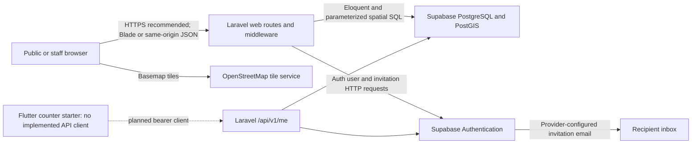

# Project Architecture Inventory

Audit date: 2026-10-13 (Asia/Manila). **Static source evidence only; runtime and production status Pending Verification.** Paths in this package are relative to C:/dev/AssocMap unless linked. No credentials, environment files, live records or generated build contents were read.

## Architecture and entry points

- `web/public/index.php` loads Composer and `bootstrap/app.php`, then handles HTTP. The production document root must be `web/public`, not the repository root.
- `web/artisan` is the CLI entry; it was inspected, never executed.
- `web/bootstrap/app.php` registers web/API/console routes, /up health route, custom Supabase aliases, loopback proxy trust, activation middleware and error handlers. `bootstrap/providers.php` loads AppServiceProvider and GisServiceProvider.
- `web/routes/web.php` implements public, administrator, Field Officer, Association Account, activation, GIS, audit and monitoring routes. Blade/JSON handlers share custom request attributes rather than assuming the Laravel default user guard authenticates Supabase profiles.
- `web/routes/api.php` provides `GET /api/v1/me` with Supabase bearer middleware and a separate scaffold `/api/user` using Sanctum. These are different authentication contracts.
- Form Requests validate input; services perform organizational rules and writes; Eloquent models map business tables. Authorization is implemented in middleware/controller/service predicates. No application Policy classes were found in the enumerated app tree; absence of Policies alone is not an authorization defect.
- SQL business migrations live under `supabase/migrations`; Laravel infrastructure and a program-activity constraint change live under `web/database/migrations`. Neither track was executed.

## Source-supported logical data flow



This diagram represents source-supported responsibilities and a proposed HTTPS boundary, not an observed production network. The Flutter connection is explicitly planned. A Cloudflare Quick Tunnel is user-reported development/testing access, not verified hosting.

## Technology and version evidence

| Component | Verified source value | Evidence | Runtime status |
|---|---|---|---|
| PHP | Requirement ^8.2 | composer.json; framework requirement in composer.lock | Installed version/extensions unverified |
| Laravel | v12.69.2 locked; manifest ^12.0 | web/composer.lock, laravel/framework | Bootstrap not executed |
| Sanctum | v4.3.3 locked | composer.lock | Main web login does not use Sanctum |
| Guzzle | 7.15.5 locked | composer.lock | Remote behavior unverified |
| Symfony HTTP Foundation | v7.4.19 locked | composer.lock | Not executed |
| PHPUnit | 11.5.56 locked | composer.lock | Test source only |
| Blade / Eloquent | Laravel framework components | controllers/models/views | Functional verification pending |
| Vite | 7.3.6 locked | package-lock.json | Current build not executed |
| Node | Vite engine ^20.19.0 or >=22.12.0 | node_modules/vite/package.json | Installed Node unknown |
| Leaflet | 1.9.4 | package.json/package-lock.json; gis-map.js | Browser verification pending |
| Leaflet-Geoman Free | 2.20.2 | package.json/package-lock.json; gis-editor.js | Polygon interactions pending |
| Tailwind and Vite plugin | 4.3.3 locked | package-lock.json; vite.config.js | Installed plugin; entry CSS is custom imports, not proof of Tailwind utility use |
| Laravel Vite plugin | 2.1.0 locked | package-lock.json | Assets/manifest unverified |
| Axios | 1.20.0 locked | package-lock.json | GIS uses fetch through gis-api.js |
| PostgreSQL / PostGIS | Required architecture; extensions installed by SQL source in extensions schema | 001_assocmap_schema.sql | Server/extension versions unknown |
| Flutter / Dart | Mobile package 1.0.0+1; Dart SDK constraint ^3.12.2 | mobile/pubspec.yaml | Flutter/Dart installed versions/build unverified |
| Chart.js | Not declared in package.json or implemented by inspected report JS | report view/JS and manifest | Do not list as implemented analytics |

Lockfile versions are snapshot evidence, not claims about newest releases, installed reproducibility or vulnerability status.

## Frontend and UI responsibilities

`web/resources/js/app.js` initializes shared navigation/dialogs/forms/reports/login helpers. It dynamically imports GIS workspace/editor code; Geoman is imported only by the editor. `vite.config.js` declares CSS and JS entry points; `resources/css/app.css` imports custom CSS for shells, forms, reports, audit, public pages and GIS. Same-origin GIS fetches include credentials, JSON Accept and CSRF for writes.

There are 128 enumerated Blade/PHP, JS and CSS resource files. Counts do not imply every template is routed or implemented. Dashboard hash navigation still includes scaffold sections alongside routed modules. The stylesheet/helper structure has responsive and keyboard-focused provisions; no visual/accessibility check was executed.

## Mobile status

`mobile/lib/main.dart` is the Material counter starter; `mobile/test/widget_test.dart` tests counter increments. There is no Supabase/network dependency or organizational API client in the inspected mobile library. Android/iOS/desktop/web scaffolding and generated directories exist; no functional mobile monitoring/GIS/authentication feature or build result is established.

## Inspection boundary

The inventory below enumerates 125 PHP application/route/migration/test files. Critical authentication, activation, GIS, auditing, registration, membership decision and scoped organizational handlers were read or inspected in relevant excerpts. Some remaining files were inventoried/search-reviewed rather than exhaustively reviewed line by line. Config PHP files and manifests were inspected selectively; environment values, compiled config, logs, private records, keys, vendor binaries and generated builds were excluded. Selected framework middleware was read to establish the API limiter default. No Git revision was collected.

## Application inventory

### Controllers (24)

```text
app/Http/Controllers/Controller.php
app/Http/Controllers/GisWorkspaceController.php
app/Http/Controllers/MonitoringWorkspaceController.php
app/Http/Controllers/PublicGisController.php
app/Http/Controllers/Admin/AreaController.php
app/Http/Controllers/Admin/AssociationController.php
app/Http/Controllers/Admin/AuditLogController.php
app/Http/Controllers/Admin/BarangayController.php
app/Http/Controllers/Admin/MemberController.php
app/Http/Controllers/Admin/MonitoringController.php
app/Http/Controllers/Admin/MunicipalityController.php
app/Http/Controllers/Admin/ProgramActivityController.php
app/Http/Controllers/Admin/ProjectController.php
app/Http/Controllers/Admin/TrainingController.php
app/Http/Controllers/Admin/UserInvitationController.php
app/Http/Controllers/Api/V1/MeController.php
app/Http/Controllers/AssociationAccount/MemberApplicationController.php
app/Http/Controllers/Auth/InvitationActivationController.php
app/Http/Controllers/Auth/StaffAuthController.php
app/Http/Controllers/FieldOfficer/MemberApplicationController.php
app/Http/Controllers/FieldOfficer/MonitoringController.php
app/Http/Controllers/FieldOfficer/ProgramActivityController.php
app/Http/Controllers/FieldOfficer/ProjectController.php
app/Http/Controllers/FieldOfficer/TrainingController.php
```

### Services (20)

```text
app/Services/AreaService.php
app/Services/AssociationService.php
app/Services/AuditLogService.php
app/Services/BarangayService.php
app/Services/GisAddressResolver.php
app/Services/GisFeatureSerializer.php
app/Services/GisGeometry.php
app/Services/GisLocationService.php
app/Services/GisQueryService.php
app/Services/InvitationActivationContext.php
app/Services/InvitationActivationService.php
app/Services/MemberApplicationService.php
app/Services/MemberService.php
app/Services/MonitoringService.php
app/Services/MunicipalityService.php
app/Services/ProgramActivityService.php
app/Services/ProjectService.php
app/Services/SupabaseAuthService.php
app/Services/TrainingService.php
app/Services/UserInvitationService.php
```

### Models (34)

```text
app/Models/Area.php
app/Models/Association.php
app/Models/AssociationAccount.php
app/Models/AssociationPosition.php
app/Models/AssociationRegistration.php
app/Models/AuditLog.php
app/Models/Barangay.php
app/Models/Commodity.php
app/Models/FisheriesProjectCategory.php
app/Models/GisLocation.php
app/Models/Member.php
app/Models/MemberApplication.php
app/Models/MemberClassification.php
app/Models/MonitoringIncome.php
app/Models/MonitoringMaterial.php
app/Models/MonitoringProduction.php
app/Models/MonitoringProductionMonthly.php
app/Models/MonitoringRecord.php
app/Models/MonitoringVisitReport.php
app/Models/Municipality.php
app/Models/ProgramActivityRecord.php
app/Models/Project.php
app/Models/ProjectMaterial.php
app/Models/ProjectProduct.php
app/Models/Quarter.php
app/Models/RegistrationAgency.php
app/Models/Role.php
app/Models/SaadActivity.php
app/Models/SexCategory.php
app/Models/Training.php
app/Models/TrainingParticipant.php
app/Models/User.php
app/Models/UserInvitation.php
app/Models/UserProfile.php
```

### Middleware (6)

```text
app/Http/Middleware/AuditRequestGuard.php
app/Http/Middleware/EnsureRole.php
app/Http/Middleware/EnsureSupabaseApiAuthenticated.php
app/Http/Middleware/EnsureSupabaseAuthenticated.php
app/Http/Middleware/GisRequestGuard.php
app/Http/Middleware/ProtectInvitationActivation.php
```

### Form Requests (22)

```text
app/Http/Requests/AuditLogIndexRequest.php
app/Http/Requests/DeleteGisLocationRequest.php
app/Http/Requests/GisLifecycleRequest.php
app/Http/Requests/GisParentRequest.php
app/Http/Requests/GisQueryRequest.php
app/Http/Requests/SaveGisLocationRequest.php
app/Http/Requests/SetInvitationPasswordRequest.php
app/Http/Requests/StaffLoginRequest.php
app/Http/Requests/StoreAreaRequest.php
app/Http/Requests/StoreAssociationRequest.php
app/Http/Requests/StoreBarangayRequest.php
app/Http/Requests/StoreMemberApplicationRequest.php
app/Http/Requests/StoreMemberRequest.php
app/Http/Requests/StoreMonitoringRequest.php
app/Http/Requests/StoreMonitoringVisitReportRequest.php
app/Http/Requests/StoreMunicipalityRequest.php
app/Http/Requests/StoreProgramActivityRequest.php
app/Http/Requests/StoreProjectRequest.php
app/Http/Requests/StoreTrainingRequest.php
app/Http/Requests/StoreUserInvitationRequest.php
app/Http/Requests/UpdateMonitoringSectionRequest.php
app/Http/Requests/VerifyInvitationRequest.php
```

### Providers/exceptions/routes (6)

```text
app/Exceptions/InvitationActivationException.php
app/Providers/AppServiceProvider.php
app/Providers/GisServiceProvider.php
routes/api.php
routes/console.php
routes/web.php
```

### Laravel migrations (5)

```text
database/migrations/0001_01_01_000000_create_users_table.php
database/migrations/0001_01_01_000001_create_cache_table.php
database/migrations/0001_01_01_000002_create_jobs_table.php
database/migrations/2026_09_28_091014_create_personal_access_tokens_table.php
database/migrations/2026_10_05_102947_update_program_activity_status_constraint.php
```

### Test source (8)

```text
tests/TestCase.php
tests/Feature/ExampleTest.php
tests/Feature/GisScopedReadsTest.php
tests/Feature/InvitationActivationServiceTest.php
tests/Feature/SupabaseInvitationAuthTest.php
tests/Unit/ExampleTest.php
tests/Unit/GisFeatureSerializerTest.php
tests/Unit/GisGeometryTest.php
```

## Frontend inventory

```text
resources/css/base/foundation.css
resources/css/components/controls.css
resources/css/components/forms.css
resources/css/components/tables.css
resources/css/layouts/admin-footer.css
resources/css/layouts/admin-responsive.css
resources/css/layouts/admin-shell.css
resources/css/pages/admin-audit-logs.css
resources/css/pages/admin-dashboard.css
resources/css/pages/admin-gis.css
resources/css/pages/admin-reports.css
resources/css/pages/gis-workspace.css
resources/css/pages/public-gis.css
resources/css/pages/public-landing.css
resources/css/pages/staff-login.css
resources/css/app.css
resources/js/core/dialogs.js
resources/js/core/gis-api.js
resources/js/core/helpers.js
resources/js/layouts/admin-navigation.js
resources/js/layouts/public-navigation.js
resources/js/pages/admin/forms.js
resources/js/pages/admin/reports.js
resources/js/pages/gis-editor.js
resources/js/pages/gis-map.js
resources/js/pages/gis-workspace.js
resources/js/pages/staff-login.js
resources/js/app.js
resources/ui/admin.php
resources/views/admin/areas/index.blade.php
resources/views/admin/areas/modals.blade.php
resources/views/admin/associations/create.blade.php
resources/views/admin/associations/edit.blade.php
resources/views/admin/associations/index.blade.php
resources/views/admin/associations/show.blade.php
resources/views/admin/audit-logs/error.blade.php
resources/views/admin/audit-logs/index.blade.php
resources/views/admin/audit-logs/show.blade.php
resources/views/admin/gis/index.blade.php
resources/views/admin/members/index.blade.php
resources/views/admin/members/show.blade.php
resources/views/admin/monitoring/create.blade.php
resources/views/admin/monitoring/edit.blade.php
resources/views/admin/monitoring/index.blade.php
resources/views/admin/monitoring/show.blade.php
resources/views/admin/program-activities/create.blade.php
resources/views/admin/program-activities/edit.blade.php
resources/views/admin/program-activities/index.blade.php
resources/views/admin/program-activities/show.blade.php
resources/views/admin/projects/create.blade.php
resources/views/admin/projects/edit.blade.php
resources/views/admin/projects/index.blade.php
resources/views/admin/projects/show.blade.php
resources/views/admin/reports/index.blade.php
resources/views/admin/shared/form.blade.php
resources/views/admin/shared/index.blade.php
resources/views/admin/shared/repeater-row.blade.php
resources/views/admin/shared/show.blade.php
resources/views/admin/trainings/create.blade.php
resources/views/admin/trainings/edit.blade.php
resources/views/admin/trainings/index.blade.php
resources/views/admin/trainings/participants.blade.php
resources/views/admin/trainings/show.blade.php
resources/views/admin/users/create.blade.php
resources/views/admin/users/index.blade.php
resources/views/admin/users/show.blade.php
resources/views/admin/dashboard.blade.php
resources/views/association/member-applications/index.blade.php
resources/views/auth/invitation-layout.blade.php
resources/views/auth/invitation-password.blade.php
resources/views/auth/invitation-recovery.blade.php
resources/views/auth/invitation-result.blade.php
resources/views/auth/invitation-verify.blade.php
resources/views/auth/login.blade.php
resources/views/components/confirmation-modal.blade.php
resources/views/components/data-table.blade.php
resources/views/components/empty-state.blade.php
resources/views/components/field.blade.php
resources/views/components/filter-panel.blade.php
resources/views/components/form-section.blade.php
resources/views/components/icon.blade.php
resources/views/components/modal.blade.php
resources/views/components/pagination.blade.php
resources/views/components/public-feature-card.blade.php
resources/views/components/search-box.blade.php
resources/views/components/sort-dropdown.blade.php
resources/views/components/stat-card.blade.php
resources/views/components/status-badge.blade.php
resources/views/dashboard/index.blade.php
resources/views/field-officer/member-applications/index.blade.php
resources/views/field-officer/monitoring/index.blade.php
resources/views/field-officer/program-activities/index.blade.php
resources/views/field-officer/projects/index.blade.php
resources/views/field-officer/trainings/index.blade.php
resources/views/layouts/admin.blade.php
resources/views/layouts/association.blade.php
resources/views/layouts/field-officer.blade.php
resources/views/layouts/public.blade.php
resources/views/monitoring/partials/context.blade.php
resources/views/monitoring/partials/details.blade.php
resources/views/monitoring/partials/editor-script.blade.php
resources/views/monitoring/partials/editor-templates.blade.php
resources/views/monitoring/partials/project-shortcuts.blade.php
resources/views/monitoring/partials/removal-modal.blade.php
resources/views/monitoring/partials/styles.blade.php
resources/views/monitoring/dashboard.blade.php
resources/views/monitoring/edit-overview.blade.php
resources/views/monitoring/editor.blade.php
resources/views/monitoring/visit.blade.php
resources/views/monitoring/visits.blade.php
resources/views/monitoring/workspace.blade.php
resources/views/partials/admin-sidebar.blade.php
resources/views/partials/admin-topbar.blade.php
resources/views/partials/gis-workspace.blade.php
resources/views/partials/page-header.blade.php
resources/views/partials/public-footer.blade.php
resources/views/partials/public-navbar.blade.php
resources/views/projects/partials/location.blade.php
resources/views/public/sections/about.blade.php
resources/views/public/sections/access.blade.php
resources/views/public/sections/features.blade.php
resources/views/public/sections/gis-preview.blade.php
resources/views/public/sections/hero.blade.php
resources/views/public/gis.blade.php
resources/views/public/landing.blade.php
resources/views/gis-editor.blade.php
resources/views/gis-unavailable.blade.php
resources/views/gis-workspace.blade.php
```

## Configuration inventory

```text
config/app.php
config/auth.php
config/cache.php
config/database.php
config/filesystems.php
config/logging.php
config/mail.php
config/queue.php
config/sanctum.php
config/services.php
config/session.php
```

Effective settings are unknown because environment/credentials and cached configuration values were not read. Root/web/mobile README files are framework starter documents, not a project deployment runbook. No dedicated deployment or approved Capstone manuscript was found in inspected project documentation locations. See [deployment readiness](06_DEPLOYMENT_READINESS.md) and [Capstone reference](08_CAPSTONE2_TECHNICAL_REFERENCE.md).

