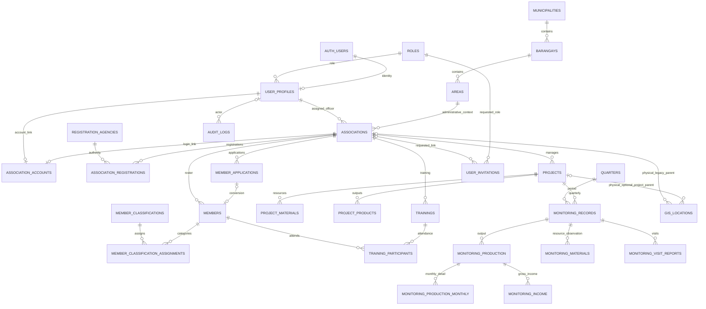

# Database Architecture and Data Dictionary Source

Audit date: 2026-10-13. **Local schema declarations were inspected; no SQL, catalog query, migration or Supabase API was executed.** These definitions are preparation data for Chapter III ERD, Data Dictionary and Implementation, not a claim about deployed tables or applied history. No row data, credentials or private Auth records are included.

## Schema tracks and inventory

SQL 001 declares 35 public business/reference tables; 003, 005 and 006 add three more, for **38 declared business tables**. Supabase-managed auth.users is referenced but its complete physical definition is not supplied here. Laravel migrations separately define users, password_reset_tokens, sessions, cache, cache_locks, jobs, job_batches, failed_jobs and personal_access_tokens; Laravel manages its migrations repository separately.

| Table | Source-supported purpose |
|---|---|
| `roles` | Role catalogue |
| `user_profiles` | Auth-linked application identities |
| `email_change_requests` | Email-change request schema; no implemented producer found |
| `municipalities` | Locality reference |
| `barangays` | Locality subdivision |
| `areas` | Specific registered-area address/context |
| `registration_agencies` | Registration/accreditation authority reference |
| `associations` | Organizational identity and assignment |
| `association_accounts` | One-to-one active login link |
| `association_registrations` | Multiple documented registrations per association |
| `sex_categories` | Member sex reference |
| `member_classifications` | Classification reference |
| `association_positions` | Officer/member position reference |
| `member_applications` | Pending/reviewed member applications |
| `member_application_classifications` | Application-classification many-to-many link |
| `members` | Official roster |
| `member_classification_assignments` | Member-classification many-to-many link |
| `saad_components` | Program component reference |
| `saad_subcomponents` | Program subcomponent reference |
| `saad_activities` | Activity classification reference |
| `fisheries_project_categories` | Project category reference |
| `commodities` | Category-specific commodity reference |
| `projects` | Association livelihood projects |
| `project_materials` | Project resource inventory |
| `project_products` | Project output/product reference |
| `trainings` | Association training interventions |
| `training_participants` | Same-association active member attendance |
| `program_activity_records` | Other organizational/program-wide activities |
| `quarters` | Quarter reference |
| `monitoring_records` | Unique project/year/quarter record |
| `monitoring_production` | Quarterly project-product output |
| `monitoring_income` | Monthly/quarterly gross income |
| `monitoring_materials` | Project material monitoring |
| `gis_locations` | Private/internal and approved public spatial locations |
| `audit_logs` | Polymorphic action metadata and change snapshots |
| `monitoring_visit_reports` | Multiple visits/overview observations |
| `monitoring_production_monthly` | Monthly production detail within a quarterly product record |
| `user_invitations` | Provisioning/activation reservation and outcome state |

## Relationships and cardinalities

- auth.users to user_profiles: profile UUID is both PK and FK; a provider identity can have zero or one application profile. roles to user_profiles is one-to-many.
- municipalities to barangays to areas to associations is one-to-many at each level. associations.area_id is required; an address is an Area attribute, not a project-site identity.
- user_profiles to associations via primary_field_officer_id is one-to-many. A SQL trigger requires an active Field Officer for that FK.
- association_accounts.association_id and user_id are individually UNIQUE: optional one-to-one links from association/profile. Active-link status controls access.
- associations to association_registrations is one-to-many; agency+registration_number is globally unique per agency, with at most one primary row per association. No approval status exists.
- associations to member_applications and members is one-to-many. members.source_application_id is optional UNIQUE, permitting zero/one converted member per application. Classifications use normalized many-to-many link tables.
- associations to projects, trainings and association-scoped program_activity_records is one-to-many; program-wide activities may have no association. Related project links are optional and SQL triggers ensure compatible ownership.
- projects to materials/products is one-to-many; trainings to participants is one-to-many, unique by training/member, and participant association/status is validated.
- projects to monitoring_records is one-to-many with UNIQUE(project_id, year, quarter_id). records to production/material observations and visits is one-to-many; production to monthly detail and income is one-to-many with period-specific uniqueness/integrity rules.
- Physical GIS schema has an association-or-project XOR parent and legacy association_point type. Active Laravel GIS uses project-only parents/types; association comes through projects.association_id. This deliberate app/schema distinction preserves old records.
- audit_logs actor UUID is an optional FK with ON DELETE SET NULL. entity_type/entity_id are polymorphic metadata, not FK-bound to deleted entities. Stored events can survive entity deletion, while actor attribution can become unavailable.

## Logical ERD preparation diagram

This is a readable core subset; all declared fields and inline FK targets are listed below. Optional GIS parents express the physical XOR/history design, not permission to create new association points. Audit entity references are intentionally not drawn as enforced foreign keys.

## Integrity mechanisms

SQL 001 supplies UUID/BIGINT/SMALLINT identifiers, normalized reference/catalog tables, unique association/geography/product names, FishR/source-application uniqueness, numeric nonnegative checks, date checks, parent matching and role constraints. Most business tables have updated_at triggers; audit_logs uses performed_at instead of mutable timestamps. FK delete actions are intentional: RESTRICT protects organizational/resource references; CASCADE removes child rows when their parent is administratively deleted; SET NULL preserves records with optional actor/related-object attribution.

PostGIS is declared in the extensions schema. gis_locations.geom is geometry(Geometry,4326) NOT NULL. A GiST geometry index and parent/publication indexes exist. validate_gis_location fixes its search_path to public, extensions and checks matching type/parent/SRID; the inspected definition does not have the suspected missing-extensions search-path defect. Application GisGeometry/readableGeometry add validity, nonempty, two-dimensional, world-bound, type and vertex constraints. Live extension/functions/index use remains unverified.

RLS is enabled on the business-table list in 001; no direct anon/authenticated policies are created. The baseline dynamically revokes execution of set_updated_at/user_has_role/validate_* helpers from PUBLIC, anon and authenticated. Migrations 003/005/006 restrict new monitoring/invitation access; 007 hardens Laravel infrastructure. This is a trusted Laravel server boundary, not evidence that deployed grants match it. PostgreSQL table owners/privileged roles can bypass ordinary RLS, so app role scopes remain necessary.

Normalization is visibly supported by catalogue FKs, many-to-many links and separate quarterly/monthly/visit rows. Do not assert a formal global normal-form proof: archived/derived summaries, intentional quarterly output plus monthly totals, legacy visit backfill and separate approved public GIS fields require business-aware interpretation. Public fields are deliberate disclosure controls, not accidental duplicate private data. Application source does not prove the deployed data satisfies these constraints.

## Migration sequence and source differences

| Track | Purpose / dependency | Review requirement |
|---|---|---|
| 001 SQL | Base schema, functions/triggers/indexes, reference seeds, RLS; expects Supabase Auth and extensions | Review ownership and existing schema before any initial application |
| 002 SQL | municipalities.locality_type VARCHAR(20) NOT NULL default municipality; municipality/city check | Confirm present; UI does not offer a separate city-creation path |
| 003 SQL | monitoring_visit_reports, indexes/update trigger, trusted-owner checks, RLS/revokes | Guard rejects an existing target table; do not replay blindly |
| 004 SQL | Backfill historical quarterly overview data into visits | Data migration, locks and prerequisites; explicit backup/review required |
| 005 SQL | monitoring_production_monthly; quarter/parent identity guards; visit conductor columns | Requires READ COMMITTED and ownership; guards reject existing objects |
| 006 SQL | user_invitations; scope/update triggers; unresolved identity/email indexes; access restrictions | Required by access gate even for existing accounts |
| Laravel infrastructure migrations | Session/cache/queue/local users/Sanctum token storage | Separate history; required before SQL 007 |
| Laravel 2026_10_05 status migration | Adds ongoing to program_activity_records status set; baseline SQL lacks it | Verify actual constraint; don't present 001 alone as current schema |
| 007 SQL | Revoke client access and enable RLS for Laravel infrastructure | Requires tables to exist; no server-role grant is automatically chosen |

SQL 005 additionally declares monitoring_visit_reports.conducted_by_user_id UUID FK user_profiles ON DELETE RESTRICT and conducted_by VARCHAR(255), nullable. Its check permits at most one conductor representation and requires nonblank text when text is supplied. SQL 002/005 additions are supplements to original CREATE declarations below, not omitted fields in the final intended schema.

No immediately confirmed wrong-column query was established in the reviewed core paths. Notable semantic differences are intentional legacy GIS type retention, the program status migration track, service-versus-trigger participant eligibility (F-015), and actor/snapshot immutability limits (F-003). Request max lengths can be stricter than SQL TEXT; this does not invent a column.

## Proposed database designs — report only, not migrations

1. Audit privileges/retention: after reviewing actual role ownership, propose a least-privilege runtime role able to INSERT/SELECT audit metadata but not generally UPDATE/DELETE it. Keep DELETE GIS tombstones. Resolve actor SET NULL and identity deletion policy before adding an immutability trigger; no blanket trigger is approved here.
2. Organizational decision integrity: first use existing row locks/unique constraints for member pending-state transitions. A schema status-transition guard would need an approved transition catalogue and a separate migration review; no new table is necessary merely to serialize decisions.
3. Indexes: existing geom/parent/assignment/reference indexes are present. Any composite status/archive/update or search index must follow measured query plans and realistic selectivity; no speculative index definition is prescribed.
4. Address provenance: no verified-site/status/source column exists on GIS. A future provenance design needs approved semantics, nullable legacy state, actor/timestamp attribution and a safe manual verification/backfill procedure; never default old area fallbacks to verified.

## Complete business-table data dictionary source

Declarations are copied from local CREATE definitions with whitespace normalized. PRIMARY KEY implies non-null; otherwise nullable behavior follows explicit SQL. Table-level constraints and later ALTER additions must be read together. This is source preparation data; obtain a redacted schema-only catalog export to reconcile live definitions before publication.

### roles

Source: [001_assocmap_schema.sql](../../supabase/migrations/001_assocmap_schema.sql), `CREATE TABLE public.roles`. **Declared source definition; live schema Pending Verification.**

| Column | SQL declaration (type, nullability, defaults, keys/checks) |
|---|---|
| `id` | `BIGINT GENERATED BY DEFAULT AS IDENTITY PRIMARY KEY` |
| `code` | `VARCHAR(50) NOT NULL UNIQUE` |
| `name` | `VARCHAR(100) NOT NULL UNIQUE` |
| `description` | `TEXT` |
| `is_active` | `BOOLEAN NOT NULL DEFAULT TRUE` |
| `created_at` | `TIMESTAMPTZ NOT NULL DEFAULT NOW()` |
| `updated_at` | `TIMESTAMPTZ NOT NULL DEFAULT NOW()` |

### user_profiles

Source: [001_assocmap_schema.sql](../../supabase/migrations/001_assocmap_schema.sql), `CREATE TABLE public.user_profiles`. **Declared source definition; live schema Pending Verification.**

| Column | SQL declaration (type, nullability, defaults, keys/checks) |
|---|---|
| `id` | `UUID PRIMARY KEY REFERENCES auth.users(id) ON DELETE CASCADE` |
| `role_id` | `BIGINT NOT NULL REFERENCES public.roles(id) ON DELETE RESTRICT` |
| `display_name` | `VARCHAR(255) NOT NULL` |
| `contact_number` | `VARCHAR(30)` |
| `is_active` | `BOOLEAN NOT NULL DEFAULT TRUE` |
| `invited_by` | `UUID REFERENCES public.user_profiles(id) ON DELETE SET NULL` |
| `invited_at` | `TIMESTAMPTZ` |
| `activated_at` | `TIMESTAMPTZ` |
| `created_at` | `TIMESTAMPTZ NOT NULL DEFAULT NOW()` |
| `updated_at` | `TIMESTAMPTZ NOT NULL DEFAULT NOW()` |

### email_change_requests

Source: [001_assocmap_schema.sql](../../supabase/migrations/001_assocmap_schema.sql), `CREATE TABLE public.email_change_requests`. **Declared source definition; live schema Pending Verification.**

| Column | SQL declaration (type, nullability, defaults, keys/checks) |
|---|---|
| `id` | `UUID PRIMARY KEY DEFAULT gen_random_uuid()` |
| `user_id` | `UUID NOT NULL REFERENCES public.user_profiles(id) ON DELETE CASCADE` |
| `old_email` | `VARCHAR(255) NOT NULL` |
| `new_email` | `VARCHAR(255) NOT NULL` |
| `requested_by` | `UUID REFERENCES public.user_profiles(id) ON DELETE SET NULL` |
| `status` | `VARCHAR(20) NOT NULL DEFAULT 'pending' CHECK (status IN ('pending','confirmed','cancelled','expired'))` |
| `confirmed_at` | `TIMESTAMPTZ` |
| `cancelled_at` | `TIMESTAMPTZ` |
| `created_at` | `TIMESTAMPTZ NOT NULL DEFAULT NOW()` |
| `updated_at` | `TIMESTAMPTZ NOT NULL DEFAULT NOW()` |

Table constraints: `CHECK (LOWER(old_email) <> LOWER(new_email))`; `CHECK ( (status = 'confirmed' AND confirmed_at IS NOT NULL) OR status <> 'confirmed' )`.

### municipalities

Source: [001_assocmap_schema.sql](../../supabase/migrations/001_assocmap_schema.sql), `CREATE TABLE public.municipalities`. **Declared source definition; live schema Pending Verification.**

| Column | SQL declaration (type, nullability, defaults, keys/checks) |
|---|---|
| `id` | `UUID PRIMARY KEY DEFAULT gen_random_uuid()` |
| `name` | `VARCHAR(150) NOT NULL` |
| `psgc_code` | `VARCHAR(20) UNIQUE` |
| `province` | `VARCHAR(100) NOT NULL DEFAULT 'Cebu'` |
| `region` | `VARCHAR(100) NOT NULL DEFAULT 'Region VII'` |
| `source` | `VARCHAR(20) NOT NULL DEFAULT 'psgc' CHECK (source IN ('psgc','manual'))` |
| `is_active` | `BOOLEAN NOT NULL DEFAULT TRUE` |
| `created_by` | `UUID REFERENCES public.user_profiles(id) ON DELETE SET NULL` |
| `created_at` | `TIMESTAMPTZ NOT NULL DEFAULT NOW()` |
| `updated_at` | `TIMESTAMPTZ NOT NULL DEFAULT NOW()` |

### barangays

Source: [001_assocmap_schema.sql](../../supabase/migrations/001_assocmap_schema.sql), `CREATE TABLE public.barangays`. **Declared source definition; live schema Pending Verification.**

| Column | SQL declaration (type, nullability, defaults, keys/checks) |
|---|---|
| `id` | `UUID PRIMARY KEY DEFAULT gen_random_uuid()` |
| `municipality_id` | `UUID NOT NULL REFERENCES public.municipalities(id) ON DELETE RESTRICT` |
| `name` | `VARCHAR(150) NOT NULL` |
| `psgc_code` | `VARCHAR(20) UNIQUE` |
| `source` | `VARCHAR(20) NOT NULL DEFAULT 'psgc' CHECK (source IN ('psgc','manual'))` |
| `is_active` | `BOOLEAN NOT NULL DEFAULT TRUE` |
| `created_by` | `UUID REFERENCES public.user_profiles(id) ON DELETE SET NULL` |
| `created_at` | `TIMESTAMPTZ NOT NULL DEFAULT NOW()` |
| `updated_at` | `TIMESTAMPTZ NOT NULL DEFAULT NOW()` |

### areas

Source: [001_assocmap_schema.sql](../../supabase/migrations/001_assocmap_schema.sql), `CREATE TABLE public.areas`. **Declared source definition; live schema Pending Verification.**

| Column | SQL declaration (type, nullability, defaults, keys/checks) |
|---|---|
| `id` | `UUID PRIMARY KEY DEFAULT gen_random_uuid()` |
| `barangay_id` | `UUID NOT NULL REFERENCES public.barangays(id) ON DELETE RESTRICT` |
| `address` | `TEXT NOT NULL` |
| `source` | `VARCHAR(20) NOT NULL DEFAULT 'manual' CHECK (source IN ('manual','imported'))` |
| `is_active` | `BOOLEAN NOT NULL DEFAULT TRUE` |
| `created_by` | `UUID REFERENCES public.user_profiles(id) ON DELETE SET NULL` |
| `created_at` | `TIMESTAMPTZ NOT NULL DEFAULT NOW()` |
| `updated_at` | `TIMESTAMPTZ NOT NULL DEFAULT NOW()` |

Table constraints: `CHECK (BTRIM(address) <> '')`.

### registration_agencies

Source: [001_assocmap_schema.sql](../../supabase/migrations/001_assocmap_schema.sql), `CREATE TABLE public.registration_agencies`. **Declared source definition; live schema Pending Verification.**

| Column | SQL declaration (type, nullability, defaults, keys/checks) |
|---|---|
| `id` | `BIGINT GENERATED BY DEFAULT AS IDENTITY PRIMARY KEY` |
| `code` | `VARCHAR(30) NOT NULL UNIQUE` |
| `name` | `VARCHAR(255) NOT NULL UNIQUE` |
| `registration_kind` | `VARCHAR(30) NOT NULL DEFAULT 'registration' CHECK (registration_kind IN ('registration','accreditation'))` |
| `is_active` | `BOOLEAN NOT NULL DEFAULT TRUE` |
| `created_at` | `TIMESTAMPTZ NOT NULL DEFAULT NOW()` |
| `updated_at` | `TIMESTAMPTZ NOT NULL DEFAULT NOW()` |

### associations

Source: [001_assocmap_schema.sql](../../supabase/migrations/001_assocmap_schema.sql), `CREATE TABLE public.associations`. **Declared source definition; live schema Pending Verification.**

| Column | SQL declaration (type, nullability, defaults, keys/checks) |
|---|---|
| `id` | `UUID PRIMARY KEY DEFAULT gen_random_uuid()` |
| `name` | `VARCHAR(255) NOT NULL` |
| `acronym` | `VARCHAR(50)` |
| `area_id` | `UUID NOT NULL REFERENCES public.areas(id) ON DELETE RESTRICT` |
| `saad_phase2_join_date` | `DATE NOT NULL` |
| `primary_field_officer_id` | `UUID NOT NULL REFERENCES public.user_profiles(id) ON DELETE RESTRICT` |
| `status` | `VARCHAR(20) NOT NULL DEFAULT 'active' CHECK (status IN ('active','inactive'))` |
| `created_by` | `UUID REFERENCES public.user_profiles(id) ON DELETE SET NULL` |
| `updated_by` | `UUID REFERENCES public.user_profiles(id) ON DELETE SET NULL` |
| `archived_at` | `TIMESTAMPTZ` |
| `archived_by` | `UUID REFERENCES public.user_profiles(id) ON DELETE SET NULL` |
| `created_at` | `TIMESTAMPTZ NOT NULL DEFAULT NOW()` |
| `updated_at` | `TIMESTAMPTZ NOT NULL DEFAULT NOW()` |

### association_accounts

Source: [001_assocmap_schema.sql](../../supabase/migrations/001_assocmap_schema.sql), `CREATE TABLE public.association_accounts`. **Declared source definition; live schema Pending Verification.**

| Column | SQL declaration (type, nullability, defaults, keys/checks) |
|---|---|
| `id` | `UUID PRIMARY KEY DEFAULT gen_random_uuid()` |
| `association_id` | `UUID NOT NULL UNIQUE REFERENCES public.associations(id) ON DELETE CASCADE` |
| `user_id` | `UUID NOT NULL UNIQUE REFERENCES public.user_profiles(id) ON DELETE CASCADE` |
| `is_active` | `BOOLEAN NOT NULL DEFAULT TRUE` |
| `linked_by` | `UUID REFERENCES public.user_profiles(id) ON DELETE SET NULL` |
| `linked_at` | `TIMESTAMPTZ NOT NULL DEFAULT NOW()` |
| `created_at` | `TIMESTAMPTZ NOT NULL DEFAULT NOW()` |
| `updated_at` | `TIMESTAMPTZ NOT NULL DEFAULT NOW()` |

### association_registrations

Source: [001_assocmap_schema.sql](../../supabase/migrations/001_assocmap_schema.sql), `CREATE TABLE public.association_registrations`. **Declared source definition; live schema Pending Verification.**

| Column | SQL declaration (type, nullability, defaults, keys/checks) |
|---|---|
| `id` | `UUID PRIMARY KEY DEFAULT gen_random_uuid()` |
| `association_id` | `UUID NOT NULL REFERENCES public.associations(id) ON DELETE CASCADE` |
| `agency_id` | `BIGINT NOT NULL REFERENCES public.registration_agencies(id) ON DELETE RESTRICT` |
| `registration_number` | `VARCHAR(150) NOT NULL` |
| `registration_date` | `DATE NOT NULL` |
| `expiration_date` | `DATE` |
| `is_primary` | `BOOLEAN NOT NULL DEFAULT FALSE` |
| `remarks` | `TEXT` |
| `created_at` | `TIMESTAMPTZ NOT NULL DEFAULT NOW()` |
| `updated_at` | `TIMESTAMPTZ NOT NULL DEFAULT NOW()` |

Table constraints: `CHECK (expiration_date IS NULL OR expiration_date >= registration_date)`; `UNIQUE (agency_id, registration_number)`.

### sex_categories

Source: [001_assocmap_schema.sql](../../supabase/migrations/001_assocmap_schema.sql), `CREATE TABLE public.sex_categories`. **Declared source definition; live schema Pending Verification.**

| Column | SQL declaration (type, nullability, defaults, keys/checks) |
|---|---|
| `id` | `BIGINT GENERATED BY DEFAULT AS IDENTITY PRIMARY KEY` |
| `code` | `VARCHAR(20) NOT NULL UNIQUE` |
| `name` | `VARCHAR(50) NOT NULL UNIQUE` |
| `is_active` | `BOOLEAN NOT NULL DEFAULT TRUE` |
| `created_at` | `TIMESTAMPTZ NOT NULL DEFAULT NOW()` |
| `updated_at` | `TIMESTAMPTZ NOT NULL DEFAULT NOW()` |

### member_classifications

Source: [001_assocmap_schema.sql](../../supabase/migrations/001_assocmap_schema.sql), `CREATE TABLE public.member_classifications`. **Declared source definition; live schema Pending Verification.**

| Column | SQL declaration (type, nullability, defaults, keys/checks) |
|---|---|
| `id` | `BIGINT GENERATED BY DEFAULT AS IDENTITY PRIMARY KEY` |
| `code` | `VARCHAR(50) NOT NULL UNIQUE` |
| `name` | `VARCHAR(100) NOT NULL UNIQUE` |
| `description` | `TEXT` |
| `is_active` | `BOOLEAN NOT NULL DEFAULT TRUE` |
| `created_at` | `TIMESTAMPTZ NOT NULL DEFAULT NOW()` |
| `updated_at` | `TIMESTAMPTZ NOT NULL DEFAULT NOW()` |

### association_positions

Source: [001_assocmap_schema.sql](../../supabase/migrations/001_assocmap_schema.sql), `CREATE TABLE public.association_positions`. **Declared source definition; live schema Pending Verification.**

| Column | SQL declaration (type, nullability, defaults, keys/checks) |
|---|---|
| `id` | `BIGINT GENERATED BY DEFAULT AS IDENTITY PRIMARY KEY` |
| `code` | `VARCHAR(50) NOT NULL UNIQUE` |
| `name` | `VARCHAR(100) NOT NULL UNIQUE` |
| `is_officer` | `BOOLEAN NOT NULL DEFAULT FALSE` |
| `sort_order` | `SMALLINT NOT NULL DEFAULT 0` |
| `is_active` | `BOOLEAN NOT NULL DEFAULT TRUE` |
| `created_at` | `TIMESTAMPTZ NOT NULL DEFAULT NOW()` |
| `updated_at` | `TIMESTAMPTZ NOT NULL DEFAULT NOW()` |

### member_applications

Source: [001_assocmap_schema.sql](../../supabase/migrations/001_assocmap_schema.sql), `CREATE TABLE public.member_applications`. **Declared source definition; live schema Pending Verification.**

| Column | SQL declaration (type, nullability, defaults, keys/checks) |
|---|---|
| `id` | `UUID PRIMARY KEY DEFAULT gen_random_uuid()` |
| `association_id` | `UUID NOT NULL REFERENCES public.associations(id) ON DELETE RESTRICT` |
| `submitted_by_user_id` | `UUID NOT NULL REFERENCES public.user_profiles(id) ON DELETE RESTRICT` |
| `first_name` | `VARCHAR(120) NOT NULL` |
| `middle_name` | `VARCHAR(120)` |
| `last_name` | `VARCHAR(120) NOT NULL` |
| `suffix` | `VARCHAR(20)` |
| `birth_date` | `DATE NOT NULL` |
| `sex_id` | `BIGINT NOT NULL REFERENCES public.sex_categories(id) ON DELETE RESTRICT` |
| `contact_number` | `VARCHAR(30)` |
| `fishr_registration_number` | `VARCHAR(100)` |
| `position_id` | `BIGINT NOT NULL REFERENCES public.association_positions(id) ON DELETE RESTRICT` |
| `position_other_text` | `VARCHAR(100)` |
| `status` | `VARCHAR(20) NOT NULL DEFAULT 'pending' CHECK (status IN ('pending','approved','rejected'))` |
| `reviewed_by` | `UUID REFERENCES public.user_profiles(id) ON DELETE SET NULL` |
| `reviewed_at` | `TIMESTAMPTZ` |
| `rejection_reason` | `TEXT` |
| `created_at` | `TIMESTAMPTZ NOT NULL DEFAULT NOW()` |
| `updated_at` | `TIMESTAMPTZ NOT NULL DEFAULT NOW()` |

Table constraints: `CHECK (birth_date <= CURRENT_DATE)`; `CHECK ( (status = 'pending' AND reviewed_by IS NULL AND reviewed_at IS NULL AND rejection_reason IS NULL) OR (status = 'approved' AND reviewed_by IS NOT NULL AND reviewed_at IS NOT NULL AND rejection_reason IS NULL) OR (status = 'rejected' AND reviewed_by IS NOT NULL AND reviewed_at IS NOT NULL AND rejection_reason IS NOT NULL AND BTRIM(rejection_reason) <> '') )`.

### member_application_classifications

Source: [001_assocmap_schema.sql](../../supabase/migrations/001_assocmap_schema.sql), `CREATE TABLE public.member_application_classifications`. **Declared source definition; live schema Pending Verification.**

| Column | SQL declaration (type, nullability, defaults, keys/checks) |
|---|---|
| `member_application_id` | `UUID NOT NULL REFERENCES public.member_applications(id) ON DELETE CASCADE` |
| `classification_id` | `BIGINT NOT NULL REFERENCES public.member_classifications(id) ON DELETE RESTRICT` |

Table constraints: `PRIMARY KEY (member_application_id, classification_id)`.

### members

Source: [001_assocmap_schema.sql](../../supabase/migrations/001_assocmap_schema.sql), `CREATE TABLE public.members`. **Declared source definition; live schema Pending Verification.**

| Column | SQL declaration (type, nullability, defaults, keys/checks) |
|---|---|
| `id` | `UUID PRIMARY KEY DEFAULT gen_random_uuid()` |
| `association_id` | `UUID NOT NULL REFERENCES public.associations(id) ON DELETE RESTRICT` |
| `source_application_id` | `UUID UNIQUE REFERENCES public.member_applications(id) ON DELETE SET NULL` |
| `first_name` | `VARCHAR(120) NOT NULL` |
| `middle_name` | `VARCHAR(120)` |
| `last_name` | `VARCHAR(120) NOT NULL` |
| `suffix` | `VARCHAR(20)` |
| `birth_date` | `DATE NOT NULL` |
| `sex_id` | `BIGINT NOT NULL REFERENCES public.sex_categories(id) ON DELETE RESTRICT` |
| `contact_number` | `VARCHAR(30)` |
| `fishr_registration_number` | `VARCHAR(100)` |
| `position_id` | `BIGINT NOT NULL REFERENCES public.association_positions(id) ON DELETE RESTRICT` |
| `position_other_text` | `VARCHAR(100)` |
| `date_registered` | `DATE NOT NULL DEFAULT CURRENT_DATE` |
| `member_status` | `VARCHAR(20) NOT NULL DEFAULT 'active' CHECK (member_status IN ('active','inactive'))` |
| `archived_at` | `TIMESTAMPTZ` |
| `archived_by` | `UUID REFERENCES public.user_profiles(id) ON DELETE SET NULL` |
| `created_at` | `TIMESTAMPTZ NOT NULL DEFAULT NOW()` |
| `updated_at` | `TIMESTAMPTZ NOT NULL DEFAULT NOW()` |

Table constraints: `CHECK (birth_date <= CURRENT_DATE)`.

### member_classification_assignments

Source: [001_assocmap_schema.sql](../../supabase/migrations/001_assocmap_schema.sql), `CREATE TABLE public.member_classification_assignments`. **Declared source definition; live schema Pending Verification.**

| Column | SQL declaration (type, nullability, defaults, keys/checks) |
|---|---|
| `member_id` | `UUID NOT NULL REFERENCES public.members(id) ON DELETE CASCADE` |
| `classification_id` | `BIGINT NOT NULL REFERENCES public.member_classifications(id) ON DELETE RESTRICT` |

Table constraints: `PRIMARY KEY (member_id, classification_id)`.

### saad_components

Source: [001_assocmap_schema.sql](../../supabase/migrations/001_assocmap_schema.sql), `CREATE TABLE public.saad_components`. **Declared source definition; live schema Pending Verification.**

| Column | SQL declaration (type, nullability, defaults, keys/checks) |
|---|---|
| `id` | `BIGINT GENERATED BY DEFAULT AS IDENTITY PRIMARY KEY` |
| `code` | `VARCHAR(20) NOT NULL UNIQUE CHECK (code IN ('SP','FPL','MAED','PM'))` |
| `name` | `VARCHAR(255) NOT NULL UNIQUE` |
| `beneficiary_scope` | `VARCHAR(20) NOT NULL CHECK (beneficiary_scope IN ('external','internal'))` |
| `description` | `TEXT` |
| `sort_order` | `SMALLINT NOT NULL` |
| `is_active` | `BOOLEAN NOT NULL DEFAULT TRUE` |
| `created_at` | `TIMESTAMPTZ NOT NULL DEFAULT NOW()` |
| `updated_at` | `TIMESTAMPTZ NOT NULL DEFAULT NOW()` |

### saad_subcomponents

Source: [001_assocmap_schema.sql](../../supabase/migrations/001_assocmap_schema.sql), `CREATE TABLE public.saad_subcomponents`. **Declared source definition; live schema Pending Verification.**

| Column | SQL declaration (type, nullability, defaults, keys/checks) |
|---|---|
| `id` | `BIGINT GENERATED BY DEFAULT AS IDENTITY PRIMARY KEY` |
| `component_id` | `BIGINT NOT NULL REFERENCES public.saad_components(id) ON DELETE RESTRICT` |
| `code` | `VARCHAR(60) UNIQUE` |
| `name` | `VARCHAR(255) NOT NULL` |
| `description` | `TEXT` |
| `source` | `VARCHAR(20) NOT NULL DEFAULT 'official' CHECK (source IN ('official','custom'))` |
| `sort_order` | `SMALLINT NOT NULL DEFAULT 0` |
| `is_active` | `BOOLEAN NOT NULL DEFAULT TRUE` |
| `created_by` | `UUID REFERENCES public.user_profiles(id) ON DELETE SET NULL` |
| `created_at` | `TIMESTAMPTZ NOT NULL DEFAULT NOW()` |
| `updated_at` | `TIMESTAMPTZ NOT NULL DEFAULT NOW()` |

Table constraints: `CHECK (source = 'custom' OR code IS NOT NULL)`.

### saad_activities

Source: [001_assocmap_schema.sql](../../supabase/migrations/001_assocmap_schema.sql), `CREATE TABLE public.saad_activities`. **Declared source definition; live schema Pending Verification.**

| Column | SQL declaration (type, nullability, defaults, keys/checks) |
|---|---|
| `id` | `BIGINT GENERATED BY DEFAULT AS IDENTITY PRIMARY KEY` |
| `subcomponent_id` | `BIGINT NOT NULL REFERENCES public.saad_subcomponents(id) ON DELETE RESTRICT` |
| `code` | `VARCHAR(80) UNIQUE` |
| `name` | `VARCHAR(255) NOT NULL` |
| `description` | `TEXT` |
| `source` | `VARCHAR(20) NOT NULL DEFAULT 'official' CHECK (source IN ('official','custom'))` |
| `sort_order` | `SMALLINT NOT NULL DEFAULT 0` |
| `is_active` | `BOOLEAN NOT NULL DEFAULT TRUE` |
| `created_by` | `UUID REFERENCES public.user_profiles(id) ON DELETE SET NULL` |
| `created_at` | `TIMESTAMPTZ NOT NULL DEFAULT NOW()` |
| `updated_at` | `TIMESTAMPTZ NOT NULL DEFAULT NOW()` |

Table constraints: `CHECK (source = 'custom' OR code IS NOT NULL)`.

### fisheries_project_categories

Source: [001_assocmap_schema.sql](../../supabase/migrations/001_assocmap_schema.sql), `CREATE TABLE public.fisheries_project_categories`. **Declared source definition; live schema Pending Verification.**

| Column | SQL declaration (type, nullability, defaults, keys/checks) |
|---|---|
| `id` | `BIGINT GENERATED BY DEFAULT AS IDENTITY PRIMARY KEY` |
| `code` | `VARCHAR(30) NOT NULL UNIQUE CHECK (code IN ('AQUACULTURE','CAPTURE','POST_HARVEST'))` |
| `name` | `VARCHAR(100) NOT NULL UNIQUE` |
| `description` | `TEXT` |
| `is_active` | `BOOLEAN NOT NULL DEFAULT TRUE` |
| `created_at` | `TIMESTAMPTZ NOT NULL DEFAULT NOW()` |
| `updated_at` | `TIMESTAMPTZ NOT NULL DEFAULT NOW()` |

### commodities

Source: [001_assocmap_schema.sql](../../supabase/migrations/001_assocmap_schema.sql), `CREATE TABLE public.commodities`. **Declared source definition; live schema Pending Verification.**

| Column | SQL declaration (type, nullability, defaults, keys/checks) |
|---|---|
| `id` | `BIGINT GENERATED BY DEFAULT AS IDENTITY PRIMARY KEY` |
| `category_id` | `BIGINT NOT NULL REFERENCES public.fisheries_project_categories(id) ON DELETE RESTRICT` |
| `name` | `VARCHAR(120) NOT NULL` |
| `description` | `TEXT` |
| `source` | `VARCHAR(20) NOT NULL DEFAULT 'official' CHECK (source IN ('official','custom'))` |
| `is_active` | `BOOLEAN NOT NULL DEFAULT TRUE` |
| `created_by` | `UUID REFERENCES public.user_profiles(id) ON DELETE SET NULL` |
| `created_at` | `TIMESTAMPTZ NOT NULL DEFAULT NOW()` |
| `updated_at` | `TIMESTAMPTZ NOT NULL DEFAULT NOW()` |

### projects

Source: [001_assocmap_schema.sql](../../supabase/migrations/001_assocmap_schema.sql), `CREATE TABLE public.projects`. **Declared source definition; live schema Pending Verification.**

| Column | SQL declaration (type, nullability, defaults, keys/checks) |
|---|---|
| `id` | `UUID PRIMARY KEY DEFAULT gen_random_uuid()` |
| `association_id` | `UUID NOT NULL REFERENCES public.associations(id) ON DELETE RESTRICT` |
| `saad_activity_id` | `BIGINT NOT NULL REFERENCES public.saad_activities(id) ON DELETE RESTRICT` |
| `fisheries_category_id` | `BIGINT NOT NULL REFERENCES public.fisheries_project_categories(id) ON DELETE RESTRICT` |
| `commodity_id` | `BIGINT REFERENCES public.commodities(id) ON DELETE SET NULL` |
| `title` | `VARCHAR(255) NOT NULL` |
| `description` | `TEXT` |
| `program_year` | `SMALLINT NOT NULL CHECK (program_year BETWEEN 2000 AND 2100)` |
| `implementation_start_date` | `DATE NOT NULL` |
| `implementation_end_date` | `DATE` |
| `status` | `VARCHAR(20) NOT NULL DEFAULT 'planned' CHECK (status IN ('planned','ongoing','completed','suspended','cancelled'))` |
| `remarks` | `TEXT` |
| `created_by` | `UUID REFERENCES public.user_profiles(id) ON DELETE SET NULL` |
| `updated_by` | `UUID REFERENCES public.user_profiles(id) ON DELETE SET NULL` |
| `archived_at` | `TIMESTAMPTZ` |
| `archived_by` | `UUID REFERENCES public.user_profiles(id) ON DELETE SET NULL` |
| `created_at` | `TIMESTAMPTZ NOT NULL DEFAULT NOW()` |
| `updated_at` | `TIMESTAMPTZ NOT NULL DEFAULT NOW()` |

Table constraints: `CHECK (implementation_end_date IS NULL OR implementation_end_date >= implementation_start_date)`.

### project_materials

Source: [001_assocmap_schema.sql](../../supabase/migrations/001_assocmap_schema.sql), `CREATE TABLE public.project_materials`. **Declared source definition; live schema Pending Verification.**

| Column | SQL declaration (type, nullability, defaults, keys/checks) |
|---|---|
| `id` | `UUID PRIMARY KEY DEFAULT gen_random_uuid()` |
| `project_id` | `UUID NOT NULL REFERENCES public.projects(id) ON DELETE CASCADE` |
| `item_name` | `VARCHAR(255) NOT NULL` |
| `quantity_planned` | `NUMERIC(14,2) NOT NULL CHECK (quantity_planned >= 0)` |
| `quantity_delivered` | `NUMERIC(14,2) NOT NULL DEFAULT 0 CHECK (quantity_delivered >= 0)` |
| `unit` | `VARCHAR(50) NOT NULL` |
| `unit_cost` | `NUMERIC(14,2) CHECK (unit_cost IS NULL OR unit_cost >= 0)` |
| `delivery_status` | `VARCHAR(30) NOT NULL DEFAULT 'planned' CHECK (delivery_status IN ('planned','not_delivered','partially_delivered','delivered'))` |
| `delivery_date` | `DATE` |
| `remarks` | `TEXT` |
| `created_at` | `TIMESTAMPTZ NOT NULL DEFAULT NOW()` |
| `updated_at` | `TIMESTAMPTZ NOT NULL DEFAULT NOW()` |

### project_products

Source: [001_assocmap_schema.sql](../../supabase/migrations/001_assocmap_schema.sql), `CREATE TABLE public.project_products`. **Declared source definition; live schema Pending Verification.**

| Column | SQL declaration (type, nullability, defaults, keys/checks) |
|---|---|
| `id` | `UUID PRIMARY KEY DEFAULT gen_random_uuid()` |
| `project_id` | `UUID NOT NULL REFERENCES public.projects(id) ON DELETE CASCADE` |
| `product_name` | `VARCHAR(255) NOT NULL` |
| `product_type` | `VARCHAR(20) NOT NULL DEFAULT 'raw' CHECK (product_type IN ('raw','processed','other'))` |
| `default_unit` | `VARCHAR(50)` |
| `description` | `TEXT` |
| `is_active` | `BOOLEAN NOT NULL DEFAULT TRUE` |
| `created_at` | `TIMESTAMPTZ NOT NULL DEFAULT NOW()` |
| `updated_at` | `TIMESTAMPTZ NOT NULL DEFAULT NOW()` |

### trainings

Source: [001_assocmap_schema.sql](../../supabase/migrations/001_assocmap_schema.sql), `CREATE TABLE public.trainings`. **Declared source definition; live schema Pending Verification.**

| Column | SQL declaration (type, nullability, defaults, keys/checks) |
|---|---|
| `id` | `UUID PRIMARY KEY DEFAULT gen_random_uuid()` |
| `association_id` | `UUID NOT NULL REFERENCES public.associations(id) ON DELETE RESTRICT` |
| `related_project_id` | `UUID REFERENCES public.projects(id) ON DELETE SET NULL` |
| `saad_activity_id` | `BIGINT NOT NULL REFERENCES public.saad_activities(id) ON DELETE RESTRICT` |
| `title` | `VARCHAR(255) NOT NULL` |
| `description` | `TEXT` |
| `program_year` | `SMALLINT NOT NULL CHECK (program_year BETWEEN 2000 AND 2100)` |
| `start_date` | `DATE NOT NULL` |
| `end_date` | `DATE` |
| `venue` | `VARCHAR(255)` |
| `conducted_by` | `VARCHAR(255)` |
| `training_cost` | `NUMERIC(14,2) CHECK (training_cost IS NULL OR training_cost >= 0)` |
| `status` | `VARCHAR(20) NOT NULL DEFAULT 'scheduled' CHECK (status IN ('scheduled','completed','cancelled'))` |
| `remarks` | `TEXT` |
| `created_by` | `UUID REFERENCES public.user_profiles(id) ON DELETE SET NULL` |
| `updated_by` | `UUID REFERENCES public.user_profiles(id) ON DELETE SET NULL` |
| `archived_at` | `TIMESTAMPTZ` |
| `archived_by` | `UUID REFERENCES public.user_profiles(id) ON DELETE SET NULL` |
| `created_at` | `TIMESTAMPTZ NOT NULL DEFAULT NOW()` |
| `updated_at` | `TIMESTAMPTZ NOT NULL DEFAULT NOW()` |

Table constraints: `CHECK (end_date IS NULL OR end_date >= start_date)`.

### training_participants

Source: [001_assocmap_schema.sql](../../supabase/migrations/001_assocmap_schema.sql), `CREATE TABLE public.training_participants`. **Declared source definition; live schema Pending Verification.**

| Column | SQL declaration (type, nullability, defaults, keys/checks) |
|---|---|
| `id` | `UUID PRIMARY KEY DEFAULT gen_random_uuid()` |
| `training_id` | `UUID NOT NULL REFERENCES public.trainings(id) ON DELETE CASCADE` |
| `member_id` | `UUID NOT NULL REFERENCES public.members(id) ON DELETE RESTRICT` |
| `attendance_status` | `VARCHAR(20) NOT NULL DEFAULT 'present' CHECK (attendance_status IN ('present','absent'))` |
| `remarks` | `TEXT` |
| `created_at` | `TIMESTAMPTZ NOT NULL DEFAULT NOW()` |
| `updated_at` | `TIMESTAMPTZ NOT NULL DEFAULT NOW()` |

Table constraints: `UNIQUE (training_id, member_id)`.

### program_activity_records

Source: [001_assocmap_schema.sql](../../supabase/migrations/001_assocmap_schema.sql), `CREATE TABLE public.program_activity_records`. **Declared source definition; live schema Pending Verification.**

| Column | SQL declaration (type, nullability, defaults, keys/checks) |
|---|---|
| `id` | `UUID PRIMARY KEY DEFAULT gen_random_uuid()` |
| `saad_activity_id` | `BIGINT NOT NULL REFERENCES public.saad_activities(id) ON DELETE RESTRICT` |
| `association_id` | `UUID REFERENCES public.associations(id) ON DELETE SET NULL` |
| `related_project_id` | `UUID REFERENCES public.projects(id) ON DELETE SET NULL` |
| `title` | `VARCHAR(255) NOT NULL` |
| `description` | `TEXT` |
| `program_year` | `SMALLINT NOT NULL CHECK (program_year BETWEEN 2000 AND 2100)` |
| `activity_date` | `DATE NOT NULL` |
| `venue` | `VARCHAR(255)` |
| `status` | `VARCHAR(20) NOT NULL DEFAULT 'completed' CHECK (status IN ('planned','completed','cancelled'))` |
| `conducted_by` | `VARCHAR(255)` |
| `conducted_by_user_id` | `UUID REFERENCES public.user_profiles(id) ON DELETE SET NULL` |
| `remarks` | `TEXT` |
| `created_by` | `UUID REFERENCES public.user_profiles(id) ON DELETE SET NULL` |
| `updated_by` | `UUID REFERENCES public.user_profiles(id) ON DELETE SET NULL` |
| `archived_at` | `TIMESTAMPTZ` |
| `archived_by` | `UUID REFERENCES public.user_profiles(id) ON DELETE SET NULL` |
| `created_at` | `TIMESTAMPTZ NOT NULL DEFAULT NOW()` |
| `updated_at` | `TIMESTAMPTZ NOT NULL DEFAULT NOW()` |

### quarters

Source: [001_assocmap_schema.sql](../../supabase/migrations/001_assocmap_schema.sql), `CREATE TABLE public.quarters`. **Declared source definition; live schema Pending Verification.**

| Column | SQL declaration (type, nullability, defaults, keys/checks) |
|---|---|
| `id` | `SMALLINT PRIMARY KEY` |
| `quarter_number` | `SMALLINT NOT NULL UNIQUE CHECK (quarter_number BETWEEN 1 AND 4)` |
| `name` | `VARCHAR(10) NOT NULL UNIQUE` |

### monitoring_records

Source: [001_assocmap_schema.sql](../../supabase/migrations/001_assocmap_schema.sql), `CREATE TABLE public.monitoring_records`. **Declared source definition; live schema Pending Verification.**

| Column | SQL declaration (type, nullability, defaults, keys/checks) |
|---|---|
| `id` | `UUID PRIMARY KEY DEFAULT gen_random_uuid()` |
| `project_id` | `UUID NOT NULL REFERENCES public.projects(id) ON DELETE RESTRICT` |
| `year` | `SMALLINT NOT NULL CHECK (year BETWEEN 2000 AND 2100)` |
| `quarter_id` | `SMALLINT NOT NULL REFERENCES public.quarters(id) ON DELETE RESTRICT` |
| `monitoring_date` | `DATE NOT NULL` |
| `monitored_by` | `UUID REFERENCES public.user_profiles(id) ON DELETE SET NULL` |
| `site_validated` | `BOOLEAN NOT NULL DEFAULT FALSE` |
| `project_status` | `VARCHAR(20) NOT NULL CHECK (project_status IN ('planned','ongoing','completed','suspended','cancelled'))` |
| `issues_encountered` | `TEXT` |
| `actions_taken` | `TEXT` |
| `overall_remarks` | `TEXT` |
| `created_by` | `UUID REFERENCES public.user_profiles(id) ON DELETE SET NULL` |
| `updated_by` | `UUID REFERENCES public.user_profiles(id) ON DELETE SET NULL` |
| `created_at` | `TIMESTAMPTZ NOT NULL DEFAULT NOW()` |
| `updated_at` | `TIMESTAMPTZ NOT NULL DEFAULT NOW()` |

Table constraints: `UNIQUE (project_id, year, quarter_id)`.

### monitoring_production

Source: [001_assocmap_schema.sql](../../supabase/migrations/001_assocmap_schema.sql), `CREATE TABLE public.monitoring_production`. **Declared source definition; live schema Pending Verification.**

| Column | SQL declaration (type, nullability, defaults, keys/checks) |
|---|---|
| `id` | `UUID PRIMARY KEY DEFAULT gen_random_uuid()` |
| `monitoring_record_id` | `UUID NOT NULL REFERENCES public.monitoring_records(id) ON DELETE CASCADE` |
| `project_product_id` | `UUID NOT NULL REFERENCES public.project_products(id) ON DELETE RESTRICT` |
| `target_output` | `NUMERIC(14,2) NOT NULL CHECK (target_output >= 0)` |
| `actual_output` | `NUMERIC(14,2) NOT NULL CHECK (actual_output >= 0)` |
| `unit` | `VARCHAR(50) NOT NULL` |
| `remarks` | `TEXT` |
| `created_at` | `TIMESTAMPTZ NOT NULL DEFAULT NOW()` |
| `updated_at` | `TIMESTAMPTZ NOT NULL DEFAULT NOW()` |

Table constraints: `UNIQUE (monitoring_record_id, project_product_id)`.

### monitoring_income

Source: [001_assocmap_schema.sql](../../supabase/migrations/001_assocmap_schema.sql), `CREATE TABLE public.monitoring_income`. **Declared source definition; live schema Pending Verification.**

| Column | SQL declaration (type, nullability, defaults, keys/checks) |
|---|---|
| `id` | `UUID PRIMARY KEY DEFAULT gen_random_uuid()` |
| `monitoring_production_id` | `UUID NOT NULL REFERENCES public.monitoring_production(id) ON DELETE CASCADE` |
| `period_type` | `VARCHAR(10) NOT NULL CHECK (period_type IN ('monthly','quarterly'))` |
| `month` | `SMALLINT CHECK (month IS NULL OR month BETWEEN 1 AND 12)` |
| `gross_income` | `NUMERIC(14,2) NOT NULL CHECK (gross_income >= 0)` |
| `remarks` | `TEXT` |
| `created_at` | `TIMESTAMPTZ NOT NULL DEFAULT NOW()` |
| `updated_at` | `TIMESTAMPTZ NOT NULL DEFAULT NOW()` |

Table constraints: `CHECK ( (period_type = 'monthly' AND month IS NOT NULL) OR (period_type = 'quarterly' AND month IS NULL) )`.

### monitoring_materials

Source: [001_assocmap_schema.sql](../../supabase/migrations/001_assocmap_schema.sql), `CREATE TABLE public.monitoring_materials`. **Declared source definition; live schema Pending Verification.**

| Column | SQL declaration (type, nullability, defaults, keys/checks) |
|---|---|
| `id` | `UUID PRIMARY KEY DEFAULT gen_random_uuid()` |
| `monitoring_record_id` | `UUID NOT NULL REFERENCES public.monitoring_records(id) ON DELETE CASCADE` |
| `project_material_id` | `UUID NOT NULL REFERENCES public.project_materials(id) ON DELETE RESTRICT` |
| `condition` | `VARCHAR(50) NOT NULL` |
| `scheduled_maintenance` | `DATE` |
| `actual_maintenance` | `DATE` |
| `remarks` | `TEXT` |
| `created_at` | `TIMESTAMPTZ NOT NULL DEFAULT NOW()` |
| `updated_at` | `TIMESTAMPTZ NOT NULL DEFAULT NOW()` |

Table constraints: `UNIQUE (monitoring_record_id, project_material_id)`.

### gis_locations

Source: [001_assocmap_schema.sql](../../supabase/migrations/001_assocmap_schema.sql), `CREATE TABLE public.gis_locations`. **Declared source definition; live schema Pending Verification.**

| Column | SQL declaration (type, nullability, defaults, keys/checks) |
|---|---|
| `id` | `UUID PRIMARY KEY DEFAULT gen_random_uuid()` |
| `association_id` | `UUID REFERENCES public.associations(id) ON DELETE CASCADE` |
| `project_id` | `UUID REFERENCES public.projects(id) ON DELETE CASCADE` |
| `location_type` | `VARCHAR(30) NOT NULL CHECK (location_type IN ('association_point','project_point','project_boundary'))` |
| `location_name` | `VARCHAR(255) NOT NULL` |
| `address` | `TEXT` |
| `geom` | `extensions.geometry(Geometry,4326) NOT NULL` |
| `public_title` | `VARCHAR(255)` |
| `public_description` | `TEXT` |
| `public_address` | `TEXT` |
| `is_published` | `BOOLEAN NOT NULL DEFAULT FALSE` |
| `published_by` | `UUID REFERENCES public.user_profiles(id) ON DELETE SET NULL` |
| `published_at` | `TIMESTAMPTZ` |
| `created_by` | `UUID REFERENCES public.user_profiles(id) ON DELETE SET NULL` |
| `updated_by` | `UUID REFERENCES public.user_profiles(id) ON DELETE SET NULL` |
| `archived_at` | `TIMESTAMPTZ` |
| `archived_by` | `UUID REFERENCES public.user_profiles(id) ON DELETE SET NULL` |
| `created_at` | `TIMESTAMPTZ NOT NULL DEFAULT NOW()` |
| `updated_at` | `TIMESTAMPTZ NOT NULL DEFAULT NOW()` |

Table constraints: `CHECK ( (association_id IS NOT NULL AND project_id IS NULL) OR (association_id IS NULL AND project_id IS NOT NULL) )`; `CHECK ( (is_published = FALSE) OR (is_published = TRUE AND published_by IS NOT NULL AND published_at IS NOT NULL AND public_title IS NOT NULL AND BTRIM(public_title) <> '') )`.

### audit_logs

Source: [001_assocmap_schema.sql](../../supabase/migrations/001_assocmap_schema.sql), `CREATE TABLE public.audit_logs`. **Declared source definition; live schema Pending Verification.**

| Column | SQL declaration (type, nullability, defaults, keys/checks) |
|---|---|
| `id` | `UUID PRIMARY KEY DEFAULT gen_random_uuid()` |
| `actor_user_id` | `UUID REFERENCES public.user_profiles(id) ON DELETE SET NULL` |
| `action_type` | `VARCHAR(100) NOT NULL` |
| `module` | `VARCHAR(100) NOT NULL` |
| `entity_type` | `VARCHAR(100)` |
| `entity_id` | `TEXT` |
| `old_values` | `JSONB` |
| `new_values` | `JSONB` |
| `ip_address` | `INET` |
| `user_agent` | `TEXT` |
| `performed_at` | `TIMESTAMPTZ NOT NULL DEFAULT NOW()` |

### monitoring_visit_reports

Source: [003_add_monitoring_visit_reports.sql](../../supabase/migrations/003_add_monitoring_visit_reports.sql), `CREATE TABLE public.monitoring_visit_reports`. **Declared source definition; live schema Pending Verification.**

| Column | SQL declaration (type, nullability, defaults, keys/checks) |
|---|---|
| `id` | `UUID PRIMARY KEY DEFAULT gen_random_uuid()` |
| `monitoring_record_id` | `UUID NOT NULL REFERENCES public.monitoring_records(id) ON DELETE CASCADE` |
| `monitoring_date` | `DATE NOT NULL` |
| `monitored_by` | `UUID REFERENCES public.user_profiles(id) ON DELETE SET NULL` |
| `site_validated` | `BOOLEAN NOT NULL DEFAULT FALSE` |
| `issues_encountered` | `TEXT` |
| `actions_taken` | `TEXT` |
| `overall_remarks` | `TEXT` |
| `created_by` | `UUID REFERENCES public.user_profiles(id) ON DELETE SET NULL` |
| `updated_by` | `UUID REFERENCES public.user_profiles(id) ON DELETE SET NULL` |
| `is_legacy_import` | `BOOLEAN NOT NULL DEFAULT FALSE` |
| `created_at` | `TIMESTAMPTZ NOT NULL DEFAULT NOW()` |
| `updated_at` | `TIMESTAMPTZ NOT NULL DEFAULT NOW()` |

### monitoring_production_monthly

Source: [005_add_monitoring_monthly_production_and_conductors.sql](../../supabase/migrations/005_add_monitoring_monthly_production_and_conductors.sql), `CREATE TABLE public.monitoring_production_monthly`. **Declared source definition; live schema Pending Verification.**

| Column | SQL declaration (type, nullability, defaults, keys/checks) |
|---|---|
| `id` | `UUID PRIMARY KEY DEFAULT gen_random_uuid()` |
| `monitoring_production_id` | `UUID NOT NULL` |
| `month` | `SMALLINT NOT NULL` |
| `activity_count` | `INTEGER NOT NULL` |
| `total_quantity` | `NUMERIC(14,2) NOT NULL` |
| `remarks` | `TEXT` |
| `created_at` | `TIMESTAMPTZ NOT NULL DEFAULT NOW()` |
| `updated_at` | `TIMESTAMPTZ NOT NULL DEFAULT NOW()` |

Table constraints: `CONSTRAINT fk_monitoring_production_monthly_parent FOREIGN KEY (monitoring_production_id) REFERENCES public.monitoring_production(id) ON DELETE RESTRICT`; `CONSTRAINT chk_monitoring_production_month CHECK (month BETWEEN 1 AND 12)`; `CONSTRAINT chk_monitoring_production_activity_count CHECK (activity_count > 0)`; `CONSTRAINT chk_monitoring_production_total_quantity CHECK (total_quantity >= 0)`; `CONSTRAINT uq_monitoring_production_monthly_parent_month UNIQUE (monitoring_production_id, month)`.

### user_invitations

Source: [006_create_user_invitations.sql](../../supabase/migrations/006_create_user_invitations.sql), `CREATE TABLE public.user_invitations`. **Declared source definition; live schema Pending Verification.**

| Column | SQL declaration (type, nullability, defaults, keys/checks) |
|---|---|
| `id` | `UUID PRIMARY KEY DEFAULT gen_random_uuid()` |
| `email` | `VARCHAR(255) NOT NULL` |
| `display_name` | `VARCHAR(255) NOT NULL` |
| `role_id` | `BIGINT NOT NULL REFERENCES public.roles(id) ON DELETE RESTRICT` |
| `association_id` | `UUID REFERENCES public.associations(id) ON DELETE RESTRICT` |
| `invited_by` | `UUID REFERENCES public.user_profiles(id) ON DELETE SET NULL` |
| `auth_user_id` | `UUID REFERENCES auth.users(id) ON DELETE SET NULL` |
| `status` | `VARCHAR(20) NOT NULL DEFAULT 'pending'` |
| `attempt_count` | `INTEGER NOT NULL DEFAULT 0` |
| `last_attempt_at` | `TIMESTAMPTZ` |
| `sent_at` | `TIMESTAMPTZ` |
| `accepted_at` | `TIMESTAMPTZ` |
| `last_error_code` | `VARCHAR(100)` |
| `created_at` | `TIMESTAMPTZ NOT NULL DEFAULT NOW()` |
| `updated_at` | `TIMESTAMPTZ NOT NULL DEFAULT NOW()` |

Table constraints: `CONSTRAINT chk_user_invitation_email CHECK ( email = LOWER(BTRIM(email)) AND LENGTH(email) > 3 AND POSITION('@' IN email) > 1 AND POSITION(' ' IN email) = 0 )`; `CONSTRAINT chk_user_invitation_display_name CHECK ( LENGTH(BTRIM(display_name)) > 0 )`; `CONSTRAINT chk_user_invitation_status CHECK ( status IN ( 'pending', 'processing', 'sent', 'accepted', 'failed', 'cancelled', 'expired' ) )`; `CONSTRAINT chk_user_invitation_attempt_count CHECK (attempt_count >= 0)`; `CONSTRAINT chk_user_invitation_accepted CHECK ( status <> 'accepted' OR accepted_at IS NOT NULL )`.

## Laravel infrastructure dictionary preparation

Source: web/database/migrations/0001_01_01_000000_create_users_table.php, 0001_01_01_000001_create_cache_table.php, 0001_01_01_000002_create_jobs_table.php, 2026_09_28_091014_create_personal_access_tokens_table.php. The following are **Blueprint declarations**, not inspected PostgreSQL catalog types; framework translation/platform-specific signedness must be confirmed manually.

| Table | Declared columns/types |
|---|---|
| users | id (id/big increment), name string, email string unique, email_verified_at nullable timestamp, password string, remember_token nullable string, created_at/updated_at timestamps |
| password_reset_tokens | email string PK, token string, created_at nullable timestamp |
| sessions | id string PK, user_id nullable foreignId/index (no FK constraint declared here), ip_address nullable string(45), user_agent nullable text, payload longText, last_activity integer/index |
| cache | key string PK, value mediumText, expiration integer/index |
| cache_locks | key string PK, owner string, expiration integer/index |
| jobs | id, queue string/index, payload longText, attempts unsignedTinyInteger, reserved_at nullable unsignedInteger, available_at/created_at unsignedInteger |
| job_batches | id string PK, name string, total_jobs/pending_jobs/failed_jobs integer, failed_job_ids longText, options nullable mediumText, cancelled_at nullable integer, created_at integer, finished_at nullable integer |
| failed_jobs | id, uuid string unique, connection text, queue text, payload longText, exception longText, failed_at timestamp/current default |
| personal_access_tokens | id, tokenable morph ID/type pair, name text, token string(64) unique, abilities nullable text, last_used_at nullable timestamp, expires_at nullable timestamp/index, created_at/updated_at timestamps |
| migrations | Laravel migration repository; physical creation managed by framework, not a business CREATE definition inspected here |

Do not equate scaffold users.password or Sanctum token tables with Supabase Auth's credential store. Main AssocMap identity is user_profiles.id tied to auth.users. A complete data dictionary for managed auth schema requires authorized schema-only evidence, never password/hash/token rows.

