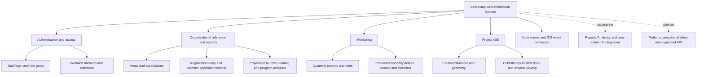
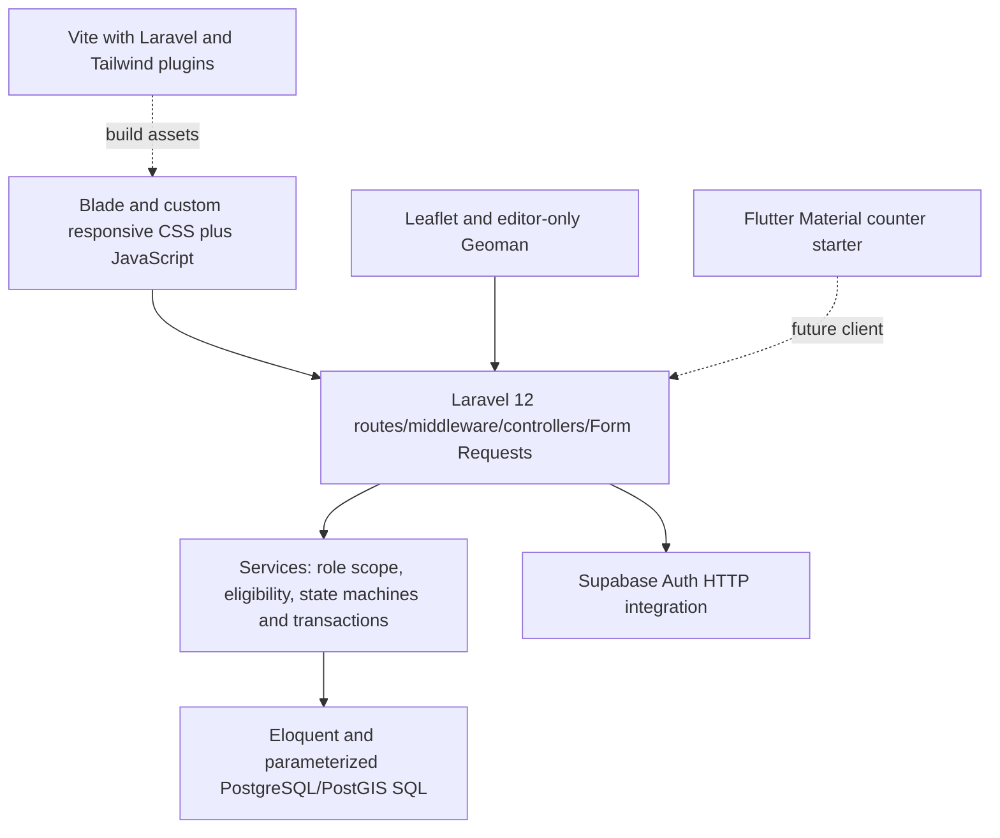

# Capstone 2 Technical Reference Package

Prepared 2026-10-13 from original AssocMap source and the user's supplied outline. **Reference material, not a completed research manuscript or verified deployment/test report.** No approved Capstone 1 manuscript, research instruments, literature list, hardware measurements, Gantt history, UAT results or production evidence was available in inspected locations. An optional manuscript-path clarification is pending; missing material must not be fabricated.

Technical claims use source evidence; research/context supplied by the user is labelled as such. [Architecture](01_PROJECT_ARCHITECTURE.md), [module inventory](02_MODULE_INVENTORY.md), [database dictionary](04_DATABASE_ARCHITECTURE.md), [testing plan](07_TESTING_PLAN.md) and [traceability](09_REQUIREMENTS_TRACEABILITY.md) are supporting preparation materials.

# CHAPTER I — INTRODUCTION

## Rationale of the Study

**Pending approved Capstone 1 foundation.** User-provided context describes a GIS-based organizational/project monitoring Information System. The code demonstrates implemented administrative and monitoring workflows but cannot prove the original organizational problem, severity, beneficiary population, existing process deficiencies or research gap. Reuse approved rationale and cited organizational evidence; do not replace it with inferred claims about speed, accuracy or impact.

## Objectives of the Study

Preserve the approved objectives. The implementation inventory can show which supporting capabilities are source-implemented, partial or absent; it does not authorize new research objectives. Map each official objective to requirements/test IDs in the traceability file once supplied. Current report/mobile/user-admin UI gaps must remain visible.

## Significance of the Study

User-provided intended beneficiaries include System Administrators, Field Officers/CDOs, Association Accounts and public viewers. Source establishes role capabilities, not measured stakeholder benefits. Obtain approved significance text and real participant/organizational evidence before claiming efficiency or decision-quality improvements.

## Flow of the Study

Use the approved research/design flow. Source-supported engineering flow is requirements -> role-specific UI -> validated backend -> relational/spatial data -> scoped presentation -> planned testing/deployment. This is an implementation diagram specification, not an observed research timeline.

## Definition of Terms

- **Association:** organizational record linked to a required Area and primary Field Officer; different from a user profile or an individual official Member.
- **Association Account:** Supabase-linked user profile with an active organizational account link, not automatically an individual member login.
- **Registered Area:** association administrative area reference (areas.address plus barangay/municipality context), not an exact project-site claim.
- **Project Site Address:** optional gis_locations.address entered for a project location; existing source/verification provenance is not recorded.
- **Public GIS fields:** separately supplied title/address/description displayed only for eligible published project locations.
- **Point/boundary geometry:** actual 2D GeoJSON Point, Polygon or MultiPolygon validated/stored with SRID 4326; address text does not create coordinates.
- **Audit event:** actor/action/module/entity/timestamp and optional permitted snapshots; viewer presence does not imply complete event coverage.
- **Source implemented:** handlers/components exist; distinct from syntax/build success, functional acceptance and production readiness.

Definitions are operational source references, not uncited academic definitions. Supply literature citations for theoretical meanings where required.

# CHAPTER II — REVIEW OF RELATED LITERATURE AND STUDIES

## Related Literature

**Pending supplied references and adviser-approved review.** Potential research topics needing authoritative sources include organizational information systems, GIS/spatial databases, program monitoring, access control/auditing, software engineering and usability. No academic citations, authors, findings or publication dates were invented or looked up in this source-only audit.

## Related Studies

**Pending actual related-study material.** Use verified authors/year/objectives/method/results and a justified comparison to AssocMap. Do not treat Laravel starter README links as a scholarly related-study review, or claim AssocMap outperforms another system without measured evidence.

# CHAPTER III — RESEARCH METHODOLOGY

## Software Engineering Methodology

**Approved study methodology unavailable.** The source shows MVC-style Laravel routing, service-layer rules, Form Requests, role middleware, transactional writes and iterative GIS changes. These are implementation techniques, not proof the team followed Agile, Scrum, Waterfall or any documented sprint schedule. Select the methodology only from approved Capstone 1/team records.

## Planning Phase

### Business Model Canvas

Preparation input: source-supported user roles and modules; user-provided organizational monitoring purpose. Key partners, cost/revenue structure, organizational resources, relationships and validated value propositions require stakeholder/approved study evidence. Do not invent commercial revenue or BFAR partnership terms from UI branding.

### Program Workflow Gantt Chart

No actual planned/completed task dates were supplied. Suggested future milestones are approved findings -> targeted patches -> isolated/regression tests -> real integration/Alpha tests -> performance/accessibility -> UAT -> staged installation/restore -> explicit deployment approval. This is a proposed sequence without dates/durations, not the team's historical Gantt chart.

### Functional Decomposition Diagram

Source-supported decomposition specification:

Dashed edges denote incomplete/planned capability, not implemented features. Decomposition must be reconciled with approved module requirements.

## Analysis Phase

### Use-Case Diagram

Preparation inventory (convert to an approved diagram; do not add unsupported actors):

| Actor | Implemented/source use cases | Partial/not implemented |
|---|---|---|
| System Administrator | Sign in/out; manage areas/associations/assignments; optionally record initial documented registration; view registrations; member roster/archive; projects/resources; training/activities; monitoring; project GIS operations; audit viewing | Invitation provisioning API exists but generic form disconnected; generated reports/account lifecycle directory UI incomplete |
| Field Officer/CDO | Sign in/out; review assigned member applications; manage assigned projects/training/activities/monitoring/GIS | No association detail directory route found; reports and organizational Flutter client absent |
| Association Account | Sign in/out; submit/view linked member applications; linked GIS and monitoring read-only views | No Project Details page found; no independent official-member login implementation |
| Public Visitor | Landing content; eligible published project GIS map/list/filter/detail presentation | No private GIS fields, organizational write access or generated public reports |
| Invited recipient | Explicit token verification, password setup, confirmed-context recovery and normal subsequent login | Actual provider email/template/callback workflow unverified |

Use cases need access/failure/precondition rules from the permission matrix; a route/method name alone does not prove successful execution. Current diagram should not promise reports/mobile completion.

### Storyboard Database

Source storyboards are existing login/activation pages, Administrator hash shell, association modal, shared Admin/FO project modal, monitoring dashboard/workspace and GIS editor/workspace. Map each storyboard step to real route/state/error/loading controls. Create genuine user-collected screenshots after approval/testing; none were generated by the agent. No separate FO/Association Account association detail screen or Association Account project screen is established.

## Design Phase

### Entity-Relationship Diagram

Use the source relationship/cardinality notes and core Mermaid ERD in the database report. Full physical drawing must include all 38 business-table declarations, SQL additions, reference catalogue links, actors and optional relationships. Distinguish physical legacy GIS XOR schema from active project-only code. Supabase-managed auth.users structure and deployed schema still need schema-only evidence.

### Data Dictionary

The database report lists **397 CREATE-declared business columns across 38 tables**, plus SQL 002/005 ALTER additions and Laravel infrastructure Blueprint preparation. Include type, PK/FK, nullable/default/check/uniqueness and business meaning. Counts describe source definitions, not live catalog counts. No real member records, addresses or passwords belong in the manuscript appendix.

### Network Design

Logical design: browser <-> Laravel origin; Laravel <-> Supabase Auth over HTTP/TLS and PostgreSQL/PostGIS connection; browser -> OSM tiles; provider -> recipient email. Flutter organizational networking is planned, not implemented. HTTPS, database certificate validation, trusted proxies and private server credentials are required operational decisions, not proven current deployment properties.

### Network Model

The implemented application is a client/server web model with centralized backend validation/scope enforcement and external Auth/database services. A Laravel profile API foundation exists. Do not describe full mobile/offline synchronization, peer-to-peer networks, realtime subscriptions or direct client database access as implemented.

### Network Topology

No physical routers/subnets/server placement, stable production domain or hosting design was verified. The architecture diagram is a logical specification. Quick Tunnel is user-reported development/testing transport; loopback proxy trust in bootstrap is not evidence of production topology. Provide physical/network diagrams only from actual approved infrastructure evidence.

## Implementation Phase

### Technology Stack Diagram

Exact locked versions and constraints are in the architecture inventory. Tailwind dependencies/plugin exist but entry styling is custom imported CSS; Chart.js is not an implemented report dependency. Runtime PHP/Node/Flutter/PostgreSQL/PostGIS versions remain unverified.

### Software Specification

Source requirements: PHP ^8.2 and Composer-managed Laravel; PostgreSQL/PostGIS functions in extensions; persistent session/cache storage for activation; Node compatible with locked Vite engine; JavaScript-capable browser; provider configuration for invitation Auth/email. Flutter SDK must satisfy pubspec Dart constraint before starter verification. Full installed extension/support matrix is pending manual platform checks.

### Hardware Specification

No actual development hardware, server CPU/RAM/storage, client device measurements or approved minimum requirements were supplied. Do not invent hardware specifications or declare a hosting tier adequate. Determine capacity through representative workload, peak memory, database size, retention/backups and browser/mobile tests.

### Program Specification

**Authentication/authorization:** provider identity -> user_profiles/role -> invitation eligibility -> server session -> route/service scope. Every GIS write revalidates actor/current parent assignment in a transaction; read scoping uses the active association link or current FO assignment. Main credential hashing/password policy is provider-managed plus activation request rules, not local UserProfile passwords.

**Association/geography:** association.area_id -> area.barangay_id -> barangay.municipality_id; association.primary_field_officer_id controls current assignment. Registrations are child records of existing associations and agencies, with distinct primary/date/uniqueness rules. No registration approval state is invented.

**Project GIS:** choose Project Point/Boundary -> association lookup displays Registered Area -> choose eligible project -> enter optional verified site address separately -> map click/coordinates or actual polygon/multipolygon -> JSON/FormRequest -> geometry/scope/parent validation -> parameterized spatial write and audit in transaction -> private serializer or eligible published public allowlist. parent_association_id validates the selection but is not a stored duplicate parent column. New records start unpublished; public title/address/description are explicitly supplied. Unpublish keeps the record; hard delete removes only the GIS row, creates minimal retained audit metadata and checks actual DB blockers/replay protection. Legacy association-point data stays untouched and hidden.

**Monitoring:** quarterly project/year/quarter identity, related product/material rows, visits/conductors, monthly detail and income form a normalized hierarchy with services and SQL triggers/checks. Account reads are link-scoped; historical parent predicates differ from GIS and require approved policy interpretation.

**Audit:** GIS produces transactional CREATE/UPDATE/PUBLISH/UNPUBLISH/ARCHIVE events and minimal DELETE GIS metadata. Stage A viewer supports filters/pages and controlled snapshots. Broader producers, database immutability and retention remain incomplete/unverified; don't claim comprehensive traceability.

**Reports:** configuration/preview only. No aggregation/export backend or actual charts; labels and blank values are placeholders. **Mobile:** starter app only; don't describe Android organizational workflows as implemented.

### List of Modules

Use the full module inventory and role matrix, preserving source/partial/UI-only/not-implemented labels. Module completion requires corresponding real test/evidence, not just controller existence.

## Testing Phase

### Unit Testing

Describe actual geometry/serializer and scaffold test methods only after execution. Current preparation lists test source; it does not state passes or coverage percentages.

### Integration Testing

SQLite scope/activation tests and mocked provider tests are useful isolated evidence after execution. Real PostgreSQL triggers/RLS/PostGIS, SMTP/token link, shared stores and browser integration still require separate tests.

### Alpha Testing

Use system workflows/failure cases in the testing plan across real roles and approved sandbox data. Record issues and retest evidence. No Alpha results were supplied.

### Performance Testing

The user observed approximately three-second parent requests; cause unknown. Use Network/server/Auth/DB spans, repetitions and approved thresholds. No p95, throughput, speedup or resource measurements were invented.

### Acceptance Testing

Use approved objectives/scenarios and genuine participants/consent. Actual result columns in the test plan are blank, statuses Not Executed. Do not infer acceptance, satisfaction scores or research impact from static source.

## Deployment Phase

### Software Specification

Use the readiness checklist for runtime dependencies, production env/debug, HTTPS/proxy/cookies, persistent storage, database permissions, provider callback/SMTP and production assets. Effective settings remain pending; no hosting provider was selected or configured.

### Hardware Specification

Pending measured approved infrastructure. Provide capacity/availability/backup requirements only after workload and operational decisions.

### User-Guide

Draft only existing workflows: normal sign-in; recipient invitation verification/password then sign-in; association/registration modal; scoped projects/resources and Location detail; monitoring sections; GIS create/edit/project address/geometry, explicit publication and permanent-deletion confirmation; Admin audit filters. Mark unavailable invite form, reporting/export, mobile features and legacy cleanup as limitations. User-collected screenshots may be added after real verification.

### Installation Guide

Proposed order: approved scope/findings -> dependencies/platform -> private stable keys/settings -> reviewed schema histories/ownership and backup -> persistent stores/provider template/origin -> assets -> staging checks/UAT/restore -> explicit deployment approval. Source scripts are not a one-command production install; composer setup can rotate keys/run forced migrations. No migration/deployment command was executed by the agent.

### Roadmap

1. Resolve named dependency advisories and live configuration/schema evidence.
2. Approve member transition, malformed-input, Auth outage/API-throttle and participant-validation patches.
3. Connect existing invitation UI contract and expand transactional audit coverage/retention.
4. Execute core PostGIS/provider/browser/UAT and restore evidence.
5. Implement approved scoped report definitions/exports and truthful dashboard aggregates.
6. Build approved mobile APIs and Flutter organizational client; verify token handling/devices.
7. Measure scale, then target pagination/query/index changes; separately approve legacy GIS cleanup/provenance design.

These are proposed future tasks, not completed milestones or guaranteed dates.

# CHAPTER IV — SUMMARY, CONCLUSION, RECOMMENDATIONS

## Summary

Source shows substantial role-scoped Laravel organizational/monitoring/project GIS implementation and guarded invitation activation, with partial audit production and clear reporting/mobile/UI gaps. This is the implementation maturity statement; it is not a study-results summary.

## Conclusion

No production-readiness, security certification, successful UAT, measured impact or deployment conclusion can be supported by this static audit. Provide actual testing/research outcomes before writing the manuscript conclusion. Preserve approved Capstone 1 objectives and interpret discrepancies openly.

## Recommendations

Use the prioritized findings, staged test plan, approvals and roadmap. Clearly distinguish implementation, technical checks, functional verification and production readiness in every claim.

# References, Curriculum Vitae and Appendices

- **References:** approved academic bibliography and verified primary technical references are pending. Source paths in this package support implementation claims, not theoretical literature assertions.
- **Curriculum Vitae:** must come from consenting team members; do not infer private personal records from source.
- **Appendices:** may include approved requirements/diagrams, schema-only dictionary, genuine redacted command/test/UAT evidence and actual user-guide screenshots. Never include credentials, password/hash/token values, private records or fake results.

## Substantial-claim evidence register

| Claim | File path and object/function | Direct source evidence | Verification status | Manuscript section |
|---|---|---|---|---|
| Laravel HTTP entry | web/public/index.php; bootstrap/app.php | Autoload/bootstrap/route wiring | Source inspected, not executed | III Architecture/Implementation |
| Exact stack constraints/locks | web/composer.json; web/composer.lock; web/package.json; web/package-lock.json; mobile/pubspec.yaml | Locked versions and constraints | Source verified; installed platform pending | III Software Specification |
| Actual module/role inventory | web/routes/web.php, api.php; handlers listed in module inventory | Role prefixes and real/disabled workflows | Static inventory; functional status pending | III FDD/Use Cases/Modules |
| Normal Auth eligibility | StaffAuthController; EnsureSupabaseAuthenticated; UserProfile::canAccessApplication | Provider lookup, role/profile/invitation gates | Source; real provider/session pending | III Program Specification/Testing |
| Provisioning state machine | UserInvitationService::initiate; UserInvitation constants; SQL 006 | Reservation/claims/inactive profile/uncertain state | Source and test preparation only | III Implementation/Database |
| Activation capability | InvitationActivationContext; ProtectInvitationActivation; auth/invitation-layout.blade.php | Encrypted expiry/fingerprint; fragment/nonce/privacy headers | Source/mocked tests; real links pending | III Implementation/Security Testing |
| Atomic local activation | InvitationActivationService::finish | Profile/link/accepted state transaction | SQLite test source exists, no execution | III Integration Testing |
| Geographic/registration schema | SQL 001/002; Association::registrations; AssociationService::recordRegistration | Area hierarchy, child registrations, constraints, optional transaction | Source; live schema pending | III ERD/Data Dictionary |
| Shared Project Location | GisQueryService::projectLocations; projects/partials/location.blade.php | Scoped multiple addresses, separate area/failure state | Source; browser/DB pending | III Storyboard/Program Specification |
| Project-only GIS reads | GisLocation::TYPES; GisQueryService::scoped | Project types/parent/scope/public predicates across modes | Source/private SQLite tests only | III GIS/Use Cases |
| Geometry validation/storage | GisGeometry::{normalize,validateSpatial}; GisLocationService::{store,update}; SQL validate_gis_location | Actual GeoJSON, 4326, parameterized spatial SQL | Source; actual PostGIS pending | III Database/Implementation |
| Publication/private separation | GisFeatureSerializer::make; GisQueryService::filter/scoped; GIS requests/views | Public allowlist and approved fields separate | Unit test source; live disclosure tests pending | III Security Testing |
| Hard delete/replay | GisLocationService::{destroy,assertDeletionSchema,lockIdentity,store} | Target DELETE, blockers, minimal audit/tombstone | Source; SQL/concurrency pending | III Implementation/Testing |
| Map/dropdown state handling | pages/gis-editor.js; gis-workspace.js; core/gis-api.js | Abort/stale guards, loading/retry, extent/bbox and caps | Source; browser/latency pending | III Performance/Alpha Testing |
| Monitoring structure | MonitoringWorkspaceController; MonitoringService; SQL 003-005 | Scoped quarters/visits/monthly/product/material relationships | Source; DB/UAT pending | III ERD/Program Specification |
| Audit viewer/coverage limit | AuditLogController; AuditLogService; AuditLog; GIS audit inserts | Admin read-only pages; GIS producer; no broader producer calls found | Source; DB retention/runtime pending | III Audit/Testing |
| Report/dashboard gap | reports/index.blade.php; reports.js; routes::admin.dashboard | Disabled generate; placeholder charts; zero counters | Confirmed source gap | III Modules; IV Recommendations |
| Mobile starter only | mobile/lib/main.dart; widget_test.dart | Counter app/test, no API client | Source; tooling not executed | III Modules/Testing/Roadmap |
| Network/deployment unknown | bootstrap proxy config; deployment checklist; user tunnel statement | Loopback proxy trust and proposed boundaries | Source/user context; no hosting proof | III Network/Deployment |
| Test evidence absent | web/tests and phpunit.xml; testing plan | 39 methods, isolated configurations, blank results | Not Executed | III Testing |

## Oral-defense explanations grounded in source

- Why PostGIS? The code stores/query-validates geometry with spatial functions and SRID 4326; text addresses alone cannot provide that geometry. This describes implemented use, not a documented historical technology-selection study.
- Why separate Registered Area/Site/Public Address? Different projects may have different physical sites and public disclosure needs. The source separates reference context, editable private site text and explicitly supplied public fields; legacy provenance remains unknown.
- How are permissions enforced? Provider identity and application eligibility precede exact role gates; services scope by current assignment or active link and revalidate GIS parents during locked transactions. Frontend hiding is not the security boundary.
- What happens on failure? Local multi-write operations use transactions; remote Auth writes cannot be rolled back by SQL, so guarded outcome/recovery states are used. Some ordinary Auth/member paths still need hardening, as documented.
- How was it tested? This audit inspected test source only. Answer with actual user-run artifacts after execution, not claims from this package.

