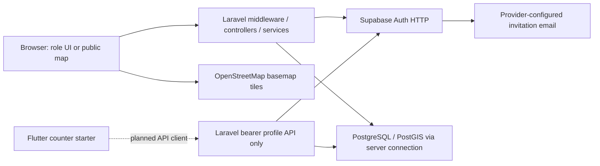

# Capstone 2 Evidence and Traceability Mapping

Assessment date: **2026-10-13 (Asia/Manila)**. This reference supports Chapter III with source evidence; it is not a replacement for approved research objectives, the questionnaire or actual results. The user explicitly confirmed Capstone 1 is unavailable. The official outline headings are available through user-provided context and the earlier technical reference; no approved research manuscript/instrument was found in inspected project locations.

The [earlier technical reference](../production-readiness/08_CAPSTONE2_TECHNICAL_REFERENCE.md) supplies broader outline/dictionary/diagram preparation. This current mapping updates F-005 and narrows overstated Specific Area claims; those earlier reports are not edited here.

## Claim-to-evidence ledger for Chapter III

| Chapter III section | Source-supported material | Exact source/file/object evidence | Current verification status | What must be supplied or verified |
|---|---|---|---|---|
| Software Engineering Methodology / Planning | Incremental architecture and change history are technical context, not a proved research methodology | Earlier reference08; current routes/services and approved F-005 conversation | Methodology unverified | Approved Capstone 1 methodology, actual planning records, BMC/Gantt and project history; do not invent Agile/Waterfall |
| Functional Decomposition Diagram | Auth/roles/invites; geographic/org/member/project/training/activity/Monitoring; GIS/audit; report/mobile missing subfunctions | web/routes/web.php; app/Services; current module inventory03 | Source-supported decomposition | Approved scope and adviser review; distinguish implemented from planned nodes |
| Use-Case Diagram | Admin manages; FO assigned org decisions/GIS; Account own-link submit/read; Public published map | web/routes/web.php; EnsureRole; service role predicates; module inventory03 | Source-supported actor/actions | Actual role tests; no unsupported account/admin workflows |
| Storyboard / interface | Existing Blade forms/dialogs/workspaces and source screenshots plan | web/resources/views/{dashboard,association,field-officer,gis-editor,gis-workspace,monitoring,admin}; resources/js | Source-supported files only | Genuine user-taken screenshots and device/navigation testing; no fabricated screens |
| ERD | Hierarchy, association assignment/link, member application->member, project resources/Monitoring, GIS/audit | supabase/migrations/001_assocmap_schema.sql; SQL 003/005/006; Laravel infra migrations | Local SQL definitions only | Schema-only deployed reconciliation, cardinality and trigger proof |
| Data Dictionary | 38 business CREATE TABLE definitions and later ALTER additions; full prior dictionary preparation | docs/production-readiness/04_DATABASE_ARCHITECTURE.md; SQL 001–007 | Source-prepared, not actual catalog | Actual deployed types/constraints/grants; approved field limits including QA-010 |
| Network Model | Browser -> Laravel -> PostgreSQL/PostGIS and provider Auth; browser -> OSM; Flutter client planned | web/public/index.php; SupabaseAuthService; config/database.php; gis-map.js; mobile/lib/main.dart | Logical/source-supported | Real host/provider regions/proxy/TLS/network routes and operator approval |
| Network Topology | No actual physical topology/hardware evidence | bootstrap/app.php loopback proxy trust; user reports development Quick Tunnel | Unknown physical deployment | Verified hosting/network/hardware diagram; don't infer topology from Windows paths |
| Technology Stack Diagram | Laravel/PHP/Blade/Vite/Leaflet/Geoman/PostGIS/Auth; Flutter counter | web/composer.json/lock; package.json/lock; mobile/pubspec.yaml; SQL 001 extensions | Source-supported locked versions/constraints | Installed platform/toolchain versions; actual diagrams clearly mark planned mobile/report features |
| Software Specification | PHP ^8.2; Laravel 12.69.2; Leaflet 1.9.4; Geoman 2.20.2; Vite 7.3.6; Node engine; Dart SDK constraint | web/composer.lock; package-lock.json; node_modules/vite/package.json::engines; mobile/pubspec.yaml | Source only | Personal version/platform/build checks; don't claim actual runtime version from manifest |
| Hardware Specification | Requirements must be measured for approved capacity | Current unbounded/bounded query patterns; no machine profiling read | Pending | Actual development/server/mobile devices and memory/CPU/storage/network/backup capacity |
| Program Specification | Input->middleware->request->service->SQL->response, roles, geometry, transactions and state recovery | web/app/Http/Controllers; Requests; Services; current security04/performance05 | Source-supported descriptions | Real success/failure/status/rollback traces tied to current source |
| List of Modules |23 scoped groups with implemented/partial/UI-only/missing boundaries | Current module inventory03 and exact source paths | Source inventory | Approved official module/objective mapping, no completion percentages |
| Unit Testing | Existing geometry/serializer/scaffold source | web/tests/Unit/{GisGeometryTest,GisFeatureSerializerTest,ExampleTest}.php | Not Executed | Actual run outputs; parameterized case counts only if observed |
| Integration Testing | Isolated activation/scoped-read/provider fixtures; F-005 needs PostgreSQL proof | web/tests/Feature/{InvitationActivationServiceTest,SupabaseInvitationAuthTest,GisScopedReadsTest}.php; MemberApplicationService | Not Executed | Real PostgreSQL/PostGIS/provider/permissions/SMTP and rollback/concurrency evidence |
| Alpha Testing | Internal end-to-end plan, no observed results | Verification plan10; prototype script06 | Not Executed | Actual current-source developer/tester task sessions and defect records |
| Performance Testing | Source bounds plus user-observed ~3s lookup with unknown attribution | GisQueryService; EnsureSupabaseAuthenticated; performance report05 | Measurement attribution pending | Redacted stage timings/query plans/memory/network/render/capacity with accepted thresholds |
| Acceptance Testing | Approved research instrument unavailable; no participant results | Current ISO matrix02; verification plan10; user confirmation | Not Executed; edition unknown | Adviser-approved instrument/edition, consented participants, genuine outcomes and analysis |
| Deployment Requirements / Installation Guide | Readiness/platform/schema/store/callback/recovery gates | Production report07; earlier06; source config/manifests/migrations | Planning only; no deployment | Tested staging runbook/restore/release artifacts and operator sign-off |
| Roadmap | Ranked proposals and pending verification | Findings09; module03; readiness06/07 | Proposed only | Separate approval and implementation evidence for each consequential step |

Grouped paths are relative to C:/dev/AssocMap; app/resources/config/SQL suffixes refer to web or supabase directories explicitly identified. Full canonical inventory is in health check01.

## Source-supported logical model — not physical topology

No deployed topology or successful network exchanges were observed. HTTPS is a deployment requirement, not an inferred actual connection result. A counter app has no implemented link to the backend despite the planned dashed edge.

## ERD/FDD preparation boundaries

SQL 001 plus003/005/006 define 38 business tables: geographic hierarchy and registrations, identity/roles/association links, member applications and classification pivots, SAAD/project/training/activity records, Monitoring periods/resources/income/visits/monthly rows, GIS and audit. Laravel infrastructure tables form a separate layer. PostgreSQL auth.users is provider-managed; its complete schema was not supplied.

An association has an area and current primary FO; its account link is independently active. Projects belong to associations; GIS currently belongs to projects (legacy SQL permits association points but current source excludes them). Monitoring resources reference project product/material IDs with same-project/period rules. Members optionally uniquely reference a source application. Audit entity_type/entity_id is a polymorphic historical text reference, not an FK to a deleted GIS record. actor_user_id can become null on profile deletion. These exact relationships and deliberate snapshot denormalization should be described without claiming formal normal-form certification.

Source: SQL 001 associations/association_accounts/member_applications/members/projects/Monitoring/gis_locations/audit_logs; SQL 003 monitoring_visit_reports; SQL 005 monitoring_production_monthly and conductor ALTER additions; SQL 006 user_invitations. The existing dictionary lists CREATE columns plus separate ALTER additions; do not mistake a CREATE-only count for the complete deployed schema.

## Requirements-to-implementation-to-test matrix

These are **working technical IDs**, not fabricated official Capstone 1 IDs. Authority distinguishes user context from source-inferred behavior; formal objectives and module completeness await approved research material. All outcome cells below are deliberately blank.

| Working requirement ID | Capability | Requirement authority | Exact implementation evidence | Implementation status | Verification case IDs | Open finding/evidence | Capstone 2 section | Actual test outcome |
|---|---|---|---|---|---|---|---|---|
| R-AUTH-01 | Eligible role authentication | Current user scope/source; approved manuscript ID pending | web/app/Http/Controllers/Auth/StaffAuthController.php::store/destroy; web/app/Models/UserProfile.php::canAccessApplication; middleware EnsureSupabaseAuthenticated/EnsureRole | Implemented in source | AUTH-01/02; ROLE-01 | QA-001/002/003/013/018 | Use Cases / Program Specification / Security Testing |  |
| R-AUTH-02 | Administrator invitation provisioning | Existing Stage1/2 context/source; approved objective mapping pending | web/app/Services/UserInvitationService.php::initiate; web/routes/web.php::admin.user-invitations.store; web/resources/views/admin/shared/form.blade.php | Backend present; form disconnected | INV-01/02; UI-01 | QA-006/004/002 | Program Specification / Integration Testing / User Guide |  |
| R-AUTH-03 | Recipient activation and recovery | Existing explicit invitation workflow/source | web/app/Services/InvitationActivationService.php::{claimPassword,finish}; InvitationActivationContext.php; web/app/Http/Controllers/Auth/InvitationActivationController.php | Implemented in source; provider/SQLite mocked tests only | INV-01/02; AUTH-02 | QA-001/003/004/013 | Implementation / Integration Testing |  |
| R-ORG-01 | Geographic hierarchy and assignment | Current user module context; approved geographic scope pending | web/app/Services/{MunicipalityService,BarangayService,AreaService,AssociationService}.php; web/routes/web.php; SQL 001 municipalities/barangays/areas/associations; SQL 002 locality_type | Municipality/Barangay management and Specific Area create/reference; city/Specific Area CRUD limits | AREA-01; ORG-01; DB-01 | QA-023/015 | FDD / ERD / Data Dictionary / List of Modules |  |
| R-ORG-02 | Association registration | Prior explicit registration task and existing SQL table | web/app/Services/AssociationService.php::recordRegistration; web/app/Models/{AssociationRegistration,RegistrationAgency}.php; SQL 001 association_registrations | Optional single initial entry and multi-record viewing; no general approval/history CRUD | ORG-02; DB-01 | QA-002; approved scope pending | ERD / Program Specification / Testing |  |
| R-MEM-01 | Own account submission/current FO decision | Existing routed organizational workflow | web/app/Services/MemberApplicationService.php::{submit,approve,reject}; member controllers; SQL 001 member_applications/members/classification pivots | Implemented; F-005 source-addressed; input limits differ | MEM-01/02/03/04; ROLE-01 | QA-009/010; F-005 runtime pending | Use Cases / Program Specification / Integration Testing |  |
| R-MEM-02 | Official roster/lifecycle | Existing roster route/source; direct CRUD scope pending | web/app/Http/Controllers/Admin/MemberController.php::index/archive/unarchive; web/app/Services/MemberService.php; web/routes/web.php | Directory/archive/restore routed; create/update methods unrouted | MEM-01/03; ROLE-01 | QA-009/015; no full direct CRUD claim | Modules / Program Specification |  |
| R-PRJ-01 | Project/resources and history | Current module context and ProjectService history rules | web/app/Services/ProjectService.php::{create,update,syncMaterials,syncProducts}; SQL 001 projects/project_materials/project_products | Implemented in source; history/concurrency tests missing | PRJ-01; MON-02; ROLE-01 | QA-001/015/024 | FDD / ERD / Implementation / Testing |  |
| R-PRJ-02 | Distinct site and Registered Area | Prior explicit address refinement context | web/app/Services/GisQueryService.php::projectLocations; GisAddressResolver.php; web/resources/views/projects/partials/location.blade.php; gis-editor.blade.php | Implemented for existing Admin/FO project modal; provenance not stored | PRJ-01; GIS-01/03 | QA-015; physical accuracy pending | Storyboard / Program Specification |  |
| R-TRN-01 | Eligible training/participants | Current module/source/SQL active-member rule | web/app/Services/TrainingService.php::validateParticipants; SQL 001 validate_training_participant_association | Implemented; inactive prevalidation mismatch | TRN-01; ROLE-01; DB-01 | QA-012 | Modules / Validation / Integration Testing |  |
| R-ACT-01 | Program activity recording | Current module/source role rules | web/app/Services/ProgramActivityService.php; SQL 001 program_activity_records; Laravel status migration2026_10_05_102947 | Implemented; ongoing constraint deployment unknown | ACT-01; ROLE-01; DB-01 | QA-002 | ERD / Program Specification / Installation |  |
| R-MON-01 | Monitoring periods/sections/history | Current Monitoring module/source rules | web/app/Services/MonitoringService.php::{create,updateSection,createVisitReport,syncMonthlyDetails}; web/app/Http/Controllers/MonitoringWorkspaceController.php; SQL 003–005 | Implemented in source; real PostgreSQL guards unverified | MON-01/02; ROLE-01; DB-01 | QA-002/015/021/024 | ERD / Modules / Integration Testing |  |
| R-GIS-01 | Project Point and Project Boundary geometry | Current explicit project-only source context; earlier Association Point requirement needs reconciliation | web/app/Models/GisLocation.php::TYPES; web/app/Services/GisGeometry.php; SQL 001 gis_locations/validate_gis_location | Implemented two project types; legacy association points retained/hidden | GIS-01/04/06; DB-01 | QA-020; no live geometry result | Use Cases / ERD / Program Specification |  |
| R-GIS-02 | Scoped/private versus published public | Current explicit GIS role/public requirements | web/app/Services/GisQueryService.php::{scoped,applyRoleScope}; GisFeatureSerializer.php::make; web/routes/web.php::GIS groups | Implemented allowlist/eligibility/assignment/link predicates | GIS-02; ROLE-01; DB-01 | QA-001/002/021 | Security / Use Cases / Testing |  |
| R-GIS-03 | Create/edit/publish/unpublish/archive/delete | Explicit prior GIS lifecycle requirements and existing implementation | web/app/Services/GisLocationService.php::{store,update,lifecycle,destroy}; DeleteGisLocationRequest; SQL 001 gis_locations/audit_logs | Source implemented; actual delete dependency/grant/rollback unknown | GIS-01/05; AUD-02; DB-01 | QA-005; retained deletion-event policy | Program Specification / Integration Testing |  |
| R-GIS-04 | Async parent/mode/loading behavior | Explicit prior dropdown/Geoman correction tasks | web/resources/js/pages/gis-editor.js::{loadProjects,loadAssociations,stopGeometryModes,updateMode}; web/resources/js/core/gis-api.js | Source guards present; browser timing/console outcomes unknown | GIS-03/04; PERF-01; UI-01 | QA-013/019; user-observed timing only | Interaction / Performance / Alpha Testing |  |
| R-AUD-01 | Audit viewing and comprehensive coverage | Stage A requirement and current audit task | web/app/Http/Controllers/Admin/AuditLogController.php; web/app/Services/AuditLogService.php; GisLocationService.php; SQL 001 audit_logs | Real viewer/GIS producers; non-GIS writers and DB append-only contract absent/unverified | AUD-01/02; DB-01 | QA-004/005 | Accountability / Modules / Testing |  |
| R-REP-01 | Reports/Analytics/export | Current module/user task; formulas/FO scope require approval | web/resources/views/admin/reports/index.blade.php; web/resources/js/pages/admin/reports.js; web/routes/web.php | Placeholder/UI-only; backend missing | REP-01/02 after approved implementation | QA-007/016 | FDD / Modules / Roadmap / Acceptance |  |
| R-API-01 | Authenticated API foundation | Actual source contract; broader mobile APIs planned | web/routes/api.php; web/app/Http/Controllers/Api/V1/MeController.php; EnsureSupabaseApiAuthenticated.php | Own profile only; separate Sanctum scaffold; application limiter missing | API-01/02; ROLE-01 | QA-014/017/018 | Architecture / Program Specification |  |
| R-MOB-01 | Android organizational workflows | User planned mobile module; no approved detailed workflow supplied | mobile/lib/main.dart; mobile/pubspec.yaml; mobile/test/widget_test.dart | Counter starter; business workflows missing | MOB-01; API-01 | QA-017 | Stack / Modules / Roadmap |  |
| R-DEP-01 | Secure reproducible operation | Current production-quality audit requirement | web/config/{app,session,database,logging}.php; bootstrap/app.php; composer.json; package-lock.json; SQL 001–007 | Source/config planning only; effective runtime/recovery/advisories unknown | TECH-01; DEP-01; DB-01; OPS-01/02; DEPLOY-01 | QA-001/002/003/008/015/019 | Deployment Requirements / Performance / Installation |  |
| R-DOC-01 | Approved ISO/research/test evidence | User-supplied Capstone outline; manuscript unavailable per user | docs/production-readiness/08_CAPSTONE2_TECHNICAL_REFERENCE.md; 09_REQUIREMENTS_TRACEABILITY.md; current docs/quality-audit/02 and10; no approved questionnaire found | Working technical mapping only; no official IDs/results/scores | DOC-01; UAT-01 | QA-022 | Methodology / Alpha / Performance / Acceptance |  |

## Evidence discipline and remaining inputs

Supply the approved manuscript, scope/ERD/data dictionary revisions, evaluation questionnaire/edition, participant/alpha/acceptance evidence, actual development methodology/Gantt, hardware/network inventory, current-source technical outputs and deployed schema/privilege/backup proof. Literature/organizational claims require real sources and adviser-approved wording; no academic findings or citations are fabricated.

ISO/IEC 25010:2023 is the requested technical lens, with official publication metadata checked in report02. No scores, compliance percentages, certification, measured usability or acceptance results are inferred. If the approved instrument uses2011/eight characteristics, preserve its identity and obtain adviser approval for any amendments. F-005 can presently be defended as a transaction/row-lock implementation, not a tested concurrency success.

