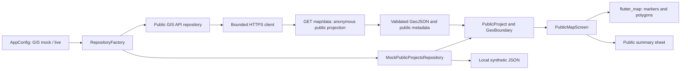

# Mobile architecture — demo foundation and optional public GIS API

## Scope and authority

Desktop 2 owns this Flutter presentation layer. Desktop 1 owns Laravel, authentication,
authorization, business rules, database constraints, and private storage. The two
desktops and Codex accounts do not share state automatically.

Confirmed by the supplied request: public welcome, unauthenticated GIS access,
synthetic locations/boundaries, search/filtering, summaries, and repository replacement.
The initial mobile inspection had no supplied manuscript, Appendix N, branding assets
or backend contract. Current Laravel reference source now documents public GIS and
identity contracts. Phase 3 authorizes demo authentication and minimal protected
navigation; other association modules remain provisional. The approved public GIS
adapter is now implemented in source; current analysis,
tests, backend connectivity and devices are unverified. Backend authentication source
was inspected separately in Phase 3; see [authentication findings](phase-3-authentication.md).

## Structure

| Directory | Responsibility |
| --- | --- |
| `lib/app` | Application composition, compile-time mode, routes, Material theme |
| `lib/core` | Safe failures, bounded public HTTP client, feedback, auth controller and guard |
| `lib/data/models` | Public DTOs/WGS84 parsing, normalized session, existing profile-response parser |
| `lib/data/repositories` | Public/authentication interfaces and central selection |
| `lib/data/mock` | Local synthetic asset loader and demo authentication |
| `lib/data/remote` | Public GIS overview/viewport adapter; authentication remains blocked |
| `lib/features/welcome` | Public landing and navigation entry points |
| `lib/features/public_map` | Search/filter state, geographic layers, public details |
| `lib/features/account` | Login, role/link denial screens, Workspace/Account shell |
| `assets/mock` | Synthetic fixture document, separate from organizational records |

Screens receive `PublicProjectsRepository` by constructor injection. Screens never
read JSON assets or call HTTP directly. `RepositoryFactory` selects the data source
once. Flutter `StatefulWidget`/`setState` manages local search, category, and selection;
`FutureBuilder` manages map loading. An app-owned `AuthController`/`ChangeNotifier`
manages demo session state; `ListenableBuilder` guards protected content. No additional
state-management dependency is used. Repository selection remains centralized.

## Navigation

- `/`: public welcome.
- `/public-map`: public map; no token or session prerequisite.
- `/association-access`: guarded sign-in/association navigation entry.
- `/association-home`: same reactive guard; signed-out direct access shows login.
- Unknown routes: page-unavailable screen; no invented protected dashboard.

An in-memory DEMO session and protected UI routes now exist. Public routes remain
accessible regardless of session state. There is no real authentication, provider
token, secure token store, or protected API integration. Actual Association Account
business modules remain pending.

## Public GIS data flow

User opens the map → screen requests public projects through the interface → mock
repository reads the bundled asset → parser constructs immutable public DTOs → map
converts coordinates to `LatLng` → marker selection opens a public summary sheet.
Search and category filters update the marker layer, boundary layer, and list together.
No backend or database participates in mock mode. In live mode, submitted searches
request public overview then map data; Search this view queries the current bbox.
Laravel scopes published PostgreSQL/PostGIS geometry and returns public GeoJSON.
The adapter validates the complete response, then maps only actual public fields.
See [the current contract and limits](public-gis-integration.md).

`PublicProject` holds an opaque public/demo ID, title, association display name,
category, broad area label, summary, location and boundary. Association/category/address
and point are now optional for live presentation; a boundary does not imply a marker. These are mobile
presentation fields, not verified database columns or Laravel response keys.
`fromFixture` is deliberately named to avoid implying a backend response contract.

GeoJSON positions are `[longitude, latitude]`. The parser converts them to typed
latitude/longitude values. Polygon exteriors, interior holes, and all MultiPolygon
parts are preserved. It rejects empty geometry, unsupported types, out-of-range or
non-finite coordinates, unclosed rings, and rings with fewer than three distinct vertices.
This is structural validation, not a topology engine: self-intersection, hole containment,
CRS transformation, and authoritative spatial validation remain backend responsibilities.

Mock mode uses a local geographic graticule; live mode uses a neutral background.
Neither requests external tiles. It has pan/zoom, fit
controls, selectable markers, a boundary toggle, and phone/tablet arrangements. Mock coordinates are synthetic; live coordinates come only from the configured
public endpoint. Polygons can also be selected through layer hit detection. Numerical
coordinates are not presented as text in public details. The mock map is not suitable for navigation, surveying or confirmation of actual locations.

## Publication and privacy

The synthetic fixture's `demoVisibility` models public, draft, and archived scenarios.
Only `published` samples are returned by the mock repository. This does not establish
a Laravel publication predicate. The adapter consumes the inspected server's anonymous public projection;
deployed publication behavior is still unverified. Private fields are not presentation inputs; private responses must never be downloaded and filtered into a
public view. Backend publication and association scoping remain authoritative.

No real personal records, applicant photos, precise private addresses, actor IDs,
privileged keys, or genuine credentials are bundled. The deliberately public synthetic
demo identities/password are not organizational credentials. All fixture contents are extractable from a mobile
binary; hidden mock samples are synthetic and are not a secrecy mechanism.

## Mode selection and error handling

ASSOCMAP_GIS_MODE=mock|live selects GIS independently of existing authentication
ASSOCMAP_DATA_MODE=mock|api. Omitted GIS configuration inherits mock→mock or api→live
for compatibility. Unknown values fail closed. Factory selection is explicit and
there is no automatic fallback. Separate GIS banners identify its configured source.

The bounded public client uses approved HTTPS base configuration and GET /map/data
only, with Accept JSON and no added authorization/cookie headers. It disables
redirects, applies a 15-second header/body timeout and 3 MiB response limit, closes
owned clients and uses safe messages for invalid JSON/fields, transport/HTTP failures
and throttling. Empty viewport results retain the requested extent; truncation remains
visible. Auth/provider/session behavior remains unchanged and unintegrated.

New fake HTTP/model/widget tests are authored but unexecuted. Neither these tests nor
the earlier demo pass prove deployed publication, database topology or device readiness.

Repository futures receive an immediate error handler while remaining available to
`FutureBuilder`. This prevents a fast retry failure from becoming an unhandled exception
between the button tap and the next UI frame; the error screen still receives the failure.

## Packages and deployment decisions

`flutter_map` 8.3.2 supplies geographic projection, gestures, markers, and polygon/hole
rendering; `latlong2` 0.10.1 supplies its coordinate type. The map package declares
Dart >=3.6.0 <4.0.0 and Flutter >=3.27.0, compatible with the inspected SDK. Dependencies
were resolved in earlier phases; http 1.6.0 is now declared directly. The current
lockfile marks it direct, but no dependency verification command was executed by
Codex in this task. Platform builds and devices require separate verification.

References: [package requirements](https://github.com/fleaflet/flutter_map/blob/v8.3.2/pubspec.yaml),
[polygon layer](https://docs.fleaflet.dev/layers/polygon-layer).

No OSM tile layer, tile downloads, third-party requests, Google Maps keys, or location
permissions are implemented. For a future street basemap, approve a provider, attribution,
usage limits, identifying User-Agent where appropriate, cache behavior, outage UX, and
production availability first. OSM public tiles are not a production availability guarantee;
see [provider guidance](https://docs.fleaflet.dev/tile-servers/using-openstreetmap-direct).

Do not deploy the prototype as production. Demo authentication now checks `kReleaseMode`
and is blocked in release builds; release-build/device verification remains unexecuted.
No authentication dependency or package was added in Phase 3.

## Oral-defense prompts

1. Why use repository interfaces? They allow a verified Laravel adapter to replace local
   fixtures while keeping screens and public presentation models stable.
2. Why is the map public? The requirement explicitly permits public project information
   before login; association operations require a separate authenticated contract.
3. Why not call Supabase directly? Business operations and server authorization belong
   to Laravel; privileged database/storage credentials must not enter Flutter.
4. How are boundaries handled? GeoJSON exterior/interior rings are preserved, and each
   MultiPolygon part becomes a separate geographic polygon.
5. What is verified? Consult the phase status. Automated widget tests do not prove device
   readiness, organizational correctness, backend integration, or stakeholder acceptance.
6. Who enforces executive uniqueness? Laravel/PostgreSQL, not this mobile presentation
   layer. No application-submission or uniqueness enforcement is implemented here.
