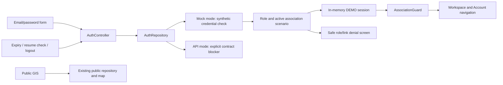

# Phase 3 — Association Account mobile authentication

**Historical Phase 3 snapshot.** The subsequent read-only readiness audit found that
`/api/v1/me` now includes mobile eligibility and association context. Its former
missing-context blocker is resolved in backend source, with deployment still unverified.
See [current readiness findings](friday-prototype-readiness.md) for the updated contract
and remaining Flutter/token-lifecycle work. The findings below record the earlier inspection.

Inspection date: 2026-10-14 (Asia/Manila). Desktop 1 backend files were read-only
references for this task. They may be copied or stale relative to Desktop 1 or deployment.
No environment files, credentials, live Supabase project, organizational records,
database commands, web tests, or Git operations were accessed/run.

## Phase 3A — source findings

**The inspected backend has bearer identity verification, but does not yet provide
the complete mobile association eligibility and token-lifecycle contract.**

| Evidence | Source behavior | Verification limit |
| --- | --- | --- |
| `web/routes/api.php`, `web/bootstrap/app.php` | `GET /api/v1/me` uses `supabase.api.auth`; API routes are registered | Source verified, deployed route not contacted |
| `EnsureSupabaseApiAuthenticated.php` | Reads `Authorization: Bearer <access-token>`; calls Supabase identity verification; loads `UserProfile` by verified provider ID | No local JWKS/token-validation implementation inferred; provider call/runtime unverified |
| `SupabaseAuthService::getUser` | Calls `GET <configured Supabase URL>/auth/v1/user` with publishable-key header and bearer token | Configuration values deliberately not inspected |
| `MeController.php` | Returns own profile ID, display name, role code/name, and profile `is_active` | No association/link/mobile eligibility returned |
| `UserProfile::canAccessApplication` | Requires active profile and active role; checks verified identity and invitation eligibility; database query failure denies access | Exact deployed invitations/schema and behavior unverified |
| `StaffAuthController::store`, `StaffLoginRequest` | Browser `POST /login`: email required/valid/max 255, password required/string; provider password grant; Laravel session regeneration and token storage; redirects by role | Browser web/CSRF/session flow, not a JSON mobile-login contract |
| `SupabaseAuthService::signIn` | Server calls `POST <Supabase URL>/auth/v1/token?grant_type=password` with email/password JSON and publishable key | Does not establish approval/configuration for a Flutter provider client |
| `StaffAuthController::destroy` | Browser `POST /logout` invalidates Laravel session and regenerates CSRF token | Does not revoke provider access/refresh tokens |
| `web/routes/api.php` | Separate `GET /api/user` scaffold uses `auth:sanctum` | No Sanctum issuance/role-link contract verified; not interchangeable with Supabase bearer auth |

The actual `/api/v1/me` JSON shape in source is:

```json
{
  "data": {
    "id": "<profile UUID>",
    "display_name": "<authorized user's display name>",
    "role": {"code": "<application role code>", "name": "<role name>"},
    "is_active": true
  }
}
```

Request: GET, no request body, bearer token required. An `Accept: application/json`
header is appropriate for a future client. Source middleware responses:

- 401 `{ "message": "Unauthenticated." }` when the bearer token is missing.
- 401 `{ "message": "Invalid or expired access token." }` when provider identity is unavailable.
- 403 `{ "message": "AssocMap user profile not found." }` when no application profile exists.
- 403 `{ "message": "This AssocMap account or role is unavailable." }` when application eligibility fails.

Admin and Field Officer profiles are not excluded by this endpoint; an unlinked
Association Account can also receive its profile if otherwise eligible. There is
no association-context enforcement in this controller. Transport failures in the
provider helper do not have a verified mobile-specific outage response contract.

No mobile login, refresh, or logout route was found in `routes/api.php`, nor a
provider refresh/revocation implementation in the inspected authentication service.
Refresh-token fields in invitation/password handling do not constitute a refresh flow.

## Association linkage and eligibility

SQL 001 defines `user_profiles.id` as a PK/FK to `auth.users.id`, `role_id` as a FK to
`roles`, and active flags on both. `association_accounts` has unique `user_id` and
`association_id` FKs and its own `is_active`; an association has active/inactive
`status` and `archived_at`. The role-validation trigger requires an active profile
and role with code `association_account`. SQL presence is not proof it is deployed.

`UserProfile::associationAccount` is a `HasOne` relation. The Association Account
member-application controller/service uses the current user's active link and scopes
applications by association and submitter. GIS queries additionally constrain parents
to active/unarchived associations and scope Association Accounts through an active
link. These rules are not uniform proof that web login or `/me` checks every association
lifecycle condition. Desktop 1 must define a shared mobile eligibility contract rather
than Flutter inferring eligibility from unrelated module responses.

The Phase 3 request explicitly requires Association Account-only mobile access and
an active valid link. The demo additionally models inactive/archived associations,
disabled profiles, and disabled roles as denied scenarios; these are not new database rules.

## Phase 3B — implemented mobile behavior

`AuthRepository` separates authentication from screens. `RepositoryFactory` selects
`DemoAuthRepository` in mock mode and an explicit `ApiAuthRepository` blocker in API
mode. The API implementation makes no requests and offers no demo identities.
`LaravelMeProfile` parses only the existing source-verified response. It cannot produce
an `AuthSession` or authorize an association from missing linkage fields.

`AuthController` uses Flutter `ChangeNotifier`; no state-management or authentication
packages were added. It stores an immutable normalized session in memory, checks the
expected data mode, expiry, profile/role status, Association Account role, and valid
association context. This normalized model is not a fabricated backend JSON schema.
Only a future verified repository adapter may construct a real authorized session.



Flow: user chooses/fills a synthetic identity → form validates email and required
password → repository checks demo credentials → controller evaluates access → guard
shows the account shell or denial/login state. There is no backend or database operation.
Demo role/link information is evaluated only after the supplied synthetic credentials
match. Invalid credentials have one generic error, not a registration/role lookup result.

Both `/association-access` and `/association-home` use the reactive guard. A direct
protected route cannot reveal the shell when signed out. The shell has Workspace and
Account navigation, the linked synthetic association name, and accurate pending-module
information. It contains no association statistics, roster, applications, or uploads.
Public welcome and GIS routes do not require any session.

### Demo access

Debug/development mock mode only. Use **Fill demo credentials** or select a synthetic
scenario, then fill and sign in. Password: `DemoOnly!2026` (deliberately public and synthetic).

| Email | Scenario |
| --- | --- |
| `association@demo.invalid` | Valid Association Account |
| `admin@demo.invalid` | Administrator denial |
| `officer@demo.invalid` | Field Officer denial |
| `unlinked@demo.invalid` | No association link |
| `inactive-link@demo.invalid` | Link disabled |
| `inactive-association@demo.invalid` | Association inactive |
| `archived@demo.invalid` | Association archived |
| `disabled@demo.invalid` | Profile disabled |
| `disabled-role@demo.invalid` | Role disabled |
| `unavailable@demo.invalid` | Simulated authentication outage |

Sessions last 15 minutes, end on logout/restart, and never persist. Account has a
**Simulate session expiry** control. The expiry timer and app-resume check remove
protected content. These simulate lifecycle UX; they do not verify Supabase expiry.

### Security and failure handling

- Demo authentication is blocked by `kReleaseMode`. The explicit blocked-demo test
  exercises equivalent disabled behavior; no release build has been executed.
- Demo options and password hints are unavailable in API mode. The controller also
  rejects a demo session from an incorrectly injected repository in API mode.
- Password input is masked, offers an explicit visibility toggle, disables suggestions,
  and clears after submission/disposal. Passwords are never trimmed or persisted.
  This is logical field clearing, not a claim of cryptographic memory zeroization.
- Repeated submissions are blocked. Operation generation checks ignore late results
  after logout, cancellation, or disposal, preventing stale login from restoring UI access.
- Logout clears local access immediately and removes protected routes before returning
  to public GIS. It makes no claim of provider revocation; no provider tokens exist here.
- Exceptions are mapped to fixed user-safe messages; no credential logging or raw
  provider diagnostic display. An unavailable service offers retry with fresh password entry.
- No private keys, real credentials, HTTP login, secure token store, refresh token,
  independent user database, or Supabase SDK is implemented.
- UI guards do not enforce server data access. Future protected APIs must derive the
  association from the verified actor and reject client-selected cross-association scope.

## Phase 3C — actual blocker and Desktop 1 handoff

Real authentication is **not integrated**. `/api/v1/me` is a useful identity boundary,
but its response is insufficient to grant Association Account-specific mobile access.
Do not fill missing association fields using demo records, a user-entered association
ID, JWT metadata, local role assumptions, or a direct Supabase database query.

Desktop 1 must:

1. Confirm the mobile token acquisition architecture: an approved Supabase public-client
   flow plus Laravel bearer verification, or a defined Laravel mobile broker. A new
   Laravel login route is not automatically necessary; do not create one solely because
   the web login uses sessions. No proposed new route is implemented in Flutter.
2. Extend the existing `/api/v1/me` contract or supply a separately approved eligibility
   endpoint. The server must report mobile eligibility and the valid linked association,
   deriving it from the verified user, profile/role/invitation state, active link, and
   approved association lifecycle rules. Return only permitted identifiers/labels.
3. Document post-authentication denial semantics for non-Association roles and missing,
   inactive, archived, or invalid links. Exact new field names/error codes require approval;
   they are not implied by the current parser. Do not expose registration or role details
   before credential verification.
4. Enforce the same role/link rules on every protected mobile business endpoint. A
   context response or Flutter guard alone is insufficient. Revalidate current linkage;
   do not trust a submitted association ID as authorization.
5. Define access/refresh expiry, rotation/concurrent refresh, revoked/disabled-account
   behavior, local versus provider/global logout, safe denial cleanup, and transient
   outage/429/timeout responses. Web logout currently proves only local session invalidation.
6. Supply sanitized schemas/examples and approved public client configuration via a
   suitable channel, never service-role/secret keys. Approve secure token storage and
   HTTP/provider packages only after the architecture is agreed.
7. Separately authorize integration against an isolated test project with synthetic
   accounts. Verify valid and denied roles/links, stale/reassigned links, provider expiry,
   logout/revocation, malformed responses, no fallback, and cross-association rejection.

Applicant-photo storage is not an authentication prerequisite and remains outside this
phase. No migrations or backend modifications were performed.

## Verification and next phase

Tests are authored for valid/invalid demo credentials, both denied staff roles,
missing/inactive links, inactive/archived associations, disabled profile/role, direct
protected routes, logout, expiry, delayed-result concurrency, API isolation/blocking,
source-verified profile parsing, input validation, password display, and responsive
layouts. Public GIS tests remain regression coverage. Execution results are recorded
in development-status.md after completion; test source alone is not a pass.

Device launches/builds, real authentication, production release verification,
backend integration, and UAT are not verified. Next: Desktop 1 contract review,
approved mobile module confirmation, then authorized integration or a separately
approved functional module phase. Do not start photo/application work automatically.

## Capstone defense questions

1. Authentication versus authorization? Supabase verifies identity; Laravel determines
   application eligibility and association scope. Flutter controls presentation only.
2. Why not use browser login unchanged? It returns redirects and stores tokens in a
   server-side browser session; a mobile client needs an explicitly verified lifecycle.
3. Why block real login despite `/me`? It omits association context and mobile eligibility;
   successful identity verification alone does not authorize association workflows.
4. How does logout avoid stale login? Clear the local session and advance an operation
   generation so an older asynchronous result cannot restore access.
5. How does demo mode remain honest? Synthetic identities, visible DEMO labeling,
   no services/tokens, no API fallback, and a release-build authentication gate.
6. What is tested? Local unit/widget behavior only; backend/deployed authorization and
   real device/provider lifecycle require separate authorized evidence.
